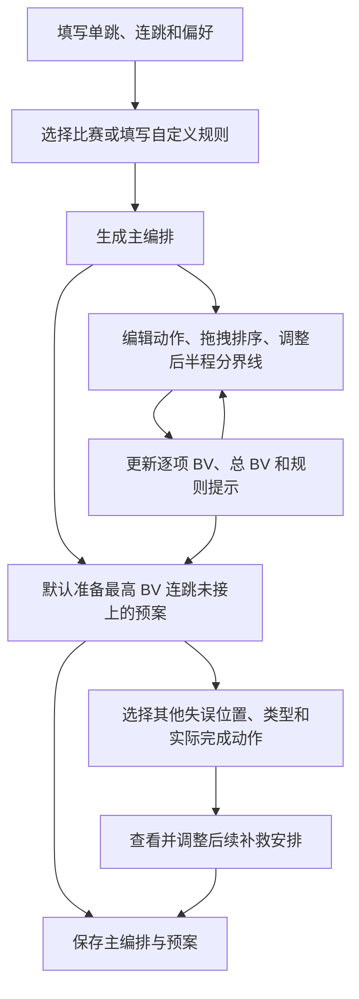

# Skating Lab 产品需求文档

版本：v0.5
更新日期：2026-11-14
产品阶段：目标产品形态评审

需求原图：[2026-11-14 手绘需求](requirements-sketch-2026-11-14.jpg)。

## 产品定位

Skating Lab 是面向花样滑冰选手的移动端跳跃编排与失误预案工具。选手填写自己会做的单跳、连跳和使用偏好，选择比赛或自定义规则，得到 BV 更高的跳跃编排，再通过编辑、拖拽和调整后半程安排形成自己的方案。

产品最终交付两份可以一起查看和调整的结果：**主编排**与**失误预案**。主编排回答“这些跳怎么安排”，预案回答“这里没跳成，后面怎么补”。

BV 指跳跃基础分。用户可以查看每个动作的分值、每组跳跃的小计，以及按所选规则计算的跳跃 BV 总和。

## 用户和使用场景

主要用户是能描述自己跳跃能力、需要准备比赛编排的花样滑冰选手。教练可以与选手共同查看和调整方案。

| 场景 | 用户要做的事 | 得到的结果 |
| --- | --- | --- |
| 准备一场比赛 | 填写会做的单跳和连跳，选择比赛与偏好 | 一套适合当前能力和规则的主编排 |
| 调整已有想法 | 改动作、改连跳、改顺序、改后半程安排 | 更新后的编排、逐项 BV 和总 BV |
| 提前准备失误应对 | 查看默认预案，或指定某一跳的失误情况 | 后续动作怎么调整的具体预案 |
| 训练后修改方案 | 更新会做的动作或某次实际完成情况 | 新的主编排或后续补救安排 |
| 赛前回看 | 打开保存的主方案与预案 | 清楚看到动作顺序、重点变化和补救方法 |

## 完整使用流程

能力清单和比赛设置可以重复使用。选手更换比赛或学会新动作时，只修改发生变化的部分。

## 输入能力与偏好

### 单跳选择

单跳按周数分组，每组提供整组选中、逐项勾选和展开收起。已选择的动作汇总展示，方便检查和取消。

截图中的两周组包含 2A、2S、2T、2Lo、2F、2Lz，三周组包含 3A、3S、3T、3Lo、3F、3Lz。界面同时显示动作代码，并可查看中文名称。

高周数选择采用截图中的快捷填写逻辑：

- 勾选某个高周数动作，默认补选全部更低周数的单跳；例如勾选 3S，会补选全部一周、两周单跳。
- 勾选整组时，选择该组全部动作，并补选更低周数组。
- 默认补选的动作直接展示在已选列表中，用户可逐项取消。
- 用户主动取消的动作保持取消状态，后续的自动补选尊重这些选择。
- 取消某个高周数动作时，保留已选择的低周数动作，方便继续调整。

例如，只勾选 3S 和 3T，就能得到“3S、3T，以及全部一周、两周单跳”的初始清单。若选手暂时不用 2A，可以直接取消 2A。

### 连跳选择

连跳有独立的搜索区和已选区。单跳清单表达“会哪些跳”，连跳清单表达“会把哪些跳连在一起”。

输入动作代码后，列出包含该动作的组合。输入 `3S` 时，可以看到截图中的这些候选：

- `3S+3T`
- `3S+Eu+3S`
- `2A+Eu+3S`
- `3S+3Lo`
- `3S+2T`

用户点选后加入已选区，可以继续搜索、移除，也可以直接填写一个完整组合。组合中的动作顺序保留。

连跳同样支持低难度组合的默认补选。例如，选中 `3S+3T` 时，将 `3S+2T` 加入可用组合。补选项与直接选择的组合一起展示，并允许删除。其他降难度组合遵循保持动作类型与连接顺序、降低周数的思路；具体自动展开范围见文末待细化项。

用户独立选择连跳能力，生成编排时使用已选组合及其保留的默认补选项。

### 自由描述

输入框用于补充“想优先使用什么”“不想使用什么”和位置偏好。例如：

- “优先用 3S+3T。”
- “不要 3Lo。”
- “第一组想放 2A。”
- “这组连跳固定在后半程。”

描述转成可以直接修改或移除的偏好项，和勾选清单一起保留。

| 偏好 | 对编排的影响 |
| --- | --- |
| 优先使用 | 作为选择倾向，在 BV 相同的方案中优先采用 |
| 必须使用 | 编排中保留指定动作或组合 |
| 禁止使用 | 从本次候选中排除指定动作或组合 |
| 固定位置 | 保留指定顺序位置或前后半程安排 |

若用户明确要求使用偏好动作，即使会降低 BV，也可以把“优先使用”改为“必须使用”，随后查看新的编排与分值。

冲突直接显示在相关输入旁。例如，既选择了 `3S+3T` 又填写“禁止 3T”时，提示两项冲突，用户可在原处调整。

## 选择比赛与自定义规则

### 搜索比赛

用户搜索比赛名称，选择对应赛季、组别和节目类型。选择后，在编排页面保留简洁的比赛信息，规则详情可展开查看。

产品根据所选比赛处理跳跃元素数量、连跳要求、重复限制、必需动作、后半程加成和分值。用户重点关注自己的动作选择和编排结果。

### 自定义规则

用户可以上传规则文件或直接描述规则，建立本次使用的规则设置。例如，粘贴一段比赛要求，或填写“允许几组跳跃、几组连跳、怎样计算后半程”。

上传或描述后，展示可编辑的规则摘要，主要包括：

| 规则内容 | 用户看到的设置 |
| --- | --- |
| 规则名称 | 比赛、训练赛或自定义方案的名称 |
| 跳跃要求 | 跳跃元素数量、必需动作及难度范围 |
| 组合要求 | 连跳或连续跳的数量与长度 |
| 重复要求 | 动作及周数的重复限制 |
| 后半程要求 | 可加成的元素范围与系数 |
| 分值设置 | 采用的动作分值及补充调整 |

缺少会影响编排的内容时，在相应字段提示补充。用户可直接修改摘要，再用于生成编排。

切换比赛或修改自定义规则后，保留现有能力清单和草稿，重新计算编排中的 BV 与规则提示。

## 主编排的结果与编辑

### 生成目标

在选定比赛规则、可用单跳、可用连跳和个人设置下，以**跳跃总 BV 最大化**为主目标生成主编排。

同等 BV 的方案优先贴合用户的使用偏好。用户正在调整已有方案时，同等 BV 下优先保留更多原有安排。

### 编排列表

结果以有顺序的跳跃列表呈现。每一行对应一个跳跃元素，可以是单跳，也可以是一整组连跳。

| 区域 | 显示内容 | 可进行的操作 |
| --- | --- | --- |
| 列表顶部 | 方案名称、比赛与组别、当前总 BV | 修改名称、切换比赛、查看规则 |
| 动作行 | 序号、动作或组合、分值明细、小计 | 编辑、替换、删除、插入 |
| 行右侧 | 拖拽手柄 | 改变动作顺序 |
| 行间分界线 | 后半程开始位置 | 上下拖动分界线 |
| 有加成的动作 | 后半程标记、适用系数与计值 | 查看分值明细 |
| 列表底部 | BV 总计与主要操作 | 重新生成、查看预案、保存 |

截图中的 `3T+2T`、`3S`、`2A`、`2Lo`、`2A+2T+2Lo`、`2Lz` 用于表达这类列表的动作结构。各行数量和分值随所选规则及用户能力变化。

### 自由修改

每一行的动作内容都能删除后重新输入，也能从可用动作中替换。用户可以修改生成结果，或从空列表开始编写自己的方案。

修改操作包括：

- 将单跳改成连跳，或将连跳改成单跳。
- 替换组合中的某一个动作。
- 新增或删除跳跃行。
- 拖动整行改变顺序。
- 固定希望保留的动作或位置，再重新生成其余部分。
- 撤销最近一次修改。

每次修改后，逐项 BV、总 BV、动作编号和相关规则提示一起更新。规则问题定位到对应动作，并给出可操作的修改建议。用户可以继续编辑和保存草稿。

### 后半程分界线

后半程在列表中以一条可移动分界线表示。线以下的动作是用户计划放在后半程的跳跃，分界线可以放在任意相邻两行之间，也可以移到全部动作之前或之后。

用户既可以拖动分界线，也可以把动作拖过分界线。界面据此更新前后半程归属，并按所选规则计算适用加成。

分界线表达计划中的后半程起点；动作行上的加成标记表达该动作实际适用的计值。规则对加成数量或位置另有要求时，只给符合条件的动作显示加成。

### 分值与规则提示

用户首先看到动作、每行小计和总 BV。展开某行后，可查看组合中各跳的分值，以及后半程或重复等规则带来的调整。

提示围绕“哪一项、怎样调整、BV 如何变化”展开。例如，“这一动作已超过本次规则允许的重复次数，可替换该行或调整前面的同类动作”。

当前能力与固定项无法组成符合所选规则的方案时，指出需要补充的动作或需要松开的设置，保留已填内容供用户修改。

## 失误预案

### 默认生成的预案

主编排生成后，默认针对**当前 BV 最高的一组连跳未接上**准备一份预案，回答“这组没连上，后面怎么补”。

默认情景为第一跳已完成，后续跳跃未接上。若有多组连跳的 BV 并列最高，先采用出场顺序靠前的一组；用户可以切换。主编排没有连跳时，提供选择某个单跳准备预案的入口。

### 选择其他失误情况

用户可以修改失误位置、失误类型，以及这一组实际完成的动作。

| 失误类型 | 需要描述的实际结果 |
| --- | --- |
| 连跳未接上 | 已完成组合中的哪些跳，漏掉哪些跳 |
| 摔倒 | 摔倒发生在哪一跳，已经执行了哪些动作 |
| 跳空或降低周数 | 原计划动作与实际跳出的动作 |
| 落冰失控或组合中断 | 哪一步中断，后面是否继续完成了其他跳跃 |
| 自定义情况 | 用文字描述实际完成内容 |

例如，`3T+2T` 只完成了 `3T`，和第一跳变成 `2T` 且未接后跳，是两种不同的预案情景。预案依据实际动作安排后续补救。

### 补救方案怎么呈现

预案保留已经发生的动作，调整尚未执行的部分，在剩余规则空间和用户能力范围内争取更高的 BV。

预案列表沿用主编排的行结构，突出显示需要改变的动作和位置。顶部先用一句话说明怎么做，例如：“第 2 组由 3S 改为 3S+2T，其余保持。”这类补法随所选规则、实际完成动作和可用连跳确定。

每份预案包含：

1. **触发情况**：哪一组发生了什么，实际完成了哪些动作。
2. **后续调整**：哪些行保留、哪些行替换、在哪里补连跳。
3. **执行顺序**：调整后的剩余跳跃列表。
4. **分值对比**：原计划 BV、失误后照原安排继续的 BV、采用预案后的 BV。
5. **补救收益**：采用预案与失误后照原安排继续之间的 BV 差值。

预案中已完成的动作显示为固定状态。用户可修改情景中的实际结果，或编辑尚未执行的动作，随后重新计算。

若保持原安排已经是当前更好的选择，预案明确显示“后续保持原安排”。若执行中再次失误，从新的实际结果继续安排后续动作。

### 主编排与预案的关联

一份主编排可以保存多份预案，每份预案带有清楚的触发条件。选手可以先看默认预案，再补充自己关心的其他情况。

主编排发生修改时，对应预案更新所引用的动作、位置、后半程安排与 BV。用户手动调整过的预案保留编辑内容，并指出需要随主编排更新的部分。

## 手机上的产品形态

以手机竖屏操作为主要体验，页面围绕“输入、编排、预案”组织。原生 App、小程序等载体在后续选择，这些操作和结果保持一致。

| 页面或区域 | 用户的主要任务 | 主操作 |
| --- | --- | --- |
| 方案首页 | 新建方案，继续上次编排，打开已保存方案 | 新建、继续编辑 |
| 输入页 | 选择单跳、连跳、偏好及比赛规则 | 生成编排 |
| 编排页 | 查看与调整动作列表、后半程和 BV | 编辑、查看预案、保存 |
| 预案页 | 查看默认补救方式，切换失误情况 | 修改情景、调整后续、保存 |
| 方案详情 | 连续查看主编排及对应预案 | 编辑、复制方案、分享 |

单跳组和连跳候选支持折叠，输入页始终能查看已选内容。编排页和预案页使用相同的行结构，在手机上切换时容易对照。

动作编辑优先在当前页展开，保存后回到原位置。拖拽之外，提供上移、下移等同等操作。总 BV 和当前主要操作保持容易找到。

## 保存与复用

主编排与预案一起保存，保留方案名称、比赛规则、能力清单、偏好和后半程设置。再次打开时可以接着编辑。

用户可以复制一份方案尝试新的排法，也可以复用同一份能力清单创建另一场比赛的方案。分享内容以清楚的主编排和预案卡为主，方便与教练讨论和赛前回看。

## 产品验收场景

以下场景用于确认产品是否完整承接本次需求。

| 编号 | 用户操作 | 应看到的结果 |
| --- | --- | --- |
| P01 | 勾选 3S、3T | 补选全部一周和两周单跳，已选内容可逐项修改 |
| P02 | 取消默认补选的 2A，再选择其他高周数动作 | 2A 保持取消状态 |
| P03 | 搜索 3S 并选择连跳 | 显示包含 3S 的候选，选择后进入已选区 |
| P04 | 选择 3S+3T | 可用组合中同时出现可取消的 3S+2T |
| P05 | 填写优先、必用、禁用或固定位置偏好 | 各项设置影响编排，并能直接修改 |
| P06 | 搜索并选择比赛 | 显示对应赛季、组别和节目类型，按所选规则编排 |
| P07 | 上传或描述自定义规则 | 显示可编辑规则摘要，补齐必要字段后用于编排 |
| P08 | 生成主编排 | 显示有序跳跃列表、分值明细、小计和总 BV |
| P09 | 删除某行内容后手动重写 | 接受新动作，更新分值与相关规则提示 |
| P10 | 拖动动作改变顺序 | 编号、顺序及相关计值同步更新 |
| P11 | 移动后半程分界线，或把动作拖过分界线 | 更新前后半程归属、适用加成和总 BV |
| P12 | 生成带有连跳的主编排 | 默认提供最高 BV 连跳未接上的补救预案 |
| P13 | 把漏接情景改为摔倒或跳空 | 记录实际完成动作，重新安排后续跳跃 |
| P14 | 修改预案中的后续动作 | 已完成部分固定，剩余列表与 BV 差值更新 |
| P15 | 主编排发生变化 | 对应预案同步更新，手动编辑部分保留并标出待调整项 |
| P16 | 当前情景没有更好的补救安排 | 显示后续保持原安排及相应 BV |
| P17 | 保存后重新打开，或复制为另一方案 | 恢复主编排、预案、能力与比赛设置 |
| P18 | 在预案基础上再输入一次失误 | 从最新实际结果重新安排尚未执行的动作 |
| P19 | 自定义输入互相冲突 | 在对应位置提示冲突，保留输入并允许就地调整 |
| P20 | 在手机上完成一次完整流程 | 可以独立完成输入、编排编辑、预案查看与保存 |

## 后续细化的产品选择

后续产品讨论集中在两个具体问题：

- **首批预置比赛**：优先覆盖哪些比赛、赛季、组别和节目类型。
- **连跳的默认展开范围**：截图明确的 `3S+3T → 3S+2T` 直接保留；其他降难度组合是否全部默认加入，按选手的实际习惯进一步细化。
