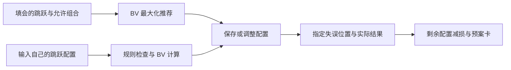

# 花样滑冰跳跃配置助手：产品需求文档

版本：v0.4（按真实选手反馈重定核心）

更新日期：2026-11-10

状态：产品评审稿，仅定义需求；当前仓库尚未实现本版核心能力。

**当前最高优先级：根据已有跳跃难度推荐 BV 最大化配置、检查用户自编配置、提供失误后的减损预案。用户画像与视频辅助属于后续增强。**

本轮仅更新 Markdown。旧 PRD.pdf 不作为当前需求依据；技术设计、数据库设计及骨架待产品需求确认后另行对齐。

## 1. 产品定位与需求优先顺序

**用户是花样滑冰选手。用户通过文字或表单填写自己会的跳跃、允许使用的组合及目标比赛要求，服务推荐规则允许范围内基础分（Base Value，BV）最高的跳跃配置，也能检查用户自己编写的配置，并在指定失误发生后调整剩余跳跃，尽量减少 BV 损失。**

基础版回答三个问题：

1. **我会这些跳，怎样配置 BV 最高？**
2. **我自己这样配，有没有规则问题，BV 是多少？**
3. **如果这个跳失误了，后面怎么改，能少损失多少 BV？**

这里的“配置”指跳跃类型、周数、单跳或连跳／连续跳、跳跃元素顺序及可选后半程标记。输出最多附带用户设置的旋转占位，不设计完整节目，不处理步法、音乐、表演或冰面利用。

真实选手的反馈优先于旧版设想，具体落实为：

| 反馈 | 本版产品决定 |
| --- | --- |
| 先做现有难度下的 BV 最大化推荐 | 作为默认目标；稳定性、体能等不作为基础推荐的必填条件或暗中降难度依据 |
| 需要自编配置检查和失误预案 | 与基础推荐并列为首版三项核心功能，可独立使用 |
| 以文字描述和填表为主 | 两者是主入口；不要求视频、成绩单、语音或音乐 |
| 更相信选手自己了解自己的能力 | 用户填报即可作为计算输入；不要求上传证明、样本数量或教练签字 |
| 先不做完整编排 | 删除整套时间表、音乐匹配、步法设计、冰面路线及 PCS 评估要求 |
| 多组别先跳过 | 本轮不讨论实现难度、不安排多组别扩展里程碑；仅保留一个明确规则基线 |
| 姿态识别用于发现不稳的跳并做预案 | 后续作为可选辅助，帮助选择重点失误分支；不替代选手自评、不作为使用门槛 |

完整产品推进顺序为：**基础配置工具 → 个性化用户画像 → 可选的视频／姿态辅助**。后两项不能成为第一阶段的前置依赖。

## 2. 首版范围与使用者

主要用户是能够描述自己跳跃能力的花样滑冰选手。选手可以独立完成输入、查看建议、检查自己的配置和生成预案。教练可以参与讨论，但不要求绑定教练账号，也不默认把选手保存的结果标成“待审核”。

首版聚焦单人滑自由滑的跳跃配置。本文继续使用 **2026/27 ISU 成年女子单人滑自由滑** 作为已研究的参考规则基线，并非替用户指定真实参赛组别。具体首发赛事及组别尚待确认；确认前可按这个明确标注的规则基线试用和评审，不称为已适配任意真实赛事。

赛事规则是计算所必需的上下文，但不要求用户自行整理整套规则文件：优先选择产品预置规则，用户只需确认适用对象。没有对应规则时，仍可保存输入，展示当前支持范围；不能静默套用其他组别。多组别、短节目及其他项目本轮暂不展开。

### 2.1 基础版做什么

- 根据用户提供的可用跳跃、组合范围和所选规则，推荐 BV 最大化配置。
- 输入、编辑和检查自编配置，逐项说明规则问题和 BV。
- 针对连跳漏接、跳空、摔倒等具体情况，锁定已发生部分，检查并优化剩余跳跃。
- 保存主配置和少量清晰、可记忆的失误预案。
- 可显示用户自定的旋转占位；占位不参与旋转难度设计或 BV 优化。

### 2.2 本轮明确移出的内容

完整节目编排、音乐输入及分析、步法设计、冰面利用、旋转等级设计、PCS 或比赛总分预测、完整视频强制上传、正式试滑验证、资料证据审核、强制教练确认，均不属于首版交付。

基础版不收集大而全的用户画像；训练年限、身体数据、风格、历史成绩、体能、成功率等都不作为计算前置项。多组别先挂起，不以“以后必做”的方式预设产品承诺。

## 3. 输入：少填信息就能开始

### 3.1 最小输入

| 输入 | 方式与默认处理 | 作用 |
| --- | --- | --- |
| 适用规则 | 选择预置规则，明确赛季、组别和节目类型 | 决定跳跃数量、重复限制、组合与计分规则 |
| 可用跳跃 | 勾选动作与周数，或直接写“会 2A、3T、3S、所有两周跳” | 确定候选跳跃；用户填报直接采用 |
| 允许的组合范围 | 使用“按所选跳跃生成规则允许的组合”，或自行填写允许／不使用的组合 | 默认选项需清晰展示；可随时缩小范围，无需提供训练证明 |
| 自编配置（检查入口） | 按顺序填写单跳、连跳或连续跳 | 直接检查，不要求先创建能力画像；仅做规则检查时可不填个人可用跳跃 |
| 失误位置与实际结果（预案入口） | 从现有配置选择位置，填“只跳了 3T，没接 2T”等 | 区分原计划与实际执行，决定剩余可调整空间 |

用户直接提供连跳时，接受其“可以做”的描述；不会因为缺少视频而排除。默认组合范围表示用户愿意考虑这些组合，不代表系统已经证明每个组合都能熟练完成。用户说“这个组合不行”后立即移出候选，无需再次举证。

### 3.2 可选输入与轻量纠错

用户可补充不使用的动作、必须保留的跳跃、固定位置、允许修改的剩余位置、旋转占位，以及哪些跳跃元素计划在后半程开始。这些是明确的计算约束，不要求先建立完整档案。

自然语言输入解析为可编辑的跳跃列表，用户可以直接纠正；填写表单后可以直接计算，不追加一轮逐条确认。仅当歧义影响结果时询问，例如“三周跳”具体是哪种、连跳失败后到底执行了哪些跳跃。其余缺项允许用清楚标注的默认设置继续。

不要求用户提交成绩单、训练样本、视频或来源链。保留计算输入、所用规则和修改历史即可；个人填报以最新主动修改为准。

### 3.3 后半程条件

基础版不分析音乐、不生成秒级时间表。未填写后半程条件时，默认计算**不含后半程加成的跳跃 BV**，并明确该口径。

用户可标记跳跃元素预计是否在规定后半程开始。系统结合顺序及规则限制计算加成，不能仅凭“排在后面”自动加分。发生失误或移动动作后，无法确定时间条件的分支按不含加成展示，或分别显示两个条件结果，不沿用旧标记作确定结论。

## 4. 核心功能一：现有难度下 BV 最大化推荐

### 4.1 目标和约束

**优化目标是所选规则和用户约束下，计划跳跃元素的 BV 总和最大。** 规则约束、可用跳跃、允许组合、禁用项及固定位置共同限定候选范围。

“BV 最大”只针对跳跃配置，不等于整套节目 TES、比赛总分或实际得分最大。旋转、步法、PCS 不进入基础版目标，GOE、摔倒扣分及成功概率也不混入默认 BV 排序。用户无需提供稳定性数据才能使用。

推荐应覆盖所选规则规定的跳跃结构，考虑单跳、连跳／连续跳、重复分配和用户提供的后半程条件。不能用“难度较高”代替分值计算，也不能按每个位置独立选最高分而忽略全局重复限制。

基础版不得因为系统自行推测选手不稳而暗中降难度。用户主动禁用某动作或组合后，按缩小后的候选范围重新计算。

### 4.2 输出要求

| 交付项 | 用户应看见什么 |
| --- | --- |
| 推荐跳跃配置 | 按跳跃元素编号列出动作、周数、组合结构和顺序；中文名称与代码可对应查看 |
| 逐项 BV 与总和 | 每个元素的基础分、适用调整和总计；明确是否含后半程加成 |
| 计算范围 | 本次可用跳跃、允许组合、禁用项、规则版本及其他约束 |
| 规则检查 | 跳跃配置通过哪些检查，哪些问题尚未解决；不声称完整节目已经合规 |
| 替代或并列结果 | 相同最高 BV 的配置可并列；用户有现有配置时，优先展示改动较少的并列方案 |
| 差异说明 | 相比用户原配置增加或减少哪些跳跃、组合及 BV；没有更高可行结果也应如实说明 |

如果多套配置 BV 相同，说明是并列最优，不编造稳定性评分强行排序。产品只有在计算过程能确认当前范围的最大值时才显示“BV 最大”；若只得到候选结果，应标记“当前候选最高 BV”，不能冒称已找到最大值。

### 4.3 无解与修改

不满足必需跳跃或锁定项互相冲突时，指出具体原因，例如“可用清单中没有该规则要求的 Axel 类跳跃”。允许用户调整输入再算，不能私自加入未提供的跳跃或解除禁用项。

用户可直接说“不要 3Lz”“第二跳固定 2A”“只用我列出的连跳”，系统即时展示受影响的配置与 BV。简单修改无需反复确认。

## 5. 核心功能二：自编配置检查

用户可以直接粘贴或填写自己的配置，不必先经过推荐功能。检查与 BV 计算应是独立入口。

检查结果分三类：

- **需要修改的规则问题：** 超出跳跃元素数、组合名额或长度限制、重复超限、缺少规定跳跃，以及其他会导致无分或减值的问题。
- **计值影响：** 重复计值、后半程条件和具体技术标记的影响；规则有后果不等于应笼统称为整套“无效”。
- **用户设置不匹配：** 配置包含用户禁用的动作或不允许的组合。未提供个人清单时，只做规则检查，不推断用户不会某个跳。

每条问题定位到具体元素，说明原因、对应规则及可选修改方式。有效配置展示 BV 明细；有问题的配置展示可确定的计值结果和待处理项，不将所有计划跳跃简单相加为有效 BV。

用户可以接受修改建议，也可以保留自己的草稿；系统不擅自覆盖原配置。旋转占位只用于用户查看相对位置，不生成等级、不计分，也不代表旋转要求已经检查。

## 6. 核心功能三：失误预案与剩余配置减损

### 6.1 使用目的

用户希望提前知道：“这一跳没按计划完成，后面怎么改最划算？”首版既支持赛前生成预案，也支持在训练、模拟或复盘中输入已发生的情况，再调整剩余跳跃。无需先做视频分析或证明某跳不稳定。

赛前用户可以自行指定需要预案的跳跃和失误类型。服务优先输出少量明确分支，让选手能记住、能练习；不要求选手在比赛滑行中操作手机，也不以实时视频识别或场边实时指令作为基础版前提。

### 6.2 按实际发生的动作分支

“失误了”不足以决定后续配置。需要保留原计划，另记当前假设的实际结果：

| 场景 | 用户可以怎么填 | 服务要处理什么 |
| --- | --- | --- |
| 漏接连跳 | “3T 完成了，没有接 2T” | 按实际单跳和剩余组合名额比较补接位置 |
| 跳空／降低周数 | “计划 3T，实际跳了 2T” | 按实际周数更新重复次数，不能继续按计划 3T 统计 |
| 摔倒或落冰失控 | “第一跳摔了，没接后面” | 记录尝试及实际执行情况，按相应规则检查后续机会；不能当作该跳从未发生 |
| 组合中断但仍继续跳 | “第一跳步出后又跳了第二跳” | 记录所有实际跳跃及连接情况，检查计值与重复影响，不能直接删除无分跳跃 |
| 周数／用刃判定不确定 | “可能不足周，不知道怎么判” | 允许选不同判定情景作比较；不要求用户现场给出官方判定 |

用户可以只描述观察到的事实。需要区分的情景用简短选项呈现；未确定的技术判定作为条件写清楚，不虚构确定结果。官方规则中的技术记号和无分处理以对应版本为准。[R2，pp.2、27–34](#r2)、[R6，Q2–Q3](#r6)

### 6.3 减损目标和状态约束

**基础版减损目标：在既定失误情景下，最大化剩余可执行跳跃的 BV，避免新增规则损失。** 已发生部分固定，后续只使用用户允许的跳跃和组合，遵守已消耗的跳跃、重复及组合名额。

生成前分别保留原计划、实际已执行部分、尚未执行部分；不能回头修改已经完成的动作。用户可指定哪些剩余位置允许调整，默认优先比较保持原配置继续滑与修改配置两种选择。相同 BV 时，优先改动较少、分支较短的方案。

不能把原先丢失的分数当成可以无条件补回的分数；不能建议新增第七个跳跃元素或违反重复限制来“补救”。没有合适补救时，明确建议保持后续安排并说明原因。

### 6.4 一张预案卡应包含什么

1. **触发条件：** 哪个跳跃元素出现什么具体结果。
2. **后面怎么改：** 从哪个剩余位置起，原动作换成什么；哪些位置保持。
3. **规则影响：** 当前已执行动作、重复计数、组合名额和待确认的条件。
4. **BV 对比：** 失误后按原计划继续的剩余 BV、调整后的剩余 BV，以及两者差值。
5. **执行边界：** 仅在所写情景成立、后续尚未执行且所需组合在用户允许范围内时适用。

“追回 1.30”必须标成 **该假设下增加的计划 BV**，不能称为实际比赛必得分。摔倒扣分和 GOE 不会因补了一个跳而自动消失。基础版不预测 PCS、总分或真实失误概率；后续个性化才讨论风险与预期收益。

出现第二次失误时，从更新后的实际状态重新检查，不把两张独立预案直接叠加。首版至少覆盖一个连续失误的检验案例，以确认不会重复消耗名额；不要求提前枚举所有可能路径。

## 7. 配置与减损案例

以下为规则和产品行为示例，不代表已经实现自动求解，也不宣称该主配置在所有可选动作下 BV 最大。假设采用本文的 2026/27 参考规则，用户允许所列跳跃和组合；为便于比较，均不计后半程加成、GOE、技术标记调整或扣分。

### 7.1 一套自编配置及 BV 检查

| 跳跃元素 | 用户配置 | BV 明细 | 小计 |
| --- | --- | --- | --- |
| J1 | 3T+2T | 4.20 + 1.30 | 5.50 |
| J2 | 3S | 4.30 | 4.30 |
| J3 | 2A | 3.30 | 3.30 |
| J4 | 2Lo | 1.70 | 1.70 |
| J5 | 2A+2T+2Lo | 3.30 + 1.30 + 1.70 | 6.30 |
| J6 | 2Lz | 2.10 | 2.10 |
| 合计 | 六个跳跃元素 | 不含后半程加成 | 23.20 |

代码说明：T 为后外点冰跳，S 为后内结环跳，A 为阿克塞尔跳，Lo 为后外结环跳，Lz 为勾手跳；数字表示名义周数，Axel 类实际包含额外半周。本例加号表示计划连跳。分值来源：[R3，pp.2–3](#r3)。

该例两组连跳分别包含两个、三个跳跃，2A、2T、2Lo 各出现两次，T 类共三次。它用于展示跳跃部分的检查，不包含旋转、步法或完整节目的合规判断。[R1，第 612 条](#r1)、[R2，pp.27–29](#r2)

### 7.2 预案 A：第一组只完成 3T，未尝试第二个 2T

假设 J1 已完成，J2 尚未开始，用户允许使用 3S+2T。此时可以比较将 J2 从 3S 改为 3S+2T，其余 J3–J6 保持原计划。

| 比较项 | 按原计划继续 | 调整 J2 |
| --- | --- | --- |
| 已发生 J1 | 3T | 3T |
| J2 | 3S | 3S+2T |
| 剩余 J2–J6 的 BV | 17.70 | 19.00 |
| 含固定 J1 的计划 BV | 21.90 | 23.20 |
| 相对继续原计划增加的 BV | 0.00 | 1.30 |

调整后仍为六个跳跃元素、两组连跳，2T 总计两次，T 类合计三次。预案卡可写：“第一组只完成 3T 且未尝试 2T 时，若 J2 尚未执行，在 J2 的 3S 后接 2T；其余保持。”这只是恢复了该假设下漏接跳跃的 BV，不意味着 GOE 或实际成绩完全恢复。

### 7.3 预案 B：第一跳跳空为 2T，且未接第二跳

此时不能直接照搬预案 A：若在 J2 补 2T，再保留 J5 中的 2T，将导致同一个两周跳出现三次。系统必须指出这一重复问题，重新比较剩余配置，也可以建议不补该 2T。

预案 A 与 B 的区别来自**实际跳出的动作**，无需依靠系统判断选手画像。若用户继续修改 J5，再次计算新配置的 BV 和重复次数，不能把删除一处 2T、又在另一处加回的动作误报成净增加 1.30。

## 8. 规则使用与检查边界

### 8.1 保留规则严谨性，减轻个人举证负担

用户自述可以直接作为个人能力输入；官方规则则按已选版本计算。两者不混淆：不要求用户证明自己会 3T，但也不能因用户认为“能重复三次”就更改相应重复规则。

规则名称、版本及出处可在详情中查看，日常使用不要求用户先阅读整套条款。问题提示优先给出“哪里需要改、怎么改、影响多少 BV”。

### 8.2 与本版直接相关的规则事实

下表为 2026/27 参考规则的关键摘要，不是全部条款；实际计算需覆盖所声明支持范围的细则和例外。

| 项目 | 已核对事实 | 产品用途 |
| --- | --- | --- |
| 跳跃元素数 | 成年单人自由滑最多六个跳跃元素，须含 Axel 类。[R1，第 612 条](#r1) | 限定主配置和失误后的剩余空间 |
| 组合限制 | 自由滑至多两组连跳，或一组不含 Euler 的连跳加一组连续跳；一组至多三个计数跳跃，另一组至多两个。[R2，pp.28–29](#r2) | 推荐、检查和补救共用，避免超额补连跳 |
| 重复限制 | 同类跳跃不论周数合计至多三次，同一两周跳至多两次；高周数另有重复名额与计值规定。[R2，pp.27–29](#r2) | 使用实际执行结果更新计数，特别注意跳空后周数改变 |
| 重复计值 | 重复高周数跳跃两次均为单跳时，第二次按相应基础分的 80% 计值；具体适用条件见原文。[R3，p.14](#r3) | 不能只按标准 BV 累加 |
| Euler | 规定用法下不计值、不占组合的计数跳数，自由滑仅能在两个列名跳跃之间使用一次，另有组合使用限制。[R2，pp.28–29](#r2) | 正确计算组合长度、分值和可用预案 |
| 后半程 | 自由滑仅最后三个在后半程开始的跳跃元素适用 1.1 基础分系数。[R1，第 353 条](#r1) | 只有明确的时间条件成立时计算加成 |
| 实际动作与无分跳跃 | 实际执行内容和技术标记需保留；连跳／连续跳中被标 `*` 的跳跃不能直接从执行记录中删除。[R2，pp.2、29–34](#r2)、[R6，Q2–Q3](#r6) | 防止漏算失误后已消耗的限制或错误恢复 BV |

每次检查覆盖：规定跳跃、元素数量、组合连接与长度、组合名额、动作类型及周数重复、Euler、适用减值或无分条件，以及用户提供的后半程条件。后续修改或失误都重新检查剩余配置与已执行部分的关系。

输出统一使用“跳跃配置检查”与“跳跃 BV”，不称“完整节目合规”“整套总分”或“比赛得分最大”。旋转和步法虽然在赛事中另有要求，但本版仅说明它们不在检查范围，不要求用户提供相应编排资料。

## 9. 后续个性化与视频辅助

### 9.1 用户画像：基础工具可用后的增强

画像可逐步收集选手自述的稳定性、常见失误、后半程表现、组合熟练度、临场偏好和风险接受程度。用户说“这个跳很稳”“这个组合容易接不上”即可使用，不要求样本数量、录像证据或专业测评。

这些信息用于在 BV 最大方案旁增加个性化备选、决定优先准备哪些预案，或在用户主动选择风险权衡目标时提供不同建议。系统要说明相对纯 BV 最大配置放弃了多少 BV、换来什么用户认可的取舍；不能悄悄修改基础模式的目标。

用户可随时修改自评。数字成功率为可选自估值，明确标注为自估，不冒充测量概率；不愿填写时可用定性描述。画像是否有用，以是否改善配置选择与预案为标准，不以字段数量为标准。

### 9.2 视频／姿态识别：服务于预案的可选辅助

视频辅助的主要用途是提示某个跳跃可能存在的不稳定表现，供用户决定是否多准备一个失误分支。流程是：选手自愿提供片段 → 展示可观察的提示 → 选手选择采用、纠正或忽略 → 更新重点预案。

系统不预设视频比选手更了解本人，不凭单个片段覆盖选手的长期自评，不把识别结果自动升级为官方周数或用刃判定。与自述冲突时可以保留不同情景，尊重用户选择。

视频／姿态识别不负责音乐、步法、冰面编排、完整节目评分，也不要求用户反复上传整套试滑录像。其技术可行性和是否进入后续版本另行评估，首版验收不依赖它。

## 10. 功能优先级与使用流程

| 编号 | 阶段 | 功能 | 完成条件 |
| --- | --- | --- | --- |
| F01 | P0 核心 | 文字和表单输入 | 少量输入即可开始，个人自述直接采用，可编辑纠错 |
| F02 | P0 核心 | 现有难度下 BV 最大化推荐 | 明确规则和约束，输出配置、逐项 BV、总计及最优性状态 |
| F03 | P0 核心 | 自编配置检查 | 独立使用，定位规则问题、计算计值影响并提供修改建议 |
| F04 | P0 核心 | 失误预案与剩余配置优化 | 按实际结果分支，锁定过去，重算剩余配置与 BV 差值 |
| F05 | P0 配套 | 配置编辑、保存与对比 | 保留原配置，可锁定位置，保存并复制主配置及预案卡 |
| F06 | P0 配套 | 规则与计算解释 | 明示支持范围、版本及计分口径，无解或未完成时如实提示 |
| F07 | P0 可选展示 | 旋转占位 | 允许用户保留占位；不设计旋转、不计分、不阻断跳跃计算 |
| F08 | 后续个性化 | 文字／表单用户画像 | 稳定性等自评影响备选和预案，独立于纯 BV 最大模式 |
| F09 | 后续辅助 | 可选视频／姿态提示 | 只辅助识别需要重点准备的失误分支，用户可以忽略 |

三个核心入口独立可达：

没有视频、教练账号、画像或试滑记录时，三个核心入口都应可用。无需完成一个入口才能使用另一个；预案可直接从用户输入的配置开始。

## 11. 验收场景与成功标准

### 11.1 首版验收场景

| 编号 | 场景 | 必须得到的结果 |
| --- | --- | --- |
| A01 | 只有文字／表单的可用跳跃，无画像和视频 | 能在明确规则与组合设置下推荐配置，不索要证明 |
| A02 | 小型可枚举的候选集 | 与独立核算的最高 BV 一致；并列结果不虚构高低 |
| A03 | 用户禁用动作、限制组合或锁定位置 | 在新范围重新求最大 BV，清楚展示变化 |
| A04 | 用户直接提交自编配置，无个人能力清单 | 可独立检查规则并计算 BV，不强制先建档 |
| A05 | 参考规则下第七个跳跃元素、第三组连跳、重复超限 | 指出具体位置、原因与计值后果，不按全部计划 BV 简单相加 |
| A06 | 未标记后半程，或改变跳跃顺序 | 未标记时不加成；修改后重查适用条件，不能沿用错误加成 |
| A07 | 第 7 节漏接情景 A | 可以比较 J2 补 2T，剩余 BV 由 17.70 变为 19.00，差值 1.30 |
| A08 | 第 7 节跳空情景 B | 拒绝直接照搬 A 的补法，指出 2T 重复超限 |
| A09 | 已完成多个跳跃后请求补救 | 已执行部分保持，后续使用正确的剩余名额；不能重新安排过去 |
| A10 | 预案执行后又发生一次失误 | 从最新状态重新检查，不叠加使用已经消耗的组合或重复名额 |
| A11 | 摔倒、步出后继续跳，或技术判定不明确 | 记录实际结果与条件分支，不将全部失误跳跃当作未发生 |
| A12 | 无可行补救、输入互相冲突或计算未完成 | 如实说明原因，不生成违规方案，也不宣称已找到 BV 最大值 |
| A13 | 添加或删除旋转占位 | 不影响纯跳跃 BV，不要求补填旋转等级、音乐或步法 |
| A14 | 用户主动修改“能做／不能做”的描述 | 直接更新候选与结果，不要求视频证明或教练确认 |

### 11.2 首版发布门槛

- 推荐、检查和预案使用一致的跳跃计值及规则口径；对小型案例独立核算最大值与逐项 BV。
- 核心正常、边界、违规和连续失误案例通过；显示“BV 最大”的结果有相应计算验证，不能只比几个候选就下结论。
- 由真实选手试用三个入口，确认输入负担、输出可理解性和预案可执行性；用户试用不以提交完整视频为前提。
- 预案对比说明触发条件、剩余可调部分和净 BV 差值，不将已发生损失或被删除跳跃重复计入收益。
- 所有验收条目都是未来产品要求，本次文档修改不代表功能测试已通过。

效果评价优先关注：能否轻松完成输入、自编错误能否解释清楚、BV 核算是否正确、预案是否容易理解和使用。暂不设依赖大规模画像、强制教练评审或视频样本的发布指标，也不把比赛成绩提高当作已证实效果。

## 12. 体验要求与后续讨论边界

个人输入默认信任，系统只对影响计算的歧义作必要询问。规则、默认假设和计值口径可查看，主界面先呈现配置、BV 和需要修改的地方。

选手可保存自己选定的配置，不存在强制审核等待状态。修改保留原版本，计算失败可重试并保留已填信息；分享和视频使用遵从用户授权，数据默认不公开。

本轮不确定算法、模型、框架、数据表或实时识别方案。下一步先评审这三个核心功能与示例，明确首发规则范围，再讨论实现。用户画像与姿态识别另行评估，多组别暂不展开。

项目竞赛展示也应围绕“输入已有难度 → 推荐／检查跳跃配置 → 失误后调整”展开。当前技术文档中的多模态、强制人工确认及完整编排设想不再代表首版需求，不能由技术展示反向扩大产品范围。

## 13. 规则来源与核对记录

规则研究及本轮相关条款复核日期：2026-11-10。沿用上轮已经阅读的官方规则与分值表，并针对实际动作记录、连跳失败及无分跳跃处理复核技术手册和赛季澄清。本版仅保留跳跃配置直接相关来源；不将规则摘要视为完整规则库。真实目标赛事尚未指定，其适用性需在首发范围确定时核对。

**R1｜ISU Sports Rules — Single & Pair Skating and Ice Dance，2026**

所读正文标注 as of 1 June 2026，Effective 12 June 2026。重点：第 353 条计分（pp.9–12）、第 502 条时长（pp.50–51）、第 504 条（pp.51–53）、第 611 条短节目（pp.66–69）、第 612 条自由滑（pp.70–72）。

[ISU 官方规则原文](https://isu-d8g8b4b7ece7aphs.a03.azurefd.net/isudamcontainer/CMS/Corporate-Site/Governance/Isu-Regulations/2026-FS---Pair-Sports-Rules-FINAL-20260513-1778685370-9916.pdf)

**R2｜ISU Technical Panel Handbook — Single Skating 2026/27，15 July 2026**

重点：实际执行动作的记录、跳跃数量、重复、组合、连续跳、Euler、技术标记及失误后的计值（pp.2、27–34）。用于跳跃配置与失误分支检查，不用于设计旋转或步法。

[ISU 官方技术手册](https://isu-d8g8b4b7ece7aphs.a03.azurefd.net/isudamcontainer/CMS/Corporate-Site/Sports-Rules/Figure-Skating-Rules/Handbooks-Single-%26-Pair-Skating/TP-HandbookSingles-26-27-15-July-2026-1784641784-3364.pdf)

**R3｜ISU Communication 2786 — Scale of Values and Program Components Factors，2026/27**

采用 2026-06-02 更新文件，分值自 2026-07-01 生效；替代 2707。重点：跳跃分值（pp.2–6）及重复跳跃计值说明（p.14）。该表列出的是规则数值，不是选手个人成功率。

[ISU 官方分值表](https://isu-d8g8b4b7ece7aphs.a03.azurefd.net/isudamcontainer/CMS/Corporate-Site/Governance/Transparency/ISU-Communications/2786-SinglesPairs-SOV-Update-260602-1780481099-6311.pdf)

**R6｜2026/27 Clarification from Technical Committee — Q&A No.3，October 2026**

重点：Q2–Q3，连跳、连续跳中无分跳跃的技术记录与整个元素质量评价。

[ISU 官方澄清文件](https://isu-d8g8b4b7ece7aphs.a03.azurefd.net/isudamcontainer/uploads/isunewrevamp/document/original/f0e21d6e25df4e42395cb70a6c06b269b590597e823034cbd94476e1ea6dd502.pdf)

**官方持续核对入口：** [ISU 手册与 Q&A 索引](https://cdn2.isu.org/en/isu-sports-rules/figure-skating-rule/handbooks-single-and-pair-skating)。新赛事、新赛季或官方修订出现时，应回到来源重新确认适用范围，不能把本 PRD 的规则摘要当成永久规则库。
