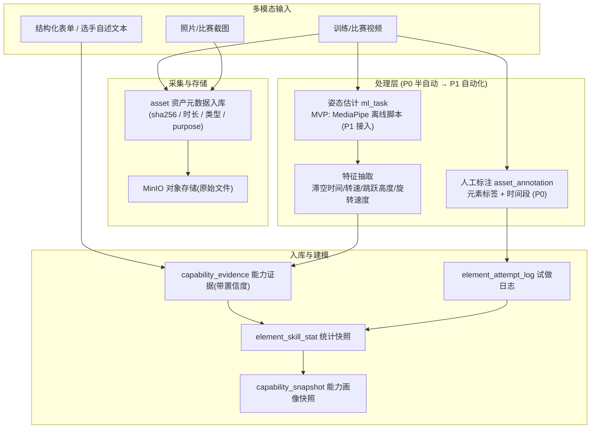
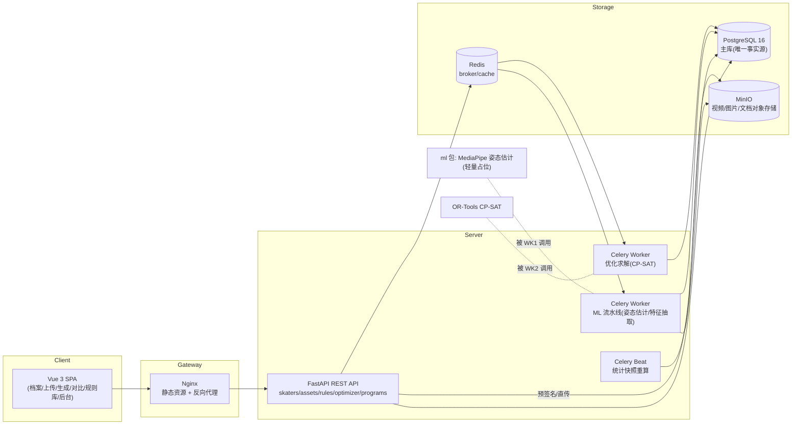
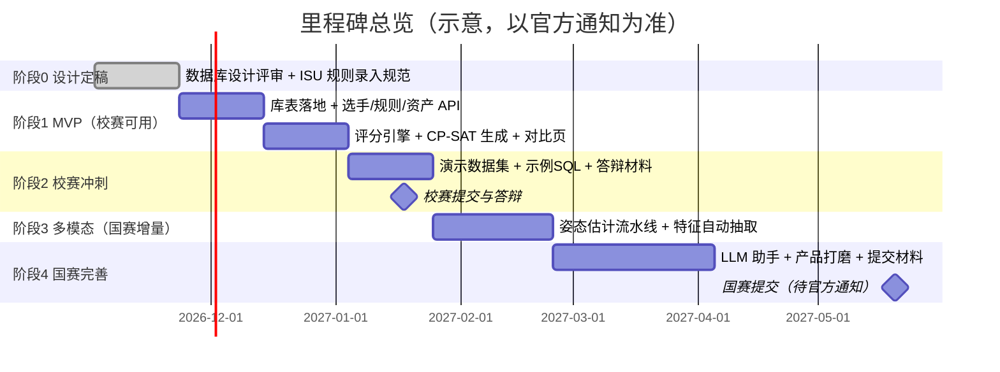

# 花样滑冰 AI 教练 · 个性化动作编排系统 —— 产品需求文档（PRD）

| 项目 | 内容 |
| --- | --- |
| 产品名称 | Skating Coach（花样滑冰 AI 教练 / 个性化动作编排系统） |
| 文档版本 | v0.1（骨架阶段评审稿） |
| 代码仓库 | `skating-coach`（monorepo） |
| 目标赛事 | 校赛：计算机数据库设计大赛 → 国赛：中国大学生计算机设计大赛 |
| 文档状态 | 待指导老师与队友评审 |

---

## 1. 背景与痛点

花样滑冰单人滑的节目编排（元素选择 + 顺序安排）直接决定技术分（TES）上限，并深刻影响节目内容分（PCS）。当前编排工作流存在以下结构性痛点：

1. **经验依赖与资源稀缺**：高水平编排高度依赖资深教练的个人经验，优秀教练稀缺且成本高；基层选手、体校与俱乐部很难获得"量身定制"的编排服务。
2. **多模态数据难以沉淀**：选手的训练视频、比赛录像、测量数据、伤病记录分散在手机相册、微信群、纸质笔记和 Excel 中，训练周期结束后即流失，无法形成可复用的数据资产，更无法支撑量化决策。
3. **个性化不足**：网络流传的编排模板不考虑选手实际能力（如 3Lz 成功率仅 40%）、伤病禁忌与疲劳特征，"照搬模板"常导致比赛失误频发。
4. **规则复杂、人工穷举不可行**：ISU 规则每赛季更新，well-balanced program（均衡节目）对元素数量、类别下限/上限、重复次数、联合跳结构等有大量硬性限制；以自由滑 12 个元素槽位、单侧数百个合法候选（元素 × 级别 × 位置）计，可行编排空间是组合爆炸的，人工只能凭直觉采样极小的子集。
5. **风险无法量化**：高基础分（Base Value）动作往往伴随低成功率，"上难度"与"稳落地"之间的权衡目前基本靠拍脑袋，缺少期望得分视角的量化依据。

**我们的主张**：把选手的极端多模态数据（视频、照片、表单/自述文本）沉淀为结构化的**能力画像**，把 ISU 评分规则**数据化**进数据库，再用**可解释的约束优化/搜索**在能力与风险约束下最大化期望总分。核心求解器必须可解释、可审计——这是竞赛答辩与真实教练接受度的共同前提。

---

## 2. 术语表（全文统一）

| 术语 | 含义 |
| --- | --- |
| ISU | 国际滑冰联盟（International Skating Union），发布竞赛规则与评分表 |
| 技术分 TES | Technical Elements Score，全部技术动作得分之和 |
| 基础分 BV | Base Value，每个元素按类型与级别对应的固定分值 |
| GOE | Grade of Execution，执行等级分，裁判对每个元素给出 −5 ~ +5 的等级并折算成分值 |
| 节目内容分 PCS | Program Components Score，现行三个分项（Composition 构成、Presentation 表演、Skating Skills 滑行技术），每项 0.25~10.00（0.25 步进），乘以当季节目类型对应的 PCS 因子。注：2022/23 赛季起 ISU 已将分项由五项精简为三项，沿用至今 |
| 短节目 SP | Short Program，单人滑两种竞赛节目之一 |
| 自由滑 FS | Free Skating，单人滑另一种竞赛节目 |
| well-balanced program | 均衡节目规则：对节目中元素数量、类别构成、重复次数等的硬性限制，不满足将受罚 |
| 联合跳 | 两至三个跳跃连成的组合，占一个跳跃元素名额 |
| 接续步 StSq | Step Sequence，步伐接续 |
| 编排步伐 ChSq | Choreographic Sequence，编排（特性）动作 |
| 重复限制 | 同一跳跃（同周数同起跳）在一套节目中最多出现次数受限，超限部分不计分或打折（如 +REP 仅计 70% BV） |
| 能力画像 | 由多模态数据抽取的、按元素粒度聚合的选手能力与风险描述 |
| 期望得分 | 按元素成功率对"成功/失误"两种结局加权平均后的预估分值 |

---

## 3. 目标用户与场景

### 3.1 选手（主要用户）
- **画像**：体校/俱乐部/高校花样滑冰单人滑选手（Novice/Junior/Senior），每周训练 5~15 小时。
- **诉求**：知道"以我现在的水平，这套节目怎么排期望分最高"；避免练习超出能力或触犯伤病禁忌的动作。
- **用户故事**：
  - 作为选手，我想上传训练视频与自评表单，让系统建立我的能力档案，以便不再从零向教练描述我的水平。
  - 作为选手，我想针对 3 个月后的目标比赛生成多套编排并对比期望得分，以便和教练一起定稿。

### 3.2 教练（核心决策用户）
- **诉求**：从"凭记忆与直觉"升级为"看数据与方案对比"；快速产出初稿，把精力放在艺术打磨与临场指导上。
- **用户故事**：
  - 作为教练，我想给某选手生成 3 套满足 well-balanced 规则的编排（激进/均衡/保守），并查看每套的 TES/PCS 拆解与风险点，以便和选手商量选型。
  - 作为教练，我想手动微调某套方案（替换一个旋转、调换顺序），系统实时重新校验规则并重算期望分。

### 3.3 队医 / 体能教练（数据贡献者与约束来源）
- **诉求**：登记伤病（部位、严重度、恢复期），让系统自动把"腹股沟拉伤未愈"翻译为"暂排除深躬身/换足旋转类动作、限制后段高周数跳跃"等编排约束。
- **用户故事**：作为队医，我想录入伤病与恢复状态，以便系统生成方案时自动规避加重伤情的元素。

### 3.4 竞赛评审 / 演示视角（答辩评委、指导老师）
- **诉求**：在 5 分钟内看懂系统价值与真实性：数据从哪来、规则存在哪、编排怎么算出来、结果为什么可信。
- **对应设计**：完整的数据链路追溯（视频 → 特征 → 能力统计 → 编排决策）、约束检查报告、方案版本对比、示例 SQL 查询演示（见 §4、§16）。

---

## 4. 竞赛定位

### 4.1 计算机数据库设计大赛（校赛）—— 数据建模为展示核心

| 数据库设计亮点 | 对应系统功能 | 答辩可讲解点 |
| --- | --- | --- |
| 8 个业务域、32 张表的规范化建模（3NF 基线） | 全系统 | ER 图 + 域划分讲清业务理解 |
| ISU 规则完全数据化（`ruleset_version` / `element_level_value` / `well_balanced_rule` / `ruleset_parameter`） | 规则引擎、赛季更新 | "规则更新 = 插入新赛季数据行，不改一行代码"，历史方案可复现 |
| 多模态资产元数据模型（`asset` / `asset_annotation` / `ml_task` / `ml_task_result` / `pose_frame_feature`） | 视频分析流水线 | 大对象进对象存储、元数据与结构化结果进库的分层设计 |
| 能力数据时间版本化（`element_skill_stat` 快照 + `capability_snapshot`） | 能力画像 | 任意时点能力可回溯，支持"为什么当时这么排" |
| 证据链追溯（`capability_evidence` 多态来源） | 编排可解释性 | 一条 SQL 追溯"某段视频特征 → 影响了哪次编排" |
| 完整性约束体系（CHECK / UNIQUE / 外键 / 触发器 / 应用层校验的分工清单） | 全系统 | 约束落地策略表 + 反范式决策及理由 |
| 审计日志（`audit_log`） | 管理后台 | 关键操作可审计，符合竞赛对"数据管理"的要求 |

### 4.2 中国大学生计算机设计大赛（国赛）—— 完整产品 + AI + 优化创新

- **完整产品闭环**：上传资料 → 建档 → 生成编排 → 对比定稿 → 版本管理，前端可视化完备。
- **AI / 多模态**：视频姿态估计（MVP 用 MediaPipe 轻量占位，后期可替换）、照片与表单通道、LLM 辅助（方案解释、自由文本抽取），多源信息融合为能力画像。
- **优化能力（核心创新点）**：将"个性化编排"形式化为**带规则硬约束的期望得分最大化问题**，用约束规划（CP-SAT）精确求解，输出可证明满足 well-balanced 规则的方案族，而非黑盒生成。
- **演示路径（5 分钟）**：选手档案演示 → 上传一段训练视频（半自动标注）→ 选择目标赛事 → 生成 3 套方案 → 得分拆解与约束报告对比 → 手动微调并实时复检 → 展示数据库中的规则数据与追溯查询。
- **合规声明**：系统不做医疗诊断（伤病数据仅用于运动负荷约束建议）；演示使用脱敏/合成数据，选手数据默认需授权入库。

---

## 5. 功能列表与优先级

优先级定义：**P0 = MVP（支撑校赛演示，必须交付）**；P1 = 国赛前补齐；P2 = 加分项/远期。

| # | 模块 | 功能点 | 优先级 | MVP 验收要点 |
| --- | --- | --- | --- | --- |
| 1 | 选手与能力档案 | 选手 CRUD、身体测量、训练负荷、伤病登记、能力总览页 | P0 | 档案页数据完整，伤病风险标签可见 |
| 2 | 多模态资料入库 | 视频/照片/文档上传、元数据（时长、大小、sha256）入库、对象存储、软删除 | P0 | 上传后资产列表可检索、可预览元数据 |
| 3 | 半自动标注 | 人工在视频时间轴上标注"元素 + 起止时间"，写入 `asset_annotation` | P0 | 标注结果入库并能统计为动作试做记录 |
| 4 | ISU 规则/动作库 | 元素字典、按赛季的 BV 表、well-balanced 规则条目、参数表的管理界面 | P0 | 规则以数据形式可见、可编辑、可版本切换 |
| 5 | 评分规则引擎 | 期望 TES 计算（BV + 期望 GOE）、PCS 估算、扣分项、+REP 重复打折 | P0 | 给定方案能输出完整得分拆解 |
| 6 | 编排优化生成 | CP-SAT 求解：输入选手+赛事+节目类型，输出 Top-K 方案（元素序列） | P0 | 生成的方案 100% 通过约束检查报告 |
| 7 | 方案对比与拆解 | 多方案并排对比：期望 TES/PCS/总分、风险分、逐元素明细、约束检查结果 | P0 | 答辩演示核心页面 |
| 8 | 人工微调与版本 | 在方案上替换/增删/移动元素，实时规则复检，版本链留存（parent_plan_id） | P0 | 微调后得分与约束状态实时刷新 |
| 9 | 管理后台/可视化 | 用户与角色、审计日志、数据字典、统计看板 | P0 | 基本后台可用 |
| 10 | 视频姿态估计流水线 | `ml_task` 异步任务：MediaPipe 逐帧关键点 → 特征抽取（滞空时间、转速、跳跃高度） | P1 | MVP 以"离线脚本 + 半自动标注"占位，接口已定义 |
| 11 | 能力特征自动抽取 | 姿态特征 → `capability_evidence` → 自动更新元素成功率统计 | P1 | 一段视频自动产出 ≥1 条带置信度的能力证据 |
| 12 | LLM 助手 | 方案自然语言解释、训练建议、自述文本结构化抽取辅助 | P1 | 仅解释/抽取，不参与求解（见 §9.3） |
| 13 | 伤病风险建模 | 伤病 → 元素禁忌映射（如腹股沟 → 限深躬身类）、疲劳位置衰减系数 | P1 | MVP 用手工风险标签 + 通用衰减参数占位 |
| 14 | 历史比赛成绩导入 | 录入历史 TES/PCS/排名，校准能力画像 | P1 | 导入后能力总览页呈现趋势 |
| 15 | What-if 模拟 | "若 4 周内把 3F 成功率提到 75% 重新生成" 的对比模拟 | P2 | — |
| 16 | 移动端/小程序 | 选手端快速上传与查看 | P2 | — |

**MVP 占位策略（重要边界声明）**：MVP 阶段（校赛）视频通道 = 上传 + 人工时间段标注 + 表单录入成功率，评分与编排链路全部真实；完整姿态估计流水线为 P1，`ml/` 包只定义接口占位，不引入重依赖、不下载大模型权重。

---

## 6. 多模态输入流水线

### 6.1 总体数据流



### 6.2 三条通道说明

- **视频通道**：上传 → 校验（格式/大小/去重 sha256）→ MinIO 存储 + `asset` 元数据入库 →（P0）人工在时间轴上标注元素与成败 → `element_attempt_log`；（P1）异步 `ml_task`（pose_estimation / feature_extraction）产出逐帧关键点与特征 → `capability_evidence`。
- **照片通道**：体态照片、比赛动作截图，作为人工评估与（后期）静态姿态参考，统一走 `asset`，标注类型 `keypoint_set` / `text_note`。
- **表单/文本通道**：结构化问卷（自评各动作成功率与稳定性、伤病史、目标赛事）直接写 `capability_evidence`（source_type='form'）；自由文本自述由 LLM 辅助抽取（P1），抽取结果**必须经人工确认**才生效（人在环）。

### 6.3 数据质量原则
- 所有自动抽取结果带 `confidence`，低置信度样本进入人工复核队列；
- 统计窗口（近 30/90 天/全部）由定时任务（Celery Beat）重算为快照，原始证据永不覆盖；
- 每条能力结论都能沿 `capability_evidence.source_type/source_id` 追溯到原始资产或任务。

---

## 7. 选手能力建模

| 维度 | 建模方式 | 数据来源 |
| --- | --- | --- |
| 跳跃能力 | 按元素×周数的成功率 `success_rate`、平均 GOE、GOE 标准差（"抖动"=稳定性）、样本量 | 试做日志（标注/姿态估计/比赛） |
| 旋转能力 | 各旋转达成级别分布、平均级别、质量分 | 同上 |
| 步伐/衔接 | StSq/ChSq 级别达成率、衔接密度（影响 PCS 估算） | 标注 + 人工评估 |
| 体能 | 训练负荷、疲劳曲线（`training_load`）、节目后段成功率衰减系数 | 日常录入 + 比赛位置标注 |
| 伤病/风险 | 部位、严重度、状态、风险标签（如 `avoid_layback`）→ 元素禁忌集 | 队医录入 |
| 历史表现 | 历史 TES/PCS/排名，校准 PCS 基线与比赛语境下的成功率折扣 | 成绩导入 |
| 综合画像 | `capability_snapshot`：艺术基线、体能、风险等级、风险标签数组（时间版本化） | 上述全部聚合 |

关键设计：
1. **三层结构**：证据（原始、不可变）→ 统计（窗口聚合、快照版本）→ 画像（决策用摘要）。任何一层可重建、可追溯。
2. **位置依赖成功率**：`element_attempt_log.position_in_program` 记录试做发生在节目中的位置，统计出"后 1/3 节目成功率衰减系数"，供优化器对高 BV 动作靠后放置施加风险惩罚。
3. **置信度与最小样本**：样本量不足的元素标记为低置信，优化器默认按保守估计（成功率下界）处理。

---

## 8. 评分规则引擎

### 8.1 ISU 评分模型（数据驱动）

- 单元素期望得分：
  `E[score_i] = p_i × (BV_i + ḡ_success,i) + (1 − p_i) × (BV_fail,i + ḡ_fail,i) − p_fall,i × fall_deduction`
  其中 `p_i` 为选手对该元素（含级别）的成功率，`BV_fail` 按典型失误模式（如存周/降组后按低一级 BV）折算，参数与折算规则存于 `ruleset_parameter`。
- GOE 折算：等级 −5~+5 按规则表折算（跳跃类通常为 BV 的每级固定百分比），比例系数存库不写死。
- TES = Σ 各元素期望得分（含 +REP 重复打折：同一跳跃第二次单独执行仅计 70% BV 之类条款，以规则库数据为准）。
- PCS = Σ 三个分项（Composition / Presentation / Skating Skills，自 2022/23 赛季起由五项精简为三项）× 因子；分项分值 0.25~10.00（0.25 步进），因子从 `ruleset_parameter` 按节目类型读取、不写死。MVP 用选手艺术基线 + 编排特征（衔接密度、元素覆盖多样性）的线性估算，P1 引入基于历史数据的回归校准。
- 节目时长、元素总数等节目级校验项同样来自规则库。

### 8.2 规则数据化（赛季可更新）

| 表 | 承载内容 |
| --- | --- |
| `ruleset_version` | 赛季/项目/生效区间/官方通讯编号与来源 URL |
| `element_level_value` | 元素 × 级别 × 赛季 的 Base Value |
| `ruleset_parameter` | GOE 比例、PCS 因子、跌倒扣分、时长等参数（支持节目级差异） |
| `well_balanced_rule` | 结构条款：各类别元素 min/max、必备项、禁止项、重复限制、联合跳限制、罚则描述 |

**赛季更新流程**：新赛季官方通讯发布 → 管理界面录入新 `ruleset_version`（状态 draft → active，旧版本 retired 保留）→ 生成任务显式绑定所用规则集版本。历史方案永远按其绑定的规则集可复现、可审计。

> 注：本文及种子数据中的具体分值、数量限制均为**示意值**，正式数据须以当季 ISU 通讯/协会规程为准，录入时执行双人核对。

---

## 9. 编排优化方法（核心技术方案）

### 9.1 问题形式化

- **输入**：选手能力画像（各元素成功率/质量/衰减系数/禁忌集）、目标规则集（`well_balanced_rule` + BV + 参数）、节目类型（SP/FS）、偏好设置（风险系数 λ、Top-K、禁用/指定元素）。
- **决策变量**：
  - `x[p,k] ∈ {0,1}`：槽位 p（p = 1..P，P = 规则允许的最大元素数）是否选择候选 k（候选 = 元素×级别，跳跃类候选还包括"单跳/联合跳第 j 跳"的结构模板）；
  - 每槽位恰好一个候选：`Σ_k x[p,k] = 1`（含"空槽"候选以支持元素数 < P）。
- **约束（硬约束，全部来自规则库 + 能力画像）**：
  1. 结构条款：元素总数、各类别（跳跃/旋转/步伐/编排）数量上下限、必备项（如 SP 必含一种指定跳跃、至少一个换足联合旋转）；
  2. 重复条款：同一跳跃（周数×起跳）出现次数 ≤ 规则上限，超限候选直接不计分（建模为计数约束）；
  3. 联合跳条款：联合跳次数 ≤ 上限、三连跳 ≤ 1、联合跳内部不允许重复同一跳；
  4. 风险条款：伤病禁忌元素从候选集剔除（injury_record.risk_tags → 候选过滤）；后段高 BV 动作数受疲劳衰减约束；
  5. 能力下限：候选集仅含该选手"样本量 ≥ 阈值且成功率 ≥ 下限"的元素（可配置放开）。
- **目标函数（最大化）**：
  `Σ_p Σ_k x[p,k] · E[score_{p,k}] + PCS_est(plan) − λ · RiskScore(plan)`
  其中 `E[score_{p,k}]` 含位置衰减（槽位越靠后成功率折扣越大）；`PCS_est` 含元素覆盖多样性与衔接密度的小幅奖励；`RiskScore` 为低成功率元素占比的惩罚项，λ 由用户在"激进/均衡/保守"档位中选择。
- **输出**：元素序列（槽位 → 元素×级别 → 预期 BV/GOE/成功率/期望分）、预估 TES/PCS/总分、风险分、约束检查报告（逐条 pass/violation）、Top-K 备选方案、以及求解元信息（求解时间、边界gap）。

### 9.2 求解器选型：约束规划 CP-SAT（Google OR-Tools）为主

| 方案 | 适用性 | 结论 |
| --- | --- | --- |
| **OR-Tools CP-SAT（推荐）** | 计数/逻辑/区间约束表达自然；小规模（P ≤ 12，候选 K ≈ 100~300）秒级精确求解；**可行性可证明**——绝不违反 well-balanced；开源免费、Python 原生 | MVP 即采用 |
| 带约束的 beam search / DP | 作为轻量备选与降级路径（无 OR-Tools 环境时），按槽位展开 + 剪枝，速度可控但最优性弱 | 备选实现 |
| 元启发式（遗传/模拟退火） | 大规模或加入连续变量时可用；作为 P2 扩展 | 远期 |
| 端到端 LLM 生成编排 | 无法保证规则可行性、不可解释、无法审计 | **明确不采用**（见 9.3） |

Top-K 方案族：对已得最优解加入 no-good 约束重复求解，得到互有差异的 K 套备选，保证答辩演示"多方案对比"真实有效。

### 9.3 LLM 的角色边界（防夸大声明）

LLM **不参与求解**，仅承担：① 方案自然语言解释（把得分拆解讲给选手听）；② 教练口语化改稿意图 → 结构化编辑指令（"把三连跳换成 3Lz+2T"）的解析建议；③ 自述文本/伤病史的抽取辅助（结果需人工确认）。理由：核心生成链路必须可解释、可复现、可在数据库中审计——这也是两大赛事的评审重点。

### 9.4 可解释性输出
每次生成写入：`program_plan`（含求解配置）+ `program_element_item`（逐元素期望分拆解）+ `program_score_breakdown` + `program_constraint_check`（逐条规则校验结果）。任何方案可在前端展开"为什么这 12 个元素、为什么这个顺序、每条规则是否满足"。

---

## 10. 数据库设计概述

完整设计见 **[docs/database-design.md](./database-design.md)**，可执行 DDL 见 **[db/schema/](../db/schema/)**。要点：

- 8 个业务域 32 张表：身份权限 / 选手健康训练 / ISU 规则 / 赛事 / 能力 / 资产与 ML / 编排 / 支撑；
- 3NF 为基线，反范式决策（如 `program_element_item` 冗余 `planned_base_value` 以冻结生成时点分值）逐条记录理由；
- PostgreSQL 16 特性运用：`UNIQUE NULLS NOT DISTINCT`、生成列（成绩总分）、部分索引、JSONB（多模态元数据）、触发器（updated_at 审计）；
- 证据链与时间版本化贯穿设计，支撑"追溯某段视频如何影响某次编排"的演示查询。

---

## 11. 系统架构



### 编排生成时序

```mermaid
sequenceDiagram
    actor U as 教练/选手
    participant FE as 前端(Vue)
    participant API as FastAPI
    participant PG as PostgreSQL
    participant Q as 任务队列(Celery/Redis)
    participant OPT as 优化Worker(CP-SAT)
    U->>FE: 选择选手 + 目标赛事 + 节目类型 + 风险档位
    FE->>API: POST /api/v1/optimizer/jobs
    API->>PG: 读取能力统计 + 规则集(生成约束快照)
    API->>Q: 投递求解任务
    API-->>FE: 202 job_id
    Q->>OPT: 消费任务
    OPT->>PG: 写入 program_plan / element_item / breakdown / constraint_check
    OPT-->>Q: 完成(Top-K)
    loop 轮询/推送
        FE->>API: GET /api/v1/optimizer/jobs/{job_id}
    end
    FE->>API: GET /api/v1/programs?plan_id=...
    API-->>FE: 元素序列 + 得分拆解 + 约束报告
    FE->>U: 多方案对比视图 / 导出报告
```

模块职责：后端 API 只做编排与鉴权，重计算全部异步化；数据库是唯一事实源，Worker 结果全部落库，前端只读 API——保证任何结果可追溯、可复算。

---

## 12. 技术栈建议

| 层 | 选型（推荐） | 理由 | 备选 |
| --- | --- | --- | --- |
| 后端语言/框架 | Python 3.11 + FastAPI | 自动生成 OpenAPI 文档（答辩演示接口一致性利器）；与 OR-Tools/ML 生态同语言，避免跨服务 | Django REST Framework |
| 主数据库 | PostgreSQL 16 | 契合"数据库设计大赛"：约束体系最丰富（CHECK/延迟约束/生成列/JSONB/部分索引/NULLS NOT DISTINCT）；成熟稳定 | MySQL 8（约束表达弱一档） |
| ORM/迁移 | SQLAlchemy 2 + Alembic | 声明式模型与文档同步演进；版本化迁移 | — |
| 前端 | Vue 3 + TypeScript + Vite + Element Plus | 国内资料多、组件齐全（表格/时间轴/图表），学生团队上手最快；管理后台风格契合 | React + Ant Design |
| 任务队列 | Celery + Redis | 视频处理/求解异步化，演示不卡 API；Beat 做统计快照 | RQ / arq（更轻） |
| 对象存储 | MinIO（S3 兼容） | 本地 docker 一键起，演示无外网依赖，接口与云上 S3 一致 | 云厂商 OSS/COS |
| 优化求解器 | Google OR-Tools CP-SAT | 免费、开源、Python 原生；组合约束表达自然；可行解可证明 | PuLP+CBC、自研 beam search |
| 姿态估计（占位） | MediaPipe Pose | CPU 实时、安装即用、无大权重下载，契合 MVP 约束 | MMPose（P1 之后评估） |
| LLM | 可插拔接口（本地小模型或云端 API） | 仅用于解释与抽取辅助，接口抽象避免厂商绑定 | — |
| 部署 | Docker Compose | 演示环境一键拉起（pg+redis+minio+api+worker+frontend） | — |

选型总原则：**成熟开源 > 炫技**；优先让有限周期花在数据库设计与优化器这两个核心差异点上。

---

## 13. 里程碑（对齐竞赛时间线）

> 赛程说明：2026–2027 赛季两大赛事的具体报名/提交/答辩日期**以官方通知为准**，下表为按"校赛 → 国赛准备"推演的阶段计划，官方日程发布后需平移调整。



| 阶段 | 时间（示意） | 关键交付 | 退出准则 |
| --- | --- | --- | --- |
| 0 设计定稿 | 2 周 | database-design.md 评审通过；规则录入模板与双人核对流程 | 指导老师签字确认 |
| 1 MVP | 6 周 | db/schema 全量落地；P0 全部功能；种子演示数据 | 校赛演示脚本全流程跑通 |
| 2 校赛冲刺 | 3 周 | 示例查询集、ER 讲解稿、PPT、录屏 | 校赛提交 |
| 3 多模态 | 4 周 | ml_task 流水线接入 MediaPipe；特征→证据自动化 | 一段视频自动改写能力统计 |
| 4 国赛完善 | 4 周 | LLM 助手、UX 打磨、性能与文案、论文/视频材料 | 国赛提交 |

---

## 14. 风险与对策

| 风险 | 等级 | 对策 |
| --- | --- | --- |
| ISU 规则数据录入错误（直接影响正确性） | 高 | 规则库双人核对 + 来源 URL 留痕 + 版本可回滚；答辩前用官方样例节目回归校验 |
| 姿态估计精度不足误导成功率 | 高 | MVP 人工标注为准，自动结果仅作证据带置信度；低置信不进入统计 |
| 优化规模增长导致求解变慢 | 中 | 候选集预过滤（能力下限）；CP-SAT 时间限制 + 最优解兜底；演示前预热 |
| 团队并行开发周期冲突 | 中 | monorepo 边界清晰（前后端接口先行）；里程碑冻结 P2 |
| 演示环境网络/服务故障 | 中 | Docker Compose 全离线演示包 + 录屏兜底 |
| 选手数据隐私 | 中 | 授权协议、演示用合成数据、敏感字段（伤病）权限隔离 |
| 依赖服务过多拖慢 MVP | 中 | Redis/MinIO 均可用开发态单进程降级（本地目录 + 同步执行） |

---

## 15. 评估指标

| 类别 | 指标 | 目标（MVP） |
| --- | --- | --- |
| 编排质量 | 生成方案期望总分 vs 教练人工基线（同一选手） | 不低于人工基线，且每套 0 违规 |
| 编排质量 | 约束满足率（well-balanced 逐条校验） | 100%（求解器保证，抽查复验） |
| 编排质量 | Top-K 方案差异度（元素序列编辑距离） | K 套两两差异 ≥ 阈值 |
| 可解释性 | 每方案可输出逐元素得分拆解 + 逐条约束报告 | 覆盖率 100% |
| 能力估计 | 成功率预测误差（对留出比赛/测试试做） | MAE ≤ 0.08，样本量分层报告 |
| 数据库规范性 | 范式合规说明 + 反范式理由清单 + 约束分工表 | 齐全并可答辩 |
| 数据库性能 | 演示数据集上示例查询响应 | < 100ms（合理索引下） |
| 演示完备性 | 5 分钟演示脚本全流程无人工兜底 | 达成；另有录屏备份 |
| 工程质量 | P0 API OpenAPI 文档覆盖率；前端页面覆盖 | 100% |

---

## 16. 附录

### 16.1 页面清单（frontend/src/pages）
`DashboardPage` 总览看板 / `SkaterProfilePage` 选手档案 / `AssetUploadPage` 资料上传与标注 / `ProgramGeneratePage` 编排生成 / `ProgramComparePage` 方案对比 / `RuleLibraryPage` 规则与动作库 / `AdminAuditPage` 后台与审计。

### 16.2 API 模块清单（backend/app/api/v1）
`skaters`（档案、测量、伤病、能力统计）、`assets`（上传、标注、任务状态）、`rules`（规则集、元素、BV、well-balanced 条款）、`optimizer`（生成任务提交/查询）、`programs`（方案查询、微调、版本、对比、导出）。

### 16.3 5 分钟演示脚本大纲
1. 选手档案与多模态资料（40s）→ 2. 规则库展示"数据即规则"（40s）→ 3. 生成 3 套方案（含风险档位切换）（90s）→ 4. 得分拆解 + 约束报告 + 视频证据追溯（70s）→ 5. 手动微调实时复检 + 版本对比（40s）→ 6. 数据库设计一页讲解（ER + 示例 SQL）（60s）。
