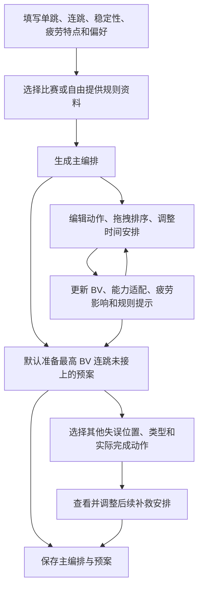

# Skating Lab 产品需求文档

版本：v0.6
更新日期：2026-11-14
产品阶段：目标产品形态评审

需求原图：[2026-11-14 手绘需求](requirements-sketch-2026-11-14.jpg)。

## 产品定位

Skating Lab 是面向花样滑冰选手的移动端跳跃编排与失误预案工具。选手填写自己会做的单跳、连跳、完成稳定性、疲劳特点和使用偏好，选择比赛或自定义规则，得到贴合自身能力、在可执行范围内争取更高收益的跳跃编排，再通过编辑、拖拽和调整动作时间形成自己的方案。

产品最终交付两份可以一起查看和调整的结果：**主编排**与**失误预案**。主编排回答“这些跳怎么安排”，预案回答“这里没跳成，后面怎么补”。

BV 指跳跃基础分。用户可以查看每个动作的分值、每组跳跃的小计，以及按所选规则计算的跳跃 BV 总和。

**优化目标为选手个人条件下的编排收益最大化，不能只追求纸面 BV。** 理论 BV 保留为可核对的分值指标；推荐同时考虑实际完成能力、动作及连跳稳定性、后半程疲劳和个人偏好。只有证据足以支持概率估计时才展示预期兑现 BV，并说明依据；它不等于含 GOE、PCS 和全部扣分的比赛总分预测。

产品载体排除手机 Web、PWA 和网页套壳。现有 Web 前端废弃。客户端在微信小程序与原生 Android 中选择；后端排除 Python，在 Node.js、Go、Java 中选择。当前技术建议见文末，建议不等同于已经确认的选型。

## 用户和使用场景

主要用户是能描述自己跳跃能力、需要准备比赛编排的花样滑冰选手。教练可以与选手共同查看和调整方案。

| 场景 | 用户要做的事 | 得到的结果 |
| --- | --- | --- |
| 准备一场比赛 | 填写会做的单跳和连跳，选择比赛与偏好 | 一套适合当前能力和规则的主编排 |
| 调整已有想法 | 改动作、改连跳、改顺序、改后半程安排 | 更新后的编排、逐项 BV 和总 BV |
| 提前准备失误应对 | 查看默认预案，或指定某一跳的失误情况 | 后续动作怎么调整的具体预案 |
| 训练后修改方案 | 更新会做的动作或某次实际完成情况 | 新的主编排或后续补救安排 |
| 赛前回看 | 打开保存的主方案与预案 | 清楚看到动作顺序、重点变化和补救方法 |

## 完整使用流程

能力清单和比赛设置可以重复使用。选手更换比赛或学会新动作时，只修改发生变化的部分。

## 输入能力与偏好

### 单跳选择

单跳按周数分组，每组提供整组选中、逐项勾选和展开收起。已选择的动作汇总展示，方便检查和取消。

截图中的两周组包含 2A、2S、2T、2Lo、2F、2Lz，三周组包含 3A、3S、3T、3Lo、3F、3Lz。界面同时显示动作代码，并可查看中文名称。

高周数选择采用截图中的快捷填写逻辑：

- 勾选某个高周数动作，默认补选全部更低周数的单跳；例如勾选 3S，会补选全部一周、两周单跳。
- 勾选整组时，选择该组全部动作，并补选更低周数组。
- 默认补选的动作直接展示在已选列表中，用户可逐项取消。
- 用户主动取消的动作保持取消状态，后续的自动补选尊重这些选择。
- 取消某个高周数动作时，保留已选择的低周数动作，方便继续调整。

例如，只勾选 3S 和 3T，就能得到“3S、3T，以及全部一周、两周单跳”的初始清单。若选手暂时不用 2A，可以直接取消 2A。

### 连跳选择

连跳有独立的搜索区和已选区。单跳清单表达“会哪些跳”，连跳清单表达“会把哪些跳连在一起”。

输入动作代码后，列出包含该动作的组合。输入 `3S` 时，可以看到截图中的这些候选：

- `3S+3T`
- `3S+Eu+3S`
- `2A+Eu+3S`
- `3S+3Lo`
- `3S+2T`

用户点选后加入已选区，可以继续搜索、移除，也可以直接填写一个完整组合。组合中的动作顺序保留。

连跳同样支持低难度组合的默认补选。例如，选中 `3S+3T` 时，将 `3S+2T` 加入可用组合。补选项与直接选择的组合一起展示，并允许删除。其他降难度组合遵循保持动作类型与连接顺序、降低周数的思路；具体自动展开范围见文末待细化项。

用户独立选择连跳能力，生成编排时使用已选组合及其保留的默认补选项。

### 选择、禁用与偏好的含义

“会／选中”表示可用并表达使用倾向，不意味着每套方案必须使用该动作；“不选／取消”表示本次不使用对应候选。默认补选只是便捷填写，不能作为选手稳定掌握动作的证据。

单跳与完整连跳分别维护选择状态。取消独立单跳 `3T`，不会自动删除独立选中的 `3S+3T`；取消 `3S+3T`，也不会自动取消独立的 `3S` 或 `3T`。若用户明确表达“任何地方都不要 3T”，系统将其理解为包含该动作的候选均不用，并展示受影响项。模糊描述结合上下文理解，必要时用一句自然语言澄清。

### 完成稳定性与疲劳特点

用户可以直接描述“3S 比较稳”“3S+3T 后半程容易漏接”“最后一分钟腿软”“今天状态一般”，也可以补充训练记录或教练意见。系统负责提取能力信息，用户无需填写完整的评估表，也不强制提供成功率。

能力信息至少区分单跳与整组连跳、正常状态与疲劳状态，以及平时能力与本次状态。系统保留信息来源和适用情境；没有数据的部分不默认成百分之百成功，也不由 LLM 编造精确概率。用户提供的新信息可以修正之前的判断。

推荐应解释影响结果的具体因素，例如“该连跳放在前段更贴合你描述的稳定性；后段保留较稳定的动作”。信息只有定性描述时，用定性的取舍说明和备选方案表达，不伪装成经过校准的得分预测。

### 自由描述

输入框用于补充“想优先使用什么”“不想使用什么”和位置偏好。例如：

- “优先用 3S+3T。”
- “不要 3Lo。”
- “第一组想放 2A。”
- “这组连跳固定在后半程。”

描述转成可以直接修改或移除的偏好项，和勾选清单一起保留。

| 偏好 | 对编排的影响 |
| --- | --- |
| 优先使用 | 与能力、稳定性和疲劳情况一起影响推荐，可接受一定理论 BV 取舍；展示取舍原因 |
| 必须使用 | 编排中保留指定动作或组合 |
| 禁止使用 | 从本次候选中排除指定动作或组合 |
| 固定位置 | 保留指定顺序位置或前后半程安排 |

若用户明确要求使用偏好动作，可以把“优先使用”改为“必须使用”，随后查看新的编排、分值和能力适配说明。系统不暗中将“偏好”升级为“必须”，也不暗中忽略必用项。

冲突结合上下文在原处解释。例如，既选择了 `3S+3T` 又明确要求“任何组合也不要 3T”时，说明受影响的连跳，并允许直接修改选择或描述。

## 选择比赛与自定义规则

### 搜索比赛

用户搜索比赛名称，选择对应赛季、组别和节目类型。选择后，在编排页面保留简洁的比赛信息，规则详情可展开查看。

产品根据所选比赛处理跳跃元素数量、连跳要求、重复限制、必需动作、后半程加成和分值。用户重点关注自己的动作选择和编排结果。

### 自定义规则

用户可以自由提供规则文件、截图、照片、粘贴文本、补充说明或混合资料，建立本次使用的规则设置。表达不必规范，资料可以零散、有批注、使用口语，或包含特殊计分和例外条款。**不得要求用户先改成指定模板、JSON、字段表或预设规则格式；不能因不匹配固定规则类型而拒收材料。**

系统通过文件读取、多模态识别、LLM 和 Agent 工具调用理解资料：保留原文与来源，整理相关条款，识别补充与例外，生成可编辑的理解摘要，并将规则落实到计分和方案推演。解析失败时由系统尝试其他读取方式；缺少决定结果的信息时，集中询问具体问题，并继续处理其余内容，不把内部数据整理工作交给用户。

上传或描述后，展示可编辑的规则摘要。以下是常见展示内容，并非用户必须填写的字段清单，也不是系统只能支持的规则范围：

| 规则内容 | 用户看到的设置 |
| --- | --- |
| 规则名称 | 比赛、训练赛或自定义方案的名称 |
| 跳跃要求 | 跳跃元素数量、必需动作及难度范围 |
| 组合要求 | 连跳或连续跳的数量与长度 |
| 重复要求 | 动作及周数的重复限制 |
| 后半程要求 | 可加成的元素范围与系数 |
| 分值设置 | 采用的动作分值及补充调整 |

出现无法确定的条款时，系统说明不同理解对结果的影响，允许用自然语言补充或纠正。复杂条款由 Agent 进一步拆解、调用工具或构造专用计算逻辑；必要的正确性检查由系统内部承担。不能把猜测包装为确定规则，不能把“收到资料”直接等同于“全部正确理解”。用户无需理解内部规则表示或程序格式。

对于互相矛盾、缺页或无法辨认的资料，保留已经理解的内容并指出具体不确定点；可以给出注明假设的不同方案。不承诺从客观缺失的信息中恢复唯一答案，但不得仅用“格式不支持／规则不在列表”结束处理。

切换比赛或修改自定义规则后，保留现有能力清单和草稿，重新计算编排中的 BV 与规则提示。

## 主编排的结果与编辑

### 生成目标

在选定比赛规则与用户明确限制内，结合可用单跳、可用连跳、完成稳定性、疲劳特点、动作时间和使用偏好，追求**选手个人条件下的编排收益最大化**。

推荐区分三个层面：理论 BV、选手兑现这些分值的能力，以及用户接受的取舍。系统不能仅因后半程可能获得 1.1 加成，就把高难动作集中到疲劳阶段。优先或不选的动作、固定位置、稳定性与疲劳信息都会影响推荐。

有足够训练统计时，可比较不同完成情景的概率与该情景按规则计算的 BV；情景须包含漏接、降周等实际结果，以及这些结果对后续规则和补救的影响，不能简单把每个动作的 BV 乘一个独立成功率后相加。概率不充分时，使用有依据的能力排序、情景对照和取舍解释，不展示虚构的精确期望值。最终优化指标与取舍方式需要通过真实选手案例验证。

能力适配和预期收益相近时，进一步考虑理论 BV；用户调整已有方案时，优先减少不必要的动作与顺序变化。推荐同时展示“为什么这样安排”，用户可以自行选择偏稳或愿意承担更多风险的排法，系统不代替用户决定风险偏好。

### 编排列表

结果以有顺序的跳跃列表呈现。每一行对应一个跳跃元素，可以是单跳，也可以是一整组连跳。

| 区域 | 显示内容 | 可进行的操作 |
| --- | --- | --- |
| 列表顶部 | 方案名称、比赛与组别、当前总 BV | 修改名称、切换比赛、查看规则 |
| 动作行 | 序号、动作或组合、分值明细、小计 | 编辑、替换、删除、插入 |
| 行右侧 | 拖拽手柄 | 改变动作顺序 |
| 行间分界线 | 比赛时间阈值对应的后半程计划位置 | 调整动作时间安排，分界线随之反映归属 |
| 有加成的动作 | 后半程标记、适用系数与计值 | 查看分值明细 |
| 列表底部 | BV 总计与主要操作 | 重新生成、查看预案、保存 |

截图中的 `3T+2T`、`3S`、`2A`、`2Lo`、`2A+2T+2Lo`、`2Lz` 用于表达这类列表的动作结构。各行数量和分值随所选规则及用户能力变化。

### 自由修改

每一行的动作内容都能删除后重新输入，也能从可用动作中替换。用户可以修改生成结果，或从空列表开始编写自己的方案。

修改操作包括：

- 将单跳改成连跳，或将连跳改成单跳。
- 替换组合中的某一个动作。
- 新增或删除跳跃行。
- 拖动整行改变顺序。
- 固定希望保留的动作或位置，再重新生成其余部分。
- 撤销最近一次修改。

每次修改后，逐项 BV、总 BV、动作编号和相关规则提示一起更新。规则问题定位到对应动作，并给出可操作的修改建议。用户可以继续编辑和保存草稿。

### 后半程时间与分界线

后半程由所选比赛对节目时间的规定决定。比赛给定时长及适用的时间判定方式，系统据此确定时间阈值；不能通过拖动一条线改变比赛的时间定义。按本次需求，适用后半程加成的动作采用 1.1 系数，具体适用元素及其他条件随比赛规则确定，自定义规则可以另作规定。

动作行可以记录计划执行时间。列表中的分界线表达时间阈值落在动作序列中的位置。保留手绘图中的拖动交互，但拖动动作跨线或移动列表中的分界线，语义是重新安排哪些动作在阈值前后执行；固定的时间阈值不随拖动改变。系统同步展示和调整受影响的计划时间，保留用户明确锁定的时间。

暂未填写精确时间时，允许先按前后半程编排，标为时间待细化的计划；系统可以估计时间并说明估计依据，不能把尚未核实的时间安排当作确定加成。时间规划还要容纳非跳跃内容和动作间的准备，不能仅凭跳跃行数推断节目时长。

后半程推荐同时考虑选手的疲劳特点、前面动作的累积负荷与剩余动作稳定性。动作行分别显示计划归属与适用加成，建议中说明加成收益和疲劳代价。拖动后的重新计算不能只更新 BV 而忽略能力适配。

### 分值与规则提示

用户首先看到动作、每行小计和总 BV。展开某行后，可查看组合中各跳的分值，以及后半程或重复等规则带来的调整。

提示围绕“哪一项、怎样调整、BV 如何变化”展开。例如，“这一动作已超过本次规则允许的重复次数，可替换该行或调整前面的同类动作”。

当前能力与固定项无法组成符合所选规则的方案时，指出需要补充的动作或需要松开的设置，保留已填内容供用户修改。

## 失误预案

### 默认生成的预案

主编排生成后，默认针对**当前 BV 最高的一组连跳未接上**准备一份预案，回答“这组没连上，后面怎么补”。

默认情景为第一跳已完成，后续跳跃未接上。若有多组连跳的 BV 并列最高，先采用出场顺序靠前的一组；用户可以切换。主编排没有连跳时，提供选择某个单跳准备预案的入口。

### 选择其他失误情况

用户可以修改失误位置、失误类型，以及这一组实际完成的动作。

| 失误类型 | 需要描述的实际结果 |
| --- | --- |
| 连跳未接上 | 已完成组合中的哪些跳，漏掉哪些跳 |
| 摔倒 | 摔倒发生在哪一跳，已经执行了哪些动作 |
| 跳空或降低周数 | 原计划动作与实际跳出的动作 |
| 落冰失控或组合中断 | 哪一步中断，后面是否继续完成了其他跳跃 |
| 自定义情况 | 用文字描述实际完成内容 |

例如，`3T+2T` 只完成了 `3T`，和第一跳变成 `2T` 且未接后跳，是两种不同的预案情景。预案依据实际动作安排后续补救。

### 补救方案怎么呈现

预案保留已经发生的动作，调整尚未执行的部分，在剩余规则空间、剩余时间、当前疲劳和用户能力范围内争取更好的可实现收益。失误后的状态变化可以由用户补充，系统不机械地将最高 BV 的补跳塞到最后。

预案列表沿用主编排的行结构，突出显示需要改变的动作和位置。顶部先用一句话说明怎么做，例如：“第 2 组由 3S 改为 3S+2T，其余保持。”这类补法随所选规则、实际完成动作和可用连跳确定。

每份预案包含：

1. **触发情况**：哪一组发生了什么，实际完成了哪些动作。
2. **后续调整**：哪些行保留、哪些行替换、在哪里补连跳。
3. **执行顺序**：调整后的剩余跳跃列表。
4. **分值对比**：原计划 BV、失误后照原安排继续的 BV、采用预案后的 BV。
5. **补救收益与取舍**：采用预案与失误后照原安排继续之间的 BV 差值，以及稳定性、疲劳和动作改动的影响；理论 BV 增加不直接等于实际收益增加。

预案中已完成的动作显示为固定状态。用户可修改情景中的实际结果，或编辑尚未执行的动作，随后重新计算。

若保持原安排已经是当前更好的选择，预案明确显示“后续保持原安排”。若执行中再次失误，从新的实际结果继续安排后续动作。

### 主编排与预案的关联

一份主编排可以保存多份预案，每份预案带有清楚的触发条件。选手可以先看默认预案，再补充自己关心的其他情况。

主编排发生修改时，对应预案更新所引用的动作、位置、后半程安排与 BV。用户手动调整过的预案保留编辑内容，并指出需要随主编排更新的部分。

## 手机上的产品形态

以手机竖屏操作为主要体验，页面围绕“输入、编排、预案”组织。采用微信小程序或原生 Android；明确排除手机 Web、PWA 和以 WebView 承载主要页面的套壳方案。现有 Vue Web 前端废弃，客户端重新实现。最终载体选择同时考虑真机调试、触控体验、用户设备覆盖与分发方式。

| 页面或区域 | 用户的主要任务 | 主操作 |
| --- | --- | --- |
| 方案首页 | 新建方案，继续上次编排，打开已保存方案 | 新建、继续编辑 |
| 输入页 | 选择单跳、连跳、偏好及比赛规则 | 生成编排 |
| 编排页 | 查看与调整动作列表、后半程和 BV | 编辑、查看预案、保存 |
| 预案页 | 查看默认补救方式，切换失误情况 | 修改情景、调整后续、保存 |
| 方案详情 | 连续查看主编排及对应预案 | 编辑、复制方案、分享 |

单跳组和连跳候选支持折叠，输入页始终能查看已选内容。编排页和预案页使用相同的行结构，在手机上切换时容易对照。

动作编辑优先在当前页展开，保存后回到原位置。拖拽之外，提供上移、下移等同等操作。总 BV 和当前主要操作保持容易找到。

## 保存与复用

主编排与预案一起保存，保留方案名称、比赛规则及原始材料、能力清单、稳定性与疲劳信息及其来源、偏好、动作时间和后半程设置。再次打开时可以接着编辑。方案记录所依据的规则和能力版本，避免资料更新后旧方案悄悄改变含义。

用户可以复制一份方案尝试新的排法，也可以复用同一份能力清单创建另一场比赛的方案。分享内容以清楚的主编排和预案卡为主，方便与教练讨论和赛前回看。

## 产品验收场景

以下场景用于确认产品是否完整承接本次需求。

| 编号 | 用户操作 | 应看到的结果 |
| --- | --- | --- |
| P01 | 勾选 3S、3T | 补选全部一周和两周单跳，已选内容可逐项修改 |
| P02 | 取消默认补选的 2A，再选择其他高周数动作 | 2A 保持取消状态 |
| P03 | 搜索 3S 并选择连跳 | 显示包含 3S 的候选，选择后进入已选区 |
| P04 | 选择 3S+3T | 可用组合中同时出现可取消的 3S+2T |
| P05 | 填写优先、必用、禁用或固定位置偏好 | 各项设置影响编排，并能直接修改 |
| P06 | 搜索并选择比赛 | 显示对应赛季、组别和节目类型，按所选规则编排 |
| P07 | 提供零散或非标准的规则资料 | 系统读取并解释、形成可编辑理解，不要求套模板或填齐字段表；具体歧义用自然语言澄清 |
| P08 | 生成主编排 | 显示有序跳跃列表、分值明细、小计和总 BV |
| P09 | 删除某行内容后手动重写 | 接受新动作，更新分值与相关规则提示 |
| P10 | 拖动动作改变顺序 | 编号、顺序及相关计值同步更新 |
| P11 | 移动后半程分界线，或把动作拖过分界线 | 比赛时间阈值保持固定，调整动作时间规划，更新归属、适用加成、BV 和疲劳影响；未落实时间的安排明确标记 |
| P12 | 生成带有连跳的主编排 | 默认提供最高 BV 连跳未接上的补救预案 |
| P13 | 把漏接情景改为摔倒或跳空 | 记录实际完成动作，重新安排后续跳跃 |
| P14 | 修改预案中的后续动作 | 已完成部分固定，剩余列表与 BV 差值更新 |
| P15 | 主编排发生变化 | 对应预案同步更新，手动编辑部分保留并标出待调整项 |
| P16 | 当前情景没有更好的补救安排 | 显示后续保持原安排及相应 BV |
| P17 | 保存后重新打开，或复制为另一方案 | 恢复主编排、预案、能力与比赛设置 |
| P18 | 在预案基础上再输入一次失误 | 从最新实际结果重新安排尚未执行的动作 |
| P19 | 自定义输入互相冲突 | 在对应位置提示冲突，保留输入并允许就地调整 |
| P20 | 在手机上完成一次完整流程 | 可以独立完成输入、编排编辑、预案查看与保存 |
| P21 | 描述某组连跳后半程不稳 | 推荐考虑其疲劳情境，解释加成与稳定性的取舍，不一味推高 BV |
| P22 | 没有提供成功率，只描述能力与偏好 | 可以继续编排，说明信息依据与不确定性，不编造精确成功率 |
| P23 | 取消独立单跳 3T，但保留 3S+3T | 独立单跳不进入本次候选，已选连跳保留；明确全局禁用才排除含 3T 的组合 |
| P24 | 规则包含常见字段之外的特殊计分或例外 | 系统继续拆解和推演，不因固定字段不支持而拒收；解释结果可回溯到原文 |
| P25 | 提供相互矛盾或无法辨认的资料 | 保留已处理部分，指出具体歧义并尝试其他读取或解释，不伪造唯一确定答案 |
| P26 | 失误后描述体力明显下降 | 后续预案考虑剩余时间和状态，解释可兑现收益及理论 BV 的差别 |

## 后续细化的产品选择

后续产品讨论集中在以下问题：

- **首批预置比赛**：优先覆盖哪些比赛、赛季、组别和节目类型。
- **连跳的默认展开范围**：截图明确的 `3S+3T → 3S+2T` 直接保留；其他降难度组合是否全部默认加入，按选手的实际习惯进一步细化。
- **能力与收益模型**：真实选手如何描述稳定性、疲劳及可接受的取舍；何时有足够数据计算概率，如何验证推荐效果。
- **动作时间输入**：前后半程粗排与精确执行时间如何衔接，尽量减轻选手填写负担。

## 技术路线评审记录（2026-11-14）

已确认的约束：不使用 Web 前端或网页套壳，不使用 Python 后端；输入表达不受固定字段模板限制；推荐必须考虑个人能力与疲劳。

当前建议为**微信小程序客户端 + Java 后端 + PostgreSQL**。以选手与教练通过微信使用和分享为假设，小程序优先；若首批用户明确只使用 Android，且重度离线编辑或系统能力成为主要要求，则原生 Android（Kotlin + Jetpack Compose）更有优势。载体和语言属于本轮提出的建议，尚未视为用户最终确认。

Java 后端采用模块化单体：资料理解与 Agent 编排、能力建模、规则解释与计分、候选搜索与评估、主方案与预案保存。常规可形式化约束可调用 OR-Tools Java；复杂规则由 Agent 拆解和扩展处理，不能把某个求解器能表达的范围当作用户输入的边界。若需要执行动态生成的计算逻辑，在受控环境中运行并核对案例与原文，不直接在业务服务中执行任意生成代码。

优化方法与目标模型需要一起验证。数据不足时做有依据的情景比较，不承诺未经验证的个人最优；已建立完整计算模型时，再按求解结果说明可行性或最优性范围。LLM 负责理解和推理，分值尽可能落到可重复运行的计算，并保留解释依据。

开发顺序：先用具体选手案例确定能力、疲劳与时间的表达；在同一个首版闭环中实现客户端输入、主编排编辑、失误预案和保存，并接入自由资料理解；再用真实材料与真机操作验证并完善。不能将个体能力或自由资料处理降为核心流程完成后的可选功能。

技术参考：[Android 调试](https://developer.android.com/studio/debug)、[Compose 预览](https://developer.android.com/develop/ui/compose/tooling/previews)、[OR-Tools Java](https://developers.google.com/optimization/install/java)。微信官方文档本轮访问失败，小程序具体调试和渲染能力需在开发者工具及目标手机上进一步核实，尚未完成实测。
