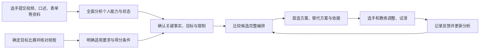

# 花样滑冰选手个性化比赛编排服务：产品需求文档

版本：v0.3（核心需求重写）

更新日期：2026-11-10

状态：产品评审稿；定义目标体验，不表示功能已经实现。

规则研究基线：ISU 2026/27 赛季单人滑；实际使用须绑定目标比赛明确采用的规则。

本文为当前有效 PRD；仓库内旧版 PRD.pdf 不随本次更新，不作为本版需求依据。技术方案、数据库及现有骨架需在产品需求确认后另行对齐。

## 1. 核心需求与产品定位

**用户是花样滑冰选手。用户通过训练或比赛视频、口述、文字、表单、成绩单等方式提供自己的信息。服务对选手自身的个性化数据进行全面分析，同时分析目标比赛的规则，为这名选手制定在该比赛中最适合其目标的完整动作编排。**

产品围绕一个具体问题展开：**“以我现在的能力、状态和备赛条件，参加这场比赛，应该滑什么、怎样组合、按什么顺序滑，以及为什么这样安排？”**

最终交付是一套有个人依据、有赛事依据、可以拿去试滑和修改的节目编排。资料收集、能力分析、规则解读、方案比较和训练反馈，均服务于这项交付。用户不需要先懂动作代码、整理统计表或完成专业测评才能开始使用。

核心价值有三层：

1. **理解这名选手。** 识别能做的动作、实际完成质量、不同场景下的稳定性、长短板、体能分配、风格偏好和现实限制。
2. **理解这场比赛。** 确定赛季、项目、组别、节目类型、计分体系、必需元素与限制，找到适用于该选手的得分机会和失分风险。
3. **给出有理由的最优编排。** 在规则、能力和准备条件允许的范围内，比较动作选择、组合、顺序、时间分配、音乐衔接与风险，提出首选方案，说明替代方案和适用条件。

服务应做到“资料影响判断，判断影响编排，编排可以验证”。只生成通用训练建议、资料摘要、动作清单或理论基础分最高的排列，均不满足核心需求。

## 2. 目标用户与使用边界

### 2.1 用户与协作关系

| 角色 | 使用目的 | 在产品中的职责 |
| --- | --- | --- |
| 花样滑冰选手（主要用户） | 为某场比赛获得适合自己的节目编排；知道理由并根据试滑调整 | 提供资料、纠正事实、表达目标与风险偏好、选择方案 |
| 教练或编舞人员（协作者） | 结合训练观察审阅方案、补充细节、指导冰上验证 | 确认关键技术判断、调整编排、记录审核意见 |
| 未成年选手的监护人 | 协助资料提交和授权管理 | 在适用情况下管理授权，不替代技术判断 |
| 规则维护人员 | 维护目标赛事适用要求 | 核对官方材料、版本和覆盖范围，处理规则冲突 |

选手可独立开始分析并获取建议，不以绑定教练账号作为使用前提。未经教练审核的方案标为“选手选定，待教练审核”；只有实际取得审核记录才显示“教练已审核”。产品不替选手或教练作参赛决定。

### 2.2 项目与组别范围

产品方向覆盖不同水平的单人滑选手，包括竞技、青少年及成人参赛者；不同组别分别维护适用规则。首版聚焦单人滑，双人滑、冰舞和队列滑不在首版范围内。

首版必须完成至少一个明确赛事组别的完整闭环。本文采用 **2026/27 ISU 成年女子单人滑自由滑** 作为规则研究和产品验收的参考场景；这是产品设计基准，不代表用户已经指定真实比赛。发布前需落实一个有正式规程的目标赛事，核实其是否采用该套规则，再建立对应的可用范围。

短节目是独立编排场景，不能用自由滑模板直接替代；青年组、Novice、成人组及国内地方赛事也不能按年龄或名称自动套用成年组要求。未覆盖的组别可以接收资料和建立画像，但只能给出明确标注条件的探索草案，不能宣称完成该赛事的规则验证。

## 3. “最优动作编排”的产品定义

### 3.1 优化对象与前提

“最优”指：**在已知个人证据、目标赛事规则、剩余准备时间以及用户确认的目标与限制下，经比较后最值得该选手采用的节目方案。** 它是有条件、可解释、可修订的推荐，不承诺绝对全局最优或实际比赛名次。

服务需要同时决定：

- **选什么：** 跳跃及周数、连跳或连续跳、旋转类型及目标难度、步法和编舞元素。
- **怎样组合：** 哪些单个动作能连贯完成，哪些组合已经在训练中验证；动作之间怎样进入、衔接和退出。
- **怎样排序：** 利用个人体能、节奏、开场适应和后半程表现，安排技术与表达重点。
- **怎样覆盖整套节目：** 从开场到结束的时间预算、音乐段落、过渡滑行、冰面利用和恢复空间。
- **怎样应对变化：** 为赛前状态变化、训练进展或明确的失误场景准备经过检查的替代方案。

以下前提不能被预估收益抵消：适用赛事规则、已确认的动作禁用或身体限制、选手明确拒绝的动作、节目时长，以及选手实际可用的能力范围。未掌握动作只能进入另列的提升情景；没有证据支持时，不能假定比赛日前一定学会。

### 3.2 用户目标与比较方式

| 用户目标 | 推荐应重点比较 | 必须解释的代价 |
| --- | --- | --- |
| 稳定完赛 | 完整滑完的可行性、失误风险、体能余量、熟悉程度 | 为提高稳定性放弃哪些潜在收益 |
| 综合表现最佳（默认） | 个人条件下的预期技术表现、节目质量、得分波动与准备成本 | 哪些高基础分动作因实际风险被放弃 |
| 冲击目标分数 | 达到用户目标所需的动作和质量、与当前能力的差距 | 需要承担的波动和必须先验证的条件 |

目标需要用户确认，系统可提供默认建议。用户可修改目标、风险接受程度、锁定动作、音乐或已有节目片段，之后重新比较。名次取决于对手和临场发挥；没有相应数据时不输出夺冠概率。

### 3.3 评分和不确定性表达

在采用 ISU 计分体系的赛事中，单个比赛阶段得分由技术分（TES）加节目内容分（PCS）再减适用扣分构成；基础分之和只是其中一部分。方案讨论应分别展示这些部分，适用系数、奖励和扣分以目标赛事规则版本为准。[规则 R1，第 353、504 条](#r1)

产品必须区分四种信息：

| 信息 | 含义 | 展示要求 |
| --- | --- | --- |
| 计划基础分 | 假定计划动作及等级被认可时的规则分值 | 标明目标等级、后半程条件及所用分值表，不称为预计实得分 |
| 个人技术表现预估 | 考虑该选手的完成质量、失误类型、组合及整套状态后的估计 | 显示样本、观察期间、假设和不确定范围；证据不足则不给数值概率 |
| 节目质量评估 | 对构成、表演、滑行技术的优势与问题作分析 | 结合音乐和整套表现；只有动作列表时不生成精确 PCS |
| 比赛结果 | 官方实际判定与成绩 | 与预测、用户自评和训练记录分开保存和展示 |

同一动作在单练、连跳、整套前半程与后半程的表现可能不同，应分别分析。不能直接把单练成功比例当作比赛成功概率，也不能把各动作成功率简单相乘后宣称整套无失误概率。摔倒、周数不足、跳空、用刃问题、组合中断、旋转或步法降级的后果需要按具体情景讨论。

当数值不足以可靠排序时，可以给出有依据的条件性推荐，指出“补充哪项证据可能改变首选”。不应为了输出排名而编造成功率、GOE 或总分。

## 4. 核心用户旅程

1. **提出任务。** 选手可以直接说“我六周后参赛，后半程容易累，帮我排一套稳一些的节目”，同时上传资料，无须先走完固定问卷。
2. **整理与补问。** 服务先提取已有信息，只追问会改变编排的关键缺项，如目标组别、动作组合经验、完整节目状态、音乐和已知限制。
3. **形成两份分析。** 给出选手综合分析和赛事适配分析，明确已知、推断、冲突和未知内容，并指出它们对编排的影响。
4. **生成与解释。** 输出一个明确的首选方案；有实际取舍时提供至多两个替代方案，说明首选理由、适用条件和仍需验证的问题。
5. **交互调整。** 用户提出“不要这个动作”“这个旋转提前”“保留开场”，服务检查整套影响并给出新版本。
6. **试滑与定稿。** 上传试滑视频或口述反馈，复核时长、体能和衔接；将结果反馈到画像与方案。完成审核后保存可回溯的比赛准备版本。

每个阶段都有可用产物。缺少资料时保留已有分析和待补项；缺少关键规则时暂停标记为“赛事规则已核对”的推荐，不要求用户从头开始。

## 5. 选手信息输入与全面分析

### 5.1 多种输入是核心能力

视频、语音口述、自由文字和表单都是首版核心入口，用户可任选一种开始，之后混合补充。不能把口述降为远期能力，或要求用户先手工转换成表格。

| 输入渠道 | 典型内容 | 服务必须完成的处理 |
| --- | --- | --- |
| 训练及比赛视频 | 单动作、多次尝试、连跳、整套节目、试滑录像 | 区分场景，定位片段和时间点，识别可观察表现与不可判定内容 |
| 语音口述 | 训练经历、近期状态、害怕的动作、教练意见、参赛目标 | 形成可编辑转写和信息摘要；动作名称、周数、次数、否定表达有疑问时核实 |
| 自由文字 | “单练能做，整套后面接不上第二跳”等自然描述 | 保留场景和条件，不压缩成单一的“会/不会”标签 |
| 引导表单 | 已知动作、训练安排、偏好、目标赛事和已有专业限制 | 允许不知道或留空；已有资料能填出的内容先给用户确认 |
| 图片及成绩资料 | 比赛成绩单、训练记录、已有节目表、教练笔记 | 提取动作与成绩、标明来源和日期；保留识别疑点供确认 |
| 音乐与既有节目 | 音频、曲目、音乐版本、段落时间、想保留的片段 | 分析可用时长、节奏段落和编排偏好；没有音频时可先按用户提供的段落草案工作 |

首版输入能力至少支持一段连续五分钟的视频，以覆盖参考场景的完整节目及少量前后留白，也支持多段短片。不能只接受一分钟片段却宣称完成了整套体能和节奏分析。格式、大小和处理限制需在上传前明确，允许分批补充；具体容量和性能预算在实现评估中确定。

### 5.2 综合画像及其对编排的作用

| 分析维度 | 需要了解的内容 | 必须影响的编排决策 |
| --- | --- | --- |
| 参赛背景 | 项目、组别、训练经历、已有等级或资格、参赛经验 | 赛事匹配、分析语境和方案成熟度；资格有疑点时提示核实 |
| 跳跃能力 | 动作及周数、质量、成功与失误记录、惯常进入方式 | 候选跳跃、重复分配、是否采用较高难度 |
| 组合能力 | 已验证连跳和连续跳、第二或第三跳表现、落冰接续能力 | 组合选择、顺序、备用组合；会两个单跳不代表会把它们连起来 |
| 旋转能力 | 位置、换足、转数、难度特征、速度与稳定性 | 旋转类型、目标等级、时长与体能成本 |
| 滑行与步法 | 用刃、转体、流畅度、速度、方向变化和冰面覆盖 | 步法目标、过渡难度、动作准备距离和衔接 |
| 整套与体能 | 整套前后表现、动作后的恢复、累积疲劳、节奏变化 | 高负荷动作分布、后半程选择、时间余量 |
| 表演与音乐 | 擅长风格、表达特点、节奏把握、熟悉曲目 | 音乐段落匹配、表现重点、编舞元素与整体结构 |
| 临场与偏好 | 自述的紧张情境、熟悉顺序、信心和风险偏好 | 开场选择、方案保守程度及训练验证重点 |
| 身体与训练限制 | 用户提供的既有专业限制、禁做动作、可训练时间 | 候选动作排除、方案调整幅度和备赛可行性 |
| 历史与近期变化 | 历次比赛、近期完整训练记录、状态变化 | 区分过去能力与当前可用能力，判断是否需要重新评估 |

“全面”表示覆盖编排所需的相关维度，不要求收集所有个人信息。身高体重等信息仅在有明确用途时选填，不能据此直接判断能力；不从视频推断疾病、心理诊断或未提供的身份属性。

### 5.3 证据与确认

每个关键结论包含：结论、适用场景、资料日期、证据位置、样本量或自述来源、不确定性、对编排的影响及确认状态。例如：“最近三次完整试滑中，两次在最后一组连跳中断，因此先比较将该组合提前的方案。”

必须区分用户自述、视频观察、官方成绩、教练评价和服务推断。十次尝试中的八次完成只能称为这组记录的完成比例；只有精选成功片段时，不能估算整体成功率。重复上传同一尝试不能重复计数。

来源冲突时展示各自日期和语境，优先补问差异原因，不静默覆盖。用户确认只表示认可记录，不能把自评升级成官方技术判定。影响正式推荐的能力限制、目标赛事、关键动作可用性需确认；普通文字整理无需逐条拦截流程。

## 6. 目标赛事分析与已核实的规则依据

### 6.1 一次编排对应一个明确赛事上下文

至少需要：赛事名称与日期、主办或管理机构、赛季、项目、参赛组别、短节目或自由滑、计分体系、正式规程及适用补充通知。只有“女子组”“大学生比赛”或“按 ISU 规则”不足以确认全部要求。

服务应从赛事明确采用的文件出发，结合相应赛季的技术规则、分值表、等级与 GOE 指引、技术手册及后续澄清，输出规则适配表。国内、成人和俱乐部赛事可能有专门要求，不默认与 ISU 成年组相同。

每项规则记录来源、条款或页码、版本日期、生效时间、适用组别和核对状态。后发布文件是否修改先前文件，要依据其修订声明和适用范围判断；有矛盾时列明冲突并核实，不由系统自行选择“更宽松”的解释。用户补充说明不能直接取代官方规则。

### 6.2 规则事实如何进入产品需求

下表是本次核对的关键事实摘要，用于说明产品必须分析什么；不是完整裁判手册。适用范围为表内注明的 2026/27 规则，不能跨赛事直接使用。

| 规则主题 | 已核实事实及出处 | 对编排服务的要求 |
| --- | --- | --- |
| 节目时长 | ISU 成年单人自由滑为 4:00，青年为 3:30，二者短节目为 2:40，均允许 ±10 秒。[R1，第 502 条](#r1) | 统计整套时长，包含过渡和结束；不能只累加技术动作时间 |
| 自由滑构成 | 成年单人自由滑最多六个跳跃元素，须含 Axel 类；三类旋转含编舞旋转，另有步法及编舞步法。青年自由滑的元素结构有区别。[R1，第 612 条](#r1) | 分组别检查元素槽位；不能沿用旧版七跳模板 |
| 短节目 | 成年与青年单人短节目各七个规定元素；青年规定动作按赛季变化。[R1，第 611 条](#r1) | 单独核对必需内容，不能由自由滑随意删减生成短节目 |
| 后半程加分 | 单人短节目仅最后一个、自由滑最后三个在后半程开始的跳跃元素可获得 1.1 基础分系数，GOE 不乘该系数。[R1，第 353 条](#r1) | 根据实际计划起跳时间和个人疲劳表现比较收益，不能对全部后半程动作加成 |
| 连跳与连续跳 | 自由滑至多两组连跳，或一组不含 Euler 的连跳加一组连续跳；一组可含三个计数跳跃，另一组至多两个。[R2，pp.28–29](#r2) | 检查组合数量、长度、连接方式及选手是否具备组合能力 |
| 重复与 Euler | 同类跳跃不论周数合计不超过三次；同一两周跳至多两次。Euler 在规定用法下不计值、不占组合跳数，自由滑仅可在两个列名跳跃间使用一次。[R2，pp.27–29](#r2) | 分开检查跳跃种类、周数、重复、Euler 和连跳限制，不只统计动作代码出现次数 |
| 高周数重复计值 | 三、四、五周跳中至多两种可重复两次，重复名额中至多一种为四周或五周；两次均为单跳时，第二次按基础分的 80% 计值。[R3，p.14](#r3) | 不能把重复的两个单跳都按完整基础分累加；仍须核对组别和动作使用范围 |
| 技术失误 | `q`、`<`、`<<`、`!`、`e` 对应不同技术标记，基础分和完成质量影响不能混为一种失败。[R2，pp.29–30](#r2) | 使用已确认判定或清晰标注的情景；画面不足时保留未知 |
| 基础分与 GOE | 分值表分别给出基础分和各档 GOE 数值；例如 2A 基础分 3.30、3T 为 4.20。2026/27 的 ChSq1、ChSp1 基础分均为 3.50。[R3，pp.3、14](#r3) | 按该季该元素查值；编舞元素不能套用普通元素的同一比例计算方式 |
| 等级与编舞元素 | 旋转、步法等级取决于满足的特征及限制；编舞旋转要求至少连续三圈，确认后按固定基础分及 GOE 评价。[R4，pp.2–6](#r4) | 展示目标等级的具体依据，不把所有旋转默认成四级；区分 ChSp、ChSq 与分级步法 |
| 节目内容与质量 | PCS 按 Composition、Presentation、Skating Skills 三项评价；音乐结构、衔接、冰面利用和滑行质量均相关。[R4，p.19](#r4) | 完整编排需包含音乐、过渡和空间安排，不能只优化跳跃 |
| Novice 差异 | 国际 Novice 各组无后半程 1.1 系数，并有独立的元素、奖励与扣分规定。[R5，pp.1–3 及相应组别章节](#r5) | 更换组别后重做规则适配；不能直接复用成年规则和分值假设 |
| 赛季中澄清 | 2026 年 10 月 Q&A 3 澄清：连续跳或连跳中被标 `*` 的跳跃仍记录技术判定，裁判评价整个元素的完成质量。[R6，Q2–Q3](#r6) | 失误情景不能把无分跳跃直接从实际执行记录中抹去；需跟踪后续澄清 |

### 6.3 每套方案必备的规则检查清单

以下是产品检查范围要求；具体数值和例外按目标赛事文件填写，未完成的项必须显示“未核对”：

1. 参赛组别及节目适配、规定动作、禁止内容、动作及元素数量。
2. 连跳或连续跳的合法连接、数量、计数跳跃数、Euler 使用限制。
3. 同种跳跃和同周数动作的重复限制、重复高周数跳跃名额、重复单跳的计值后果。
4. 旋转类型区别、基本姿态、转数、换足、特征重复使用和目标等级；步法及编舞元素的相应要求。
5. 节目时长、元素开始时间、后半程条件、额外或超时元素的计值影响。
6. 该季基础分、GOE 对应值、技术标记、PCS 系数和适用扣分或奖励。
7. 计划修改、漏跳、跳空、连跳中断后，后续动作的重复、槽位和计分影响。

输出区分“计划内容符合已核对规则”“需要实际滑出才能确认的条件”和“尚未核对事项”。纸面安排合法不等于临场一定被认可。规则更新后提示受影响方案，重新检查生成新版本，保留旧版当时依据。

## 7. 编排生成与交付要求

### 7.1 从个人分析到候选方案

服务应先形成个人可用动作和组合清单，区分“近期证据支持”“需要复核”“练习中”“不使用”。随后结合赛事要求、用户目标、音乐和备赛周期形成完整候选方案。

每个首选方案至少与一个有意义的可行替代方案或用户已有节目比较；只有一个可行方案时说明受哪些条件限制。比较可以改变动作、组合、顺序、目标等级或时间分布，不能只修改方案名称与解释文字。

关键取舍必须具体到个人：为何保留较低基础分动作、为何将某连跳提前、为何选择三级目标而非四级、为何给某段音乐留出表达空间，以及改变哪个条件会改变选择。

### 7.2 用户收到的完整方案包

| 交付项 | 必须包含的内容 |
| --- | --- |
| 首选结论 | 对应选手、目标比赛、节目类型、目标、采用理由及适用条件 |
| 个人综合分析 | 优势、短板、可用动作与组合、整套体能和表达特点、关键证据及未知项 |
| 赛事适配分析 | 必需内容、限制、相关得分机会、规则来源和覆盖情况 |
| 节目编排表 | 全部元素的顺序、中文名称和代码、目标等级或周数、组合结构、计划时间及主要衔接 |
| 节目结构说明 | 开场、发展、高潮、收束的安排；音乐段落、体能分布、冰面利用的文字说明或简图 |
| 分值与风险说明 | 计划基础分、可支持的个人表现估计、主要失分情景、PCS 定性分析、未验证条件 |
| 对比与解释 | 相对已有节目或替代方案的变化、收益、代价、为何适合此人、哪些资料支撑判断 |
| 验证清单 | 必须试滑的组合、目标转数或等级、后半程表现、时间余量和需要补充的证据 |
| 版本与可携带结果 | 保存方案、审核状态与依据，复制或导出可读节目表，供训练及人工填写赛事节目内容表参考 |

时间表应说明时间段是否包含准备与衔接，避免重复计时或大段无安排。后半程判断必须定位到跳跃元素开始时间。空间安排至少说明使用区域与进入、退出方向；精确冰上坐标、逐帧动作动画和完整舞蹈教学不属于首版承诺。

### 7.3 推荐、调整与无可行方案

- 首屏先展示一个首选，而不是让用户在多套方案中自行猜测；备选只在确有差异时给出。
- 用户可用自然语言修改，也可锁定、替换、移动或删除元素；修改后检查整套规则、时长、体能、音乐及评分假设，展示变化理由。
- 用户坚持保留有问题的修改时，可以保存为未通过检查的草案，不能显示为赛事可用方案。
- 无可行方案时，列出冲突条件及可调整方向，例如“当前可用组合与该组短节目规定冲突”；用户选择放宽偏好或更换目标后再生成，不自动解除禁忌或杜撰能力。
- 替代预案要注明触发条件并检查剩余节目；不得笼统建议“失败后在后面补一个跳”。首版至少支持赛前完整备选及一个明确失误情景的复核，不要求比赛中实时指挥。

## 8. 参考使用案例：同一名选手怎样得到不同编排

本节为**合成产品案例**，说明交付形态与决策逻辑，不是真实选手评估、实测得分或可直接采用的比赛节目。

### 8.1 输入与分析

假设目标赛事确认采用 2026/27 ISU 成年女子自由滑规则。选手有六周备赛时间，提供两次完整试滑、若干动作尝试记录、一段口述、既有节目表和四分钟音乐。口述说明希望稳定发挥，教练已确认暂不将 3Lz 放入比赛方案。

资料支持将 3T、3S、2A、2Lo、2Lz 及两组已练习组合纳入候选：3T+2T、2A+2T+2Lo。近期整套中，三周跳后置出现质量下降；两组连跳的前后段适应性仍须分别复核。旋转和步法目标等级依赖具体特征验证，不直接认定已达到。

服务据此比较：将高难度组合前置、保留熟悉的两周组合；或进一步前移后半程连跳，放弃部分潜在加分以减轻疲劳。没有足够证据时，后一项显示为需试滑验证的条件选择。

### 8.2 一套待试滑的完整结构示例

以下时间段均包含相应准备和过渡；跳跃开始时间单独注明。音乐段落名称仅用于示意，实际需按选手音频核对。

本例跳跃代码：T 为后外点冰跳，S 为后内结环跳，A 为阿克塞尔跳，Lo 为后外结环跳，Lz 为勾手跳；前面的数字表示名义周数，Axel 类实际包含额外半周。加号表示本例计划的连跳连接。

| 顺序 | 时间段 | 内容与目标 | 个性化理由及验证点 |
| --- | --- | --- | --- |
| 开场 | 0:00–0:10 | 开场姿态、进入滑行 | 使用熟悉的进入节奏，为首组连跳准备 |
| 1 | 0:10–0:25 | 3T+2T；计划 0:16 开始 | 已练习组合放在体能较充足阶段；验证第一跳落冰接续 |
| 2 | 0:25–0:40 | 3S；计划 0:32 开始 | 依据近期整套表现，三周跳不后置 |
| 3 | 0:40–0:56 | 2A；计划 0:48 开始 | 使用已掌握动作，衔接音乐推进段 |
| 4 | 0:56–1:20 | FCSp3（跳接燕式旋转，目标三级） | 与后续旋转区分类型；需验证特征和转数 |
| 5 | 1:20–1:52 | ChSq1（编舞步法） | 安排选手擅长的表现性滑行动作；确认构成和连接 |
| 6 | 1:52–2:10 | 2Lo；计划 2:03 开始 | 后半程边界附近的候选安排，需实测时间余量 |
| 7 | 2:10–2:35 | 2A+2T+2Lo；计划 2:21 开始 | 已练习的三跳组合；若后半程试滑不稳定则比较前移版本 |
| 8 | 2:35–2:55 | 2Lz；计划 2:45 开始 | 使用允许且熟悉的跳跃，避免临近比赛增加陌生难度 |
| 9 | 2:55–3:20 | CCoSp3（换足联合旋转，目标三级） | 核对基本姿态、换足及特征；不能把目标等级当成已认可等级 |
| 10 | 3:20–3:45 | StSq2（接续步，目标二级） | 与高潮段相配，按实际滑行能力安排转体和冰面覆盖 |
| 11 | 3:45–4:00 | ChSp1（编舞旋转）与结束 | 留出连续转数和收束时间；试滑验证完整停止时间 |

该结构包含六个跳跃元素、两组连跳、三类旋转、接续步和编舞步法。两组连跳分别含两个与三个计数跳跃；T 类合计三次，2T、2Lo、2A 各两次。上述计数只展示部分计划检查，不代表所有等级、时长、音乐及实际执行条件已通过。[规则依据 R1](#r1)、[重复与组合检查 R2](#r2)

计划中的最后三个跳跃元素均在后半程开始，但是否保留该安排取决于个人完整试滑结果。若只有把连跳前移才能维持可接受的质量，就应重新比较，不能为了凑足加分数量坚持后置。服务不在缺少真实数据时给这套合成节目填写成功率、预计总分或“最优已证明”的标签。

### 8.3 必须观察到的个性化变化

| 条件改变 | 产品应出现的变化 |
| --- | --- |
| 试滑显示后半程三跳组合持续中断 | 对比组合前移或替换版本，重查重复、时长和音乐，解释可能放弃的加分 |
| 新证据确认该组合后半程质量稳定 | 更新依据后重新比较；不得仅因新增上传就自动提高全部动作成功率 |
| 将目标从稳定完赛改为冲击目标分数 | 在已有能力范围内重新比较风险收益，明确目标分数是否有证据支撑 |
| 改报青年或其他组别 | 重新加载相应规则，指出元素结构差异；旧方案不能直接保持“已核对”状态 |
| 用户要求加入未经验证的更难跳跃 | 放入独立提升情景并说明验证条件，保留当前能力方案作为现实比较基线 |

## 9. 功能优先级与首版交付范围

P0 是首版完整产品闭环，P1 是在该闭环基础上的扩展，P2 是后续方向。以下为需求，不代表当前仓库已实现。

| 编号 | 优先级 | 能力 | 完成条件 |
| --- | --- | --- | --- |
| F01 | P0 | 选手档案、权限与资料管理 | 多次补充资料可归于同一选手和备赛任务；区分授权对象与用途 |
| F02 | P0 | 视频、口述、文字、表单及辅助资料输入 | 任一核心入口均能开始；支持整套视频；保留证据和可纠正摘要 |
| F03 | P0 | 综合能力与状态分析 | 第 5 节各相关维度有结论或明确缺项，关键判断可解释其编排影响 |
| F04 | P0 | 针对性补问与确认 | 先利用已有资料，只补问关键缺项；冲突、误识别和未知可更正 |
| F05 | P0 | 目标赛事规则分析 | 至少一个真实赛事组别完成来源核对；展示覆盖情况及不适用范围 |
| F06 | P0 | 个性化完整编排与候选比较 | 输出首选和比较依据，覆盖技术元素、衔接、音乐段落、时长和体能 |
| F07 | P0 | 分值、风险与解释 | 分开计划基础分和个人预估；说明选择与舍弃原因；无证据时不编造数值 |
| F08 | P0 | 自然语言修改与整套复核 | 锁定、替换和排序后重查整体，展示修改前后差异和冲突 |
| F09 | P0 | 试滑反馈与再次编排 | 新视频或口述反馈能改变相关判断并产生新方案版本 |
| F10 | P0 | 方案保存、分享与审核 | 授权分享、可读节目表、选手选择及教练审核状态、历史依据齐全 |
| F11 | P0 | 缺失、失败和无解处理 | 缺资料、规则冲突、分析失败或无可行方案均有明确原因和下一步 |
| F12 | P1 | 更多组别与短节目 | 各新增范围独立完成规则和案例验收；不得批量宣称通用覆盖 |
| F13 | P1 | 长期能力趋势与比赛复盘 | 关联多个备赛周期、官方成绩与预测误差，改进后续建议 |
| F14 | P1 | 更丰富的调整情景 | 比较能力提升、不同备赛周期及更多失误分支对方案的影响 |
| F15 | P2 | 更细的可视化与其他项目 | 精细冰面路线、动作演示及其他滑冰项目，分别评估后立项 |

基本反馈迭代属于 P0，不能把所有复盘能力推迟到长期版本。首版可以限制赛事覆盖数量，但必须保留“个人分析 + 赛事分析 + 完整编排 + 试滑修订”的链条。

## 10. 产品质量、授权与体验要求

| 方面 | 要求 |
| --- | --- |
| 可理解 | 动作代码配中文名称；关键结论用普通语言解释，选手不必具备裁判知识 |
| 可追溯 | 从推荐可找到个人片段、规则条款、假设、修改原因和审核记录 |
| 不确定性 | 区分观察、推断、自述和正式判定；不将“未发现”写成“确定没有” |
| 数据时效 | 展示画像采用日期与资料期间；有明显状态变化时提示复评，不悄悄沿用旧判断 |
| 处理过程 | 上传后及时反馈受理状态，展示理解、补问、规则核对、编排、复核进度；可取消、重试并保留已完成结果 |
| 等待体验 | 上传完成后目标五秒内显示受理状态；正式处理时延指标在完整视频样本试测后确定，公开计时口径，避免使用只适合短片的时延承诺 |
| 隐私与授权 | 默认仅本人及授权协作者可见；训练分析、外部处理和公开演示用途分开说明；支持撤回及删除进度查询 |
| 未成年人资料 | 提供适用的监护授权流程，公开演示使用合成或明确授权的脱敏材料 |
| 身体限制 | 仅记录已有专业意见和用户明确限制；不输出医疗诊断或自行解除禁做条件 |
| 成本与额度 | 生成或重复分析前说明额度消耗，失败与重试的计费规则清晰 |
| 版本一致性 | 保存当时的输入、规则、方案和审核状态；重算形成新版本，历史回放明确标识 |

## 11. 验收标准与成功指标

### 11.1 核心验收场景

| 编号 | 输入或操作 | 必须观察到的结果 |
| --- | --- | --- |
| A01 | 同一选手分别通过口述、表单、视频提交相容信息 | 能汇入同一任务；不同来源有标识，不要求重复录入 |
| A02 | 仅提供精选成功片段，口述“很稳定” | 不伪造长期成功率；提出获取完整尝试或整套表现的补问 |
| A03 | 两名会相同跳跃但稳定性、体能和风格不同的选手 | 方案选择或排序有证据支持的差异；若不改变也解释原因 |
| A04 | 同一选手更换组别、赛季或节目类型 | 重新核对规则，展示不适用条款和方案变化，不能沿用通过状态 |
| A05 | 向参考自由滑方案加入第七个跳跃元素或第三组连跳 | 明确指出违规或计值问题及依据；不标记为规则已通过 |
| A06 | 调整顺序使后半程条件变化 | 更新相关加分条件和时间安排；同时检查体能及衔接 |
| A07 | 用“两个单跳都会”替代组合证据 | 标记组合待验证，不自动认定组合可用于比赛 |
| A08 | 删除音乐或整套视频 | 保留可支持的分析，指出音乐、体能或 PCS 判断的证据缺口 |
| A09 | 用户锁定动作使规则与限制无法同时满足 | 返回冲突原因与可调整条件，不自行违反限制凑出方案 |
| A10 | 上传试滑，显示后半程质量下降或连跳中断 | 修订相关画像和方案，显示前后变化、得失与依据 |
| A11 | 旋转目标四级但证据仅支持部分特征 | 展示目标与当前证据的差距，避免虚增基础分和表现预估 |
| A12 | 修改连跳失误后的后续动作 | 重查重复与剩余槽位，保留实际动作记录并说明风险 |
| A13 | 没有教练账号，选手独立使用 | 可以获得和选择建议；审核状态如实显示，不虚构教练确认 |
| A14 | 查看旧方案后补充新资料或规则更新 | 旧方案依据保持原样，新建议生成独立版本并提示差异 |

### 11.2 发布门槛与效果评价

以下为计划目标，未进行真实验证前不得宣传为产品效果：

- **核心闭环：** A01–A14 全部通过；输入、分析、编排和试滑反馈连续可用。
- **规则正确性：** 已声明覆盖的规则在正常、边界和违规案例中均由花滑教练或规则专业人员核对；所有阻断性错误修复后才能声明该范围可用。未覆盖规则不得计入通过率。
- **依据完整性：** 关键个人判断、硬性规则、数值来源和首选理由均可追溯；不允许无来源的确定性判断。
- **编排可用性：** 至少十名不同能力选手的授权案例，由至少两名教练独立评价；目标至少 80% 被评为“可进入试滑验证”，同时报告分歧及失败原因。
- **真实个性化：** 对照同一选手改变目标、能力或赛事条件，审查方案变化是否有因果依据；不以“输出文本不同”作为合格标准。
- **准备效率：** 与相同资料条件下人工形成可试滑方案的过程比较，目标总准备时间减少 30%；统计补资料、审核和修改时间。
- **估计质量：** 给出数值估计时，用后续试滑或官方结果记录偏差及区间覆盖情况；样本不足时仅报告案例，不宣称已验证预测能力。

基础分更高不是单独的成功标准。首选方案必须能解释对这名选手的实际收益，并经完整试滑验证关键假设。

## 12. 产品推进顺序与非目标

### 12.1 产品评审与交付顺序

1. 确认本 PRD 的核心价值、用户旅程、最优定义和完整方案包。
2. 落实首个真实赛事及组别，收集官方规程、授权选手资料与教练评审案例。
3. 用案例逐步验证个人分析、赛事分析、完整编排及试滑迭代是否成立。
4. 在产品需求确认后，另行讨论技术实现、数据结构、分析方法、性能及工程里程碑。
5. 首版闭环达标后，再扩展组别、短节目、长期复盘和更丰富的编排表达。

项目仍可用于数据库设计及计算机设计类比赛展示，但评审演示应围绕真实产品闭环展开。数据库管理、证据追溯和技术创新是支撑能力，不能取代“为这名选手编排这场比赛节目”的用户价值。演示回放与实时生成、合成案例与真实效果须明确区分。

### 12.2 本轮及首版不承担的事项

本轮只修订产品文档，不确定模型、算法、框架、系统架构、接口或数据库方案。原技术设计中的实现选择不构成本版产品需求已经通过评审的结论。

首版不承担正式裁判判分、成绩或名次保证、医疗诊断、完整音乐剪辑、逐帧舞蹈教学、精确冰上轨迹仿真、实时比赛指挥或自动赛事报名。允许资料存在不确定性，但不能声称从任意角度的视频准确判定所有周数、用刃或等级。

尚待产品评审落实的事项：首个真实目标赛事及覆盖组别、可获取的授权样本、教练评审安排、正式支持的文件格式与输入容量。这些事项不改变本文定义的核心闭环。

## 13. 官方规则来源与核对记录

检索与核对日期：2026-11-10。以下均为 ISU 官方文件或国家协会托管的 ISU 文件；本次阅读了与单人滑编排相关章节，未将整套裁判制度逐条转写为产品规则。目标赛事尚未指定，因此未声称完成任何具体国内赛事的适用性核对。

**R1｜ISU Sports Rules — Single & Pair Skating and Ice Dance，2026**

所读正文标注 as of 1 June 2026，Effective 12 June 2026。重点：第 353 条计分（pp.9–12）、第 502 条时长（pp.50–51）、第 504 条（pp.51–53）、第 611 条短节目（pp.66–69）、第 612 条自由滑（pp.70–72）。

[ISU 官方规则原文](https://isu-d8g8b4b7ece7aphs.a03.azurefd.net/isudamcontainer/CMS/Corporate-Site/Governance/Isu-Regulations/2026-FS---Pair-Sports-Rules-FINAL-20260513-1778685370-9916.pdf)

**R2｜ISU Technical Panel Handbook — Single Skating 2026/27，15 July 2026**

重点：旋转、步法及编舞元素章节；跳跃数量、重复、组合、连续跳、Euler、技术标记及异常判定（pp.27–34）。本文规则摘要未列完高周数重复及所有例外，实际校验必须检查对应完整条款。

[ISU 官方技术手册](https://isu-d8g8b4b7ece7aphs.a03.azurefd.net/isudamcontainer/CMS/Corporate-Site/Sports-Rules/Figure-Skating-Rules/Handbooks-Single-%26-Pair-Skating/TP-HandbookSingles-26-27-15-July-2026-1784641784-3364.pdf)

**R3｜ISU Communication 2786 — Scale of Values and Program Components Factors，2026/27**

采用 2026-06-02 更新文件，分值自 2026-07-01 生效；替代 2707。重点：跳跃分值（pp.2–6）、编舞元素与 PCS 系数及说明（p.14）。该表列出的是规则数值，不是选手个人完成质量。

[ISU 官方分值表](https://isu-d8g8b4b7ece7aphs.a03.azurefd.net/isudamcontainer/CMS/Corporate-Site/Governance/Transparency/ISU-Communications/2786-SinglesPairs-SOV-Update-260602-1780481099-6311.pdf)

**R4｜ISU Communication 2788 — Levels of Difficulty and Guidelines for marking GOE and Program Components，2026/27**

2026-05-19 更新，替代 2701。重点：单人滑等级与编舞要求（pp.2–6）、正负 GOE 指引（pp.12–15）、补充说明及 PCS（pp.16–19）。ISU 直链在本次读取中失败，已读取 Ice Skating Australia 托管的同编号、同更新日期原文，并交叉核对美国协会官方索引。

[澳大利亚协会托管的 ISU 原文](https://isa.org.au/wp-content/uploads/2026/06/2788-SP-Levels-and-GOE-2026-Updated-MAY-19-1779351385-9626.pdf)；[美国协会规则索引](https://usfigureskating.org/sports/2025/9/9/singles-pairs-excel-rules-resources.aspx)

**R5｜ISU Communication 2770 — Guidelines for International Novice Competitions，2026/27**

2026-05-11 更新，替代 2699。重点：一般要求、时长、扣分、无后半程系数以及各组别独立要求（pp.1–9）。用于确认跨组别差异，不代表首版已支持全部 Novice 组别。

[ISU 官方 Novice 指引](https://isu-d8g8b4b7ece7aphs.a03.azurefd.net/isudamcontainer/CMS/Corporate-Site/Governance/Transparency/ISU-Communications/2770-SP-Novice-Guidelines-2026-27-upd-May11-1778513322-3881.pdf)

**R6｜2026/27 Clarification from Technical Committee — Q&A No.3，October 2026**

重点：Q2–Q3，连跳、连续跳中无分跳跃的技术记录与整个元素质量评价；Q4 涉及燕式旋转姿态判定与 GOE 的分工。

[ISU 官方澄清文件](https://isu-d8g8b4b7ece7aphs.a03.azurefd.net/isudamcontainer/uploads/isunewrevamp/document/original/f0e21d6e25df4e42395cb70a6c06b269b590597e823034cbd94476e1ea6dd502.pdf)

**官方持续核对入口：** [ISU 手册与 Q&A 索引](https://cdn2.isu.org/en/isu-sports-rules/figure-skating-rule/handbooks-single-and-pair-skating)。新赛事、新赛季或官方修订出现时，应回到来源重新确认适用范围，不能把本 PRD 的规则摘要当成永久规则库。
