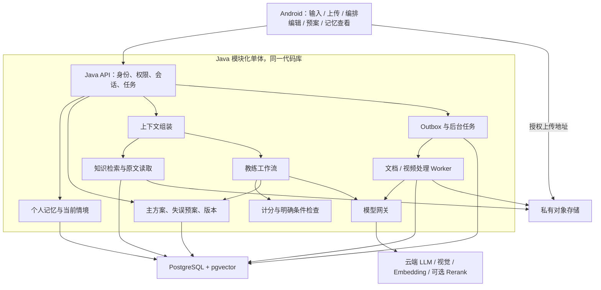
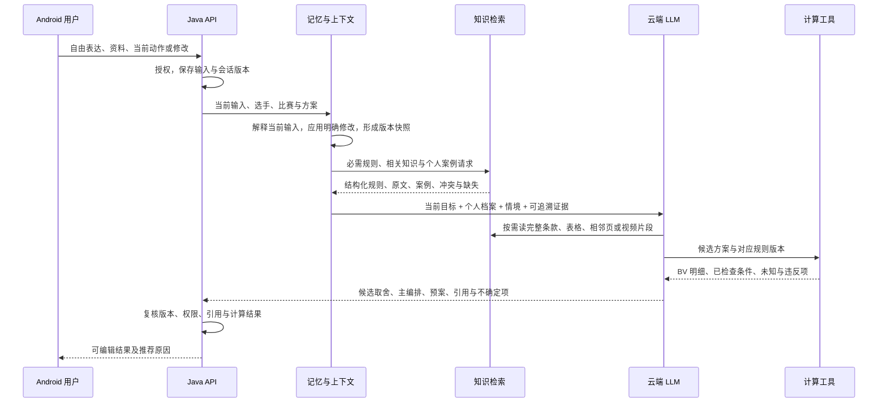

# Skating Lab 架构设计

版本：v0.1，2026-11-14。状态：供产品与技术审核的设计基线，尚未实现。

产品约束来自 [PRD v0.8](PRD.md)、手绘需求及后续讨论。本轮采用原生 Android、Java 服务端、云端 LLM、知识检索和个人长期记忆的路线。本文件定义模块边界与一次推荐的完整链路；重点设计分别见[个性化记忆](personal-memory-design.md)和[知识库与混合检索](knowledge-rag-design.md)。

## 1. 架构决策

| 部分 | 本轮采用的框架 | 选择理由与边界 |
| --- | --- | --- |
| 用户端 | Kotlin + Jetpack Compose 原生 Android | 输入、资料与视频上传、主编排编辑、预案、来源查看、个人记忆管理；推理、计分和检索都在服务端 |
| 应用服务 | Java + Spring Boot 模块化单体 | 同一代码库内分模块，先把授权、版本和业务事务做清楚，不引入微服务协调成本 |
| 模型接入 | Spring AI 适配层 + 必要的厂商 HTTP 适配器 | 云端文本、视觉、embedding、可选 rerank 分角色接入；业务层不绑定某个厂商的对话格式 |
| 事实与版本存储 | PostgreSQL | 个人记录、比赛规则、资料版本、主方案、预案和运行记录的权威数据源 |
| 检索 | PostgreSQL 精确查询、关键词检索 + pgvector 语义检索 | 核心事实直接读取；说明性知识与历史案例混合检索；小规模先采用精确向量检索 |
| 原始资料 | 私有对象存储 | 保存文件、原始页、视频及派生片段，数据库保存权限和定位信息 |
| 后台任务 | 数据库 outbox + 持久化任务表 + Java worker | 支持重试、进度、取消与幂等；API 和 worker 可从同一构建产物以不同角色启动 |
| 精确计算 | Java 计分与条件检查模块 | 核对动作、时点、BV 与已明确的规则；复杂局部搜索按验证结果再引入 |

当前不训练、不微调模型，不采购训练 GPU，不在手机部署模型。首版不依赖独立向量数据库、消息中间件、知识图谱服务或多 Agent 集群。依赖具体版本在连通性原型中锁定并记录，不能把“使用最新版本”当作兼容性方案。

Spring AI 提供聊天上下文、RAG 和工具调用组件，但不会自动实现本产品的长期档案、知识适用范围或授权策略。[RAG 文档](https://docs.spring.io/spring-ai/reference/api/retrieval-augmented-generation.html)、[工具调用文档](https://docs.spring.io/spring-ai/reference/api/tools.html)

## 2. 部署与模块框架

图中的模块是业务边界，不代表需要分别部署。首版可以在一台服务主机上运行 API 和 worker；数据库与对象存储按实际环境提供。模型请求不占用长数据库事务，视频处理不阻塞 API 请求线程。

| 模块 | 主要职责 | 不承担的职责 |
| --- | --- | --- |
| 身份与访问 `access` | 确定当前操作者、目标选手、资料可见性和授权版本 | 不让模型或客户端自报身份来绕过授权 |
| 输入与会话 `conversation` | 保存消息、编辑事件、附件关系和当前情境 | 不把全部聊天记录直接当作个人档案 |
| 个人记忆 `memory` | 提取个人陈述、管理事实版本与时效、构建档案、纠正与遗忘 | 不把推测或推荐自动升级为已掌握能力 |
| 知识管理 `knowledge` | 资料版本、解析、规则包、案例、来源关系和索引任务 | 不通过向量相似度决定规则效力 |
| 检索与上下文 `retrieval/context` | 按授权、赛季与情境选资料，混合召回、展开原文、组装证据 | 不让历史摘要盖过当前用户输入 |
| 教练工作流 `coach` | 理解目标、比较候选、必要时补检索、调用工具、解释取舍 | 不自行写入已确认个人事实、发布公共资料或执行任意代码 |
| 计分 `scoring` | 版本化规则下的逐动作 BV、时间条件、明确限制、差异说明 | 不用固定人工权重替代个人建议，不编造成功率 |
| 方案 `planning` | 主编排、实际失误前缀、补救方案、保存及修订 | 不修改已经实际发生的动作来提高预案分数 |
| 媒体 `media` | 上传、转码/抽帧、时间戳、云端观察与来源定位 | 不把一次视频观察直接当作稳定掌握证明 |
| 模型与任务 `gateway/jobs` | 调用适配、超时、限额、重试、去重、用量和进度 | 不把任务重试变成重复记忆或重复方案 |

首版一个账号默认对应自己的选手档案。数据上区分 `actor_id`（操作者）和 `athlete_id`（被描述的选手），避免未来教练参与时把两个人的记忆混在一起；首版不因此扩建完整教练组织系统。

## 3. 一次推荐的逻辑框架

一次普通推荐采用一个有明确步骤的编排工作流，允许模型按需调用工具。首版不让多个自治 Agent 互相讨论来承担核心逻辑。工具循环有内部时间与成本预算；预算不足时保留已经完成的工作、说明尚未解决的部分，并支持继续处理，不能要求用户把资料改成固定模板。

关键顺序如下：

1. **先接住原始输入。** 消息、图片、视频、文档和用户编辑都保存来源；同一客户端请求带幂等键，网络重试不重复创建。
2. **当前输入先于旧摘要。** 明确的选择和更正尽快写入当前投影；复杂表达由模型解释。解释尚未完成时，最新原话仍进入本次上下文，旧档案不能静默压过它。
3. **直接载入必要数据。** 当前可选动作、明确排除项、当前目标、疲劳情境、方案、比赛规则包不依赖语义召回。资料适用性有疑问时保留疑问，不拿相似比赛替代。
4. **检索相关材料并读原文。** 以动作、情境和待解决问题检索技术说明、例外条款和个人案例；需要时展开整节、完整表格、相邻页或整份短文档。
5. **LLM 比较，工具算数。** 模型提出适合个人的候选并说明取舍。计分模块返回可复核的计算结果和适用范围，不输出一个人为固定权重的“适合度总分”。
6. **产生可编辑产品结果。** 返回主编排、预案、BV、依据及仍有疑问的地方；界面保留原手绘的编辑主线，不变成只能聊天的机器人。
7. **保存运行依据。** 保存所用事实和来源版本、模型配置版本、计算明细与简洁理由；不存储或要求模型隐藏思维链。模型自身的推荐不会自动回流为事实。

## 4. 数据与上下文契约

本节是内部逻辑对象，不要求用户填写这些字段，也不要求第一版把每个对象单独建成一张表。

| 对象 | 核心内容 | 权威来源 |
| --- | --- | --- |
| `AthleteContext` | 当前动作选择、能力自述/观察、偏好、目标、时效、冲突、个人记录版本 | 个人记忆模块；来源和推断分开 |
| `RuleBundle` | 比赛/赛季/组别/节目、来源版本、修订关系、可执行规则、原文、未解决条款 | 知识管理；明示自定义规则形成私有覆盖层 |
| `EvidenceRef` | 来源类型、对象版本、消息片段/页码/表格/视频时间、可见性、证据类别 | 来源对象；引用 ID 必须由服务端解析 |
| `ContextEnvelope` | 授权主体、最新输入、会话版本、记忆版本、规则包版本、方案版本、证据、冲突与缺失 | 上下文组装器的短事务快照 |
| `PlanDraft` | 有顺序和计划执行时间的动作、主方案或预案类型、所用证据和版本 | 方案模块；与已经发生的动作区分 |
| `Evaluation` | BV 明细、已执行检查、违反项、尚不可判定项和计算规则版本 | Java 计算模块；模型不能直接修改数字 |
| `RecommendationRun` | 输入与上下文引用、产物、模型/提示/工具版本、耗时用量、状态 | 工作流；不复制无限份个人原文 |

`ContextEnvelope` 至少带有 `athlete_id`、`session_revision`、`memory_revision`、`rule_bundle_version`、`plan_revision`、`access_revision` 和 `privacy_epoch`。版本用于检测修改与撤回，不是让用户理解的一组产品字段。

生成过程中出现新的用户更正或方案编辑：旧结果可保留为过期草稿，但不能覆盖新版方案，界面显示需要按当前资料更新。若发生授权撤回或遗忘，涉及被撤回内容的在途结果不得发布或复用；已发送给云端的请求不能靠本地取消追溯收回，调用策略必须事先控制发送范围。

检索索引、摘要、缓存均为派生物。索引晚几秒更新不能使已纠正的个人事实继续成为当前事实。具体修订、删除和重试机制见两份专题设计。

## 5. 模型与工具的职责

| 模型角色 | 输入与输出 | 调用时机 |
| --- | --- | --- |
| 理解/记忆提取 | 自由表达及来源 → 有范围的陈述、疑问、候选修改 | 每次有实质新输入；明确 UI 操作可直接写入 |
| 教练推理 | 个人档案、当前情境、知识证据、计算结果 → 候选及取舍 | 生成、重排、情境改变或预案调整 |
| 文档/视觉理解 | 页面或视频片段 → 带定位的内容和观察 | 上传后后台处理，必要时进一步读取 |
| Embedding | 授权范围内的知识/案例文本 → 检索向量 | 入库、索引更新和查询 |
| Rerank（可选） | 已授权候选证据 → 相关性顺序 | 通过评测证明有增益后启用 |

这些是角色，可以由同一个云端模型承担，也可以由不同模型承担；不等于每轮必须连续调用五个模型。普通输入不进行无意义的多轮自我审查。模型选择通过花滑样例、稳定结构化输出、工具调用、时延、成本和数据处理条款验证，不凭通用排行榜决定。

首批工具边界：`get_athlete_context`、`search_knowledge`、`read_evidence`、`read_section`、`evaluate_plan`、`compare_plans`、`save_plan_draft`。`compare_plans` 提供动作、时间、计算结果和条件差异，不生成固定加权的个人排名。模型提出的个人记忆变化通过记忆模块处理；模型没有直接 SQL、任意代码执行、公共知识发布或跨选手读取工具。工具请求参数由服务端补齐授权范围并校验；输入格式修复由系统负责。[工具调用的应用执行边界](https://docs.spring.io/spring-ai/reference/api/tools.html)

计分中，后半程按比赛规定的时间阈值及动作资格计算；适用的 1.1 倍奖励不等于所有后置动作都乘 1.1。未知的动作时间不能用列表后一半冒充。概率、疲劳影响和预期兑现收益只有有依据时才量化，否则比较情景并明确依据。自定义新条款先保留原文与解释，再扩展相应处理；暂未完成可执行化的条款标为“尚不可机器核对”，继续提供条件化建议，不误报全部规则已验证。

## 6. Android 与服务接口

Android 页面延续产品主线：动作与偏好输入 → 比赛/自由资料 → 主编排编辑 → 失误预案 → 保存回看；增加可随时打开的“系统记住了什么”和建议来源查看。个人记忆管理不是开始使用前的必填表。

| 接口草案 | 行为 |
| --- | --- |
| `POST /athletes/{id}/sessions/{sid}/messages` | 收自由输入、关联附件，返回会话版本与处理任务 |
| `POST /athletes/{id}/assets` / `POST /assets/{id}/complete` | 获取授权上传地址、确认上传并启动解析 |
| `GET /jobs/{id}` / `GET /runs/{id}/events` | 任务进度与断线恢复；可用轮询或事件流 |
| `GET /athletes/{id}/memory` | 当前档案、来源、时效、待澄清内容和可编辑项 |
| `PATCH /athletes/{id}/memory/{item}` | 带预期版本的纠正/范围修改；过期编辑返回当前版本供合并 |
| `DELETE /athletes/{id}/memory/{item}` | 立即停止使用并启动关联派生内容清理，返回可查询的删除状态 |
| `POST /athletes/{id}/recommendations` | 在会话、比赛与方案版本下启动推荐，返回运行 ID |
| `PATCH /plans/{id}` / `POST /plans/{id}/recovery` | 编辑主方案并服务端重算；按实际失误前缀生成预案 |
| `GET /evidence/{ref}` | 校验当前授权后返回原文定位与允许展示的内容 |

客户端可以缓存页面草稿和已授权查看的结果，以便网络恢复后继续；它们不是档案和计分的权威来源。Android 不保存云端模型密钥。用户拖拽后展示的正式计分来自服务端；快速连续操作可以合并请求，响应必须绑定所编辑的方案版本，避免旧响应覆盖新顺序。

## 7. 故障与一致性

| 情况 | 处理方式 |
| --- | --- |
| 模型超时/服务不可用 | 保留输入和草稿，任务可重试；不把缺少推理包装成已完成建议 |
| Embedding 或 rerank 失败 | 使用精确查询、关键词和原文阅读继续；记录检索降级，不能漏掉必需规则 |
| 文档只有部分页可读 | 已读部分继续可用，按条款记录未解析区域；换 OCR/视觉路径重试，不让用户重填模板 |
| 资料很长 | 分段后台处理并保留进度，按当前问题优先读取；不把尚未读完等同于无相关规则 |
| 后台任务重试/乱序完成 | 根据来源版本、处理版本和任务幂等键写入；旧任务不得覆盖新修订 |
| 两台设备同时修改档案 | 乐观并发控制，保留两个输入并处理冲突；不按响应到达顺序静默覆盖 |
| 检索返回失效引用 | 回读权威记录校验，移除并补检索；不让模型看无权限或已遗忘内容 |
| 规则更新 | 已保存方案保留原计算版本并提示可重评；新方案按适用规则包计算 |

日志默认只记录对象 ID、版本、状态、耗时、用量和脱敏错误；不能通过全量 prompt 日志再复制一份不受遗忘机制管理的私人资料。调试样本必须进入相同访问与删除管理。模型网关对推理、embedding、rerank 分别执行最小必要数据发送；更换厂商不能自动扩大允许的数据接收方。

## 8. 实施顺序与审核标准

| 阶段 | 交付物 | 验证重点 |
| --- | --- | --- |
| 架构原型 | 少量真实规则资料、两位测试选手、云端模型接入、原文引用 | 是否读到正确规则，能否区分两位选手及当前输入 |
| 首版完整闭环 | Android 输入/编辑/预案/保存 + 个人记忆 + 自由资料理解 + 计分 | 个体能力、疲劳与自然输入贯穿闭环，不能最后再补 |
| 纠正与可靠性 | 档案查看/纠正/遗忘、版本更新、并发修改、任务重试 | 旧记录不复活、索引延迟不导致错误建议、删除及时生效 |
| 视频增强 | 云端视频观察、时间定位、用户/教练反馈 | 能否为建议补充可信证据；不能把视频标签准确率当教练效果 |

在同一模型及相同计算工具下，对比“无知识检索”“知识检索”“知识检索 + 个人记忆”，由懂花滑的人比较可执行性、偏好贴合、疲劳安排、补救质量和证据支持。记录延迟与成本分布，不在尚无样例时编造准确率或性能承诺。

当前仓库的 Python `backend`、`agent`、`ml` 与既有 SQL 是旧方案参考。本设计不声称它们已经实现上述链路；后续建立 Java 工程和迁移时逐项核对，尤其不能沿用“全部记忆必须人工确认后才可使用”的旧门禁。

优先审核的决策：明确自述可自动成为带来源的个人记录；短期状态不会自动永久化；规则和核心档案直接载入；历史案例与解释资料混合检索；复杂输入由系统理解；模型推测与真实训练结果始终区分。两份专题文档给出了对应数据结构、例子和验收场景。
