# 数据库设计文档 —— Skating Coach

| 项目 | 内容 |
| --- | --- |
| 目标数据库 | PostgreSQL 16 |
| 表数量 | 8 个业务域 / 32 张表 |
| 对应 DDL | [db/schema/001_schema.sql](../db/schema/001_schema.sql)（可执行） |
| 种子数据 | [db/schema/002_seed_minimal.sql](../db/schema/002_seed_minimal.sql)（最小示意数据） |
| 文档版本 | v0.1（与 PRD v0.1 配套） |

---

## 1. 设计原则与范式选择

### 1.1 基线与原则
1. **3NF 为基线**：所有业务事实表满足第三范式——非键属性只依赖键、不存在传递依赖；用于消除录入冗余与更新异常（这正是"数据库设计大赛"评审关注的基本功）。
2. **规则即数据**：ISU 评分规则（Base Value、GOE 参数、well-balanced 条款）全部建模为数据行而非代码常量；赛季更新 = 插入新版本行，历史方案按其绑定的规则集版本永远可复现。
3. **时间版本化**：能力类数据（统计、画像）采用"快照 + 时间戳"建模，不做物理更新，任何历史时点可回放。
4. **证据链可追溯**：从原始资产 → ML 任务 → 能力证据 → 统计 → 编排决策，全链路外键或多态引用可追溯。
5. **命名约定**：表/字段一律英文 `snake_case`；主键统一 `id BIGINT GENERATED ALWAYS AS IDENTITY`；时间统一 `TIMESTAMPTZ`；外键列以 `_id` 结尾；布尔以 `is_`/`has_` 开头。
6. **枚举策略**：稳定且面向存储层校验的状态用 `TEXT + CHECK`（相对 PG ENUM 更易演进），同时以通用字典表 `dict_entry` 支撑界面展示与国际化。**不使用** PostgreSQL 原生 ENUM 类型的决策理由：修改枚举值需要专用 DDL 且无法回收，CHECK 约束可随迁移脚本平滑演进。

### 1.2 受控反范式（逐条理由）

| 位置 | 反范式做法 | 理由 |
| --- | --- | --- |
| `program_element_item.planned_base_value / est_goe / est_success_prob` | 冗余生成时点的 BV 与估计值 | 方案必须**冻结生成时点的分值与能力估计**，即使后续规则/能力更新，历史方案拆解不变（可复现性优先） |
| `program_score_breakdown.*` | 汇总行与明细并存 | 对比页高频读汇总，避免每次聚合 12 行以上明细 + 约束表 |
| `asset.meta` (JSONB) | 非规范化多模态元数据 | 不同 asset_type 元数据结构差异大，JSONB 避免稀疏列；查询高频字段仍提为普通列 |
| `skater_competition_result.total_score` | 生成列（tes + pcs − deduction） | 由数据库保证一致性，非人工维护 |

除以上清单外，其余表均保持 3NF。

---

## 2. 概念模型（ER 图）

> 关系标注：`||` 恰好一个，`o|` 零或一个，`}o` / `o{` 零或多。主要属性见逻辑模型章节，图中仅列关键属性。

```mermaid
erDiagram
    APP_USER ||--o| SKATER_PROFILE : "扩展为选手"
    APP_USER ||--o{ COACH_SKATER : "担任教练"
    SKATER_PROFILE ||--o{ COACH_SKATER : "被指导"
    SKATER_PROFILE ||--o{ BODY_MEASUREMENT : "身体测量"
    SKATER_PROFILE ||--o{ TRAINING_LOAD : "训练负荷"
    SKATER_PROFILE ||--o{ INJURY_RECORD : "伤病记录"
    SKATER_PROFILE ||--o{ ASSET : "拥有资产"
    APP_USER ||--o{ ASSET : "上传"
    ASSET ||--o{ ASSET_ANNOTATION : "被标注"
    ASSET ||--o{ ML_TASK : "被分析"
    ML_TASK ||--o| ML_TASK_RESULT : "产出结果"
    ML_TASK ||--o{ POSE_FRAME_FEATURE : "逐帧特征"
    SKATER_PROFILE ||--o{ ELEMENT_ATTEMPT_LOG : "试做日志"
    ELEMENT ||--o{ ELEMENT_ATTEMPT_LOG : "被试做"
    ELEMENT_ATTEMPT_LOG }o--o| ASSET : "来源视频"
    SKATER_PROFILE ||--o{ ELEMENT_SKILL_STAT : "元素统计"
    ELEMENT ||--o{ ELEMENT_SKILL_STAT : "统计对象"
    SKATER_PROFILE ||--o{ CAPABILITY_SNAPSHOT : "能力快照"
    SKATER_PROFILE ||--o{ CAPABILITY_EVIDENCE : "能力证据"
    ELEMENT ||--o{ CAPABILITY_EVIDENCE : "关联元素"
    ELEMENT_CATEGORY ||--o{ ELEMENT : "归类"
    RULESET_VERSION ||--o{ ELEMENT_LEVEL_VALUE : "定价"
    ELEMENT ||--o{ ELEMENT_LEVEL_VALUE : "基础分"
    RULESET_VERSION ||--o{ RULESET_PARAMETER : "参数"
    RULESET_VERSION ||--o{ WELL_BALANCED_RULE : "条款"
    PROGRAM_TYPE ||--o{ WELL_BALANCED_RULE : "适用节目"
    ELEMENT_CATEGORY ||--o{ WELL_BALANCED_RULE : "目标类别"
    ELEMENT ||--o{ WELL_BALANCED_RULE : "目标元素"
    RULESET_VERSION ||--o{ COMPETITION : "被采用"
    COMPETITION ||--o{ COMPETITION_CATEGORY : "下设组别"
    PROGRAM_TYPE ||--o{ COMPETITION_CATEGORY : "滑何种节目"
    COMPETITION_CATEGORY ||--o{ SKATER_COMPETITION_RESULT : "产生成绩"
    SKATER_PROFILE ||--o{ SKATER_COMPETITION_RESULT : "取得成绩"
    SKATER_PROFILE ||--o{ PROGRAM_PLAN : "生成方案"
    COMPETITION_CATEGORY ||--o{ PROGRAM_PLAN : "面向赛事"
    PROGRAM_TYPE ||--o{ PROGRAM_PLAN : "节目类型"
    RULESET_VERSION ||--o{ PROGRAM_PLAN : "依据规则"
    PROGRAM_PLAN ||--o{ PROGRAM_PLAN : "版本链(parent)"
    PROGRAM_PLAN ||--o{ PROGRAM_ELEMENT_ITEM : "元素序列"
    ELEMENT ||--o{ PROGRAM_ELEMENT_ITEM : "被选用"
    PROGRAM_PLAN ||--o| PROGRAM_SCORE_BREAKDOWN : "得分拆解"
    PROGRAM_PLAN ||--o{ PROGRAM_CONSTRAINT_CHECK : "约束检查"
    WELL_BALANCED_RULE ||--o{ PROGRAM_CONSTRAINT_CHECK : "对应条款"
    APP_USER ||--o{ AUDIT_LOG : "操作留痕"

    SKATER_PROFILE {
        bigint id PK
        bigint user_id FK "可空唯一"
        text full_name
        date birth_date
        text discipline
    }
    ELEMENT {
        bigint id PK
        text code UK "如 3A / FSSp / StSq"
        bigint category_id FK
        smallint jump_rotations "仅跳跃非空"
    }
    RULESET_VERSION {
        bigint id PK
        text season_code "如 2026-27"
        text discipline
        text status
    }
    ELEMENT_LEVEL_VALUE {
        bigint id PK
        bigint ruleset_version_id FK
        bigint element_id FK
        text level_code "N/B/1/2/3/4"
        numeric base_value
    }
    WELL_BALANCED_RULE {
        bigint id PK
        bigint ruleset_version_id FK
        bigint program_type_id FK
        text rule_key
        text constraint_kind
        smallint min_count
        smallint max_count
    }
    ASSET {
        bigint id PK
        bigint skater_id FK "可空"
        text asset_type
        text storage_key UK
        jsonb meta
    }
    ML_TASK {
        bigint id PK
        bigint asset_id FK
        text task_type
        text status
    }
    CAPABILITY_EVIDENCE {
        bigint id PK
        bigint skater_id FK
        text source_type "多态来源"
        bigint source_id "不设外键"
        text metric_key
        numeric metric_value
    }
    PROGRAM_PLAN {
        bigint id PK
        bigint skater_id FK
        bigint ruleset_version_id FK
        int version_no
        bigint parent_plan_id FK "版本链"
    }
    PROGRAM_ELEMENT_ITEM {
        bigint id PK
        bigint plan_id FK
        smallint seq_no "槽位"
        smallint combo_index "联合跳第几跳"
        numeric est_score
    }
```



---

## 3. 逻辑模型：完整表清单

### 域 A：身份与权限

#### A1. `role` 角色字典
- 用途：系统角色（admin/coach/skater/medic/viewer）。
- 主键：`id`。重要字段：`code`（UNIQUE）、`name_zh`、`description`。
- 约束/索引：`code` 唯一；预置行 `is_system = true` 禁止删除（应用层）。

#### A2. `app_user` 应用用户
- 用途：所有登录主体（教练、队医、管理员；选手可选关联账号）。
- 主键：`id`；外键：`role_id → role.id`。
- 重要字段：`username`（UNIQUE）、`password_hash`、`display_name`、`email`（UNIQUE）、`status`、`last_login_at`。
- 约束：`status IN ('active','disabled')`；触发器维护 `updated_at`。
- 索引：`role_id`；唯一索引 `username`、`email`。

#### A3. `coach_skater` 教练-选手关系（纯关联表）
- 用途：多对多指导关系（含时间段）。
- 主键：复合 `(coach_user_id, skater_id)`；外键 → `app_user`、`skater_profile`。
- 约束：`ended_at IS NULL OR ended_at >= started_at`。

### 域 B：选手健康与训练

#### B1. `skater_profile` 选手档案
- 用途：选手核心档案（1:0..1 关联登录账号，便于"无账号先建档"）。
- 主键：`id`；外键：`user_id → app_user.id`（UNIQUE、可空）。
- 重要字段：`full_name`、`gender`、`birth_date`、`height_cm`、`weight_kg`、`dominant_side`、`club_name`、`current_category`（novice/junior/senior，字典）、`primary_discipline`、`notes`。
- 约束：身高/体重 CHECK 合理区间；`gender IN ('F','M','X')`；`current_category IN (...)`。
- 设计说明：**不放** `photo_asset_id`（避免与 `asset.skater_id` 形成循环外键），头像照片由 `asset.purpose='profile_photo'` 表达。
- 索引：`user_id` 唯一；`current_category`。

#### B2. `body_measurement` 身体测量（时序）
- 外键：`skater_id`。字段：`measured_at TIMESTAMPTZ`、`height_cm`、`weight_kg`、`body_fat_pct`、`resting_hr`、`jump_reach_cm`、`flexibility_score(0-100)`、`notes`。
- 约束：`UNIQUE(skater_id, measured_at)`。索引：`(skater_id, measured_at DESC)`。

#### B3. `training_load` 训练负荷（日粒度）
- 字段：`train_date`、`duration_min`、`intensity(1-10)`、`fatigue_score(0-10)`、`soreness_score(0-10)`、`notes`。
- 约束：`UNIQUE(skater_id, train_date)`；各分值 CHECK 区间。

#### B4. `injury_record` 伤病记录
- 用途：伤病事实 + 编排风险标签来源。
- 字段：`body_part_code`（字典 body_part）、`injury_type_code`（字典 injury_type）、`severity('mild','moderate','severe')`、`occurred_on`、`recovered_on`、`status('active','recovering','recovered')`、`risk_tags TEXT[]`（如 `{avoid_layback, limit_quads_late}`，直接被优化器消费）、`medical_notes`、`recorded_by → app_user`。
- 约束：状态与恢复日期一致性 CHECK（recovered ⇒ recovered_on 非空，反之亦然）。
- 索引：`(skater_id, status)`。

### 域 C：ISU 规则域（规则数据化核心）

#### C1. `element_category` 元素类别
- 预置：`jump` / `spin` / `step` / `choreo`。字段：`code`(UNIQUE)、`name_zh`、`sort_order`。

#### C2. `element` 动作元素字典
- 用途：全部可选技术动作。跳跃含周数（如 3A）；旋转/步伐不含级别（级别在 C3 定价表展开，如 `FSSp` × level 4）。
- 重要字段：`code`(UNIQUE，如 `3Lz`/`FSSp`/`StSq`/`ChSq`)、`name_en`、`name_zh`、`category_id FK`、`jump_rotations(1-4，仅跳跃非空)`、`has_flying`、`has_change_foot`、`is_combinable`（能否进入联合跳）、`is_active`、`description`。
- 跨表业务规则（如"jump 类必须提供 jump_rotations"）由**触发器/应用层**保证——见 §5 约束分工。

#### C3. `element_level_value` 基础分定价表
- 用途：元素 × 级别 × 赛季规则集 → Base Value。级别域 `('N','B','1','2','3','4')`：跳跃恒为 `N`（不分级），旋转/步伐为 `B`/`1`~`4`。
- 外键：`ruleset_version_id`、`element_id`。
- 约束：`UNIQUE(ruleset_version_id, element_id, level_code)`；`base_value >= 0`。
- 索引：`element_id`；`(ruleset_version_id, level_code)`。

#### C4. `ruleset_version` 规则集版本
- 用途：一个赛季 × 项目的规则宇宙（版本化的锚点）。
- 字段：`season_code`（如 `2026-27`）、`discipline('singles','pairs','ice_dance')`、`name`、`isu_communication_no`、`effective_from/to`、`source_url`、`status('draft','active','retired')`。
- 约束：`UNIQUE(season_code, discipline)`；同一 `(discipline)` 至多一个 `active`（应用层/部分唯一索引 `CREATE UNIQUE INDEX ... WHERE status='active'`）。

#### C5. `ruleset_parameter` 规则参数
- 用途：GOE 每级比例、PCS 因子、跌倒扣分、节目时长等键值参数；`program_type_id` 可空表示对 SP/FS 通用。
- 约束：`UNIQUE NULLS NOT DISTINCT (ruleset_version_id, program_type_id, param_key)`（PG15+ 特性，防止"通用参数"重复插入）。

#### C6. `program_type` 节目类型
- 预置：`SP`（短节目）、`FS`（自由滑）。字段：`code`(UNIQUE)、`name_zh`、`discipline`、`duration_min_sec/max_sec`（参考值，细分组别时长以 `ruleset_parameter` 或赛事规程为准）。

#### C7. `well_balanced_rule` 均衡节目条款（结构规则数据化）
- 用途：把 well-balanced 的每条限制表达为一行数据，优化器直接消费生成约束。
- 重要字段：`rule_key`（机器可读，如 `element_total` / `jump_element` / `combo_jump` / `triple_combo` / `same_jump_repeat` / `spin_type_min` / `step_seq_required`）、`constraint_kind('count_min','count_max','required','forbidden','value')`、`target_category_id → element_category`（可空）、`target_element_id → element`（可空，用于"SP 必含 2A"这类条款）、`skater_category`（可空=通用）、`min_count` / `max_count`、`penalty_note`（不满足时的后果描述，入约束检查报告）。
- 约束：`UNIQUE NULLS NOT DISTINCT (ruleset_version_id, program_type_id, skater_category, rule_key)`；`(constraint_kind='required' ⇒ min_count IS NOT NULL)` 之类的形态校验由应用层完成。
- 索引：`(ruleset_version_id, program_type_id)`。

### 域 D：赛事域

#### D1. `competition` 赛事
- 字段：`name`、`level('school','city','provincial','national','international')`、`start/end_date`、`location`、`organizer`、`ruleset_version_id FK`、`status('planned','ongoing','finished')`。
- 约束：`end_date >= start_date`。

#### D2. `competition_category` 赛事组别
- 用途：一次赛事的竞赛单元（如"成年组女子单人自由滑"），是编排任务的瞄准目标。
- 外键：`competition_id`、`program_type_id`。约束：`UNIQUE(competition_id, name)`。

#### D3. `skater_competition_result` 比赛成绩
- 外键：`competition_category_id`、`skater_id`。字段：`tes`、`pcs`、`deduction`、`total_score`（**生成列** `tes + pcs - deduction`）、`rank`、`detail JSONB`。
- 约束：`UNIQUE(competition_category_id, skater_id)`；`rank >= 1`。

### 域 E：能力域（时间版本化 + 证据链）

#### E1. `element_attempt_log` 元素试做日志（原始事实）
- 用途：一次可观测的动作尝试（训练/测试/比赛），是统计的原始数据。
- 外键：`skater_id`、`element_id`、`video_asset_id → asset`（可空，追溯来源）。
- 字段：`level_code`、`attempted_at`、`context('training','test','competition')`、`is_success`、`goe`、`quality_score(0-10)`、`position_in_program(1-20)`（供位置衰减建模）、`fatigue_before(0-10)`、`notes`。
- 索引：`(skater_id, element_id, attempted_at DESC)`；`video_asset_id`。

#### E2. `element_skill_stat` 元素统计快照（时间版本化）
- 用途：按窗口聚合的能力统计——优化器的直接输入。
- 字段：`stat_window('recent_30d','recent_90d','all_time')`、`attempt_count`、`success_rate(0-1)`、`avg_goe`、`std_goe`（稳定性/"抖动"）、`avg_quality`、`computed_at`。
- 约束：`UNIQUE(skater_id, element_id, level_code, stat_window, computed_at)`——同一快照时点不重复；历史快照永不 UPDATE（追加式）。
- 索引：`(skater_id, element_id, stat_window, computed_at DESC)`。

#### E3. `capability_snapshot` 能力画像快照
- 用途：选手级综合画像（决策摘要），同样时间版本化。
- 字段：`jump_consistency`、`max_jump_rotations`、`spin_quality`、`step_quality`、`stamina`、`flexibility`、`artistry_baseline`（各 0-10）、`injury_risk_level('low','medium','high')`、`risk_tags TEXT[]`、`model_version`、`source_summary JSONB`、`snapshot_at`。
- 约束：`UNIQUE(skater_id, snapshot_at)`。

#### E4. `capability_evidence` 能力证据（多态来源，追溯链起点）
- 用途：把"某个结论/测量"绑定到来源（ML 任务、资产、人工、表单、比赛成绩）。
- 字段：`source_type('ml_task','asset','manual','form','competition_result')`、`source_id`（**多态引用，不设外键**，理由与补偿见 §5）、`element_id`（可空）、`metric_key`（如 `air_time`、`spin_speed`、`self_report_success`）、`metric_value`、`unit`、`confidence(0-1)`、`captured_at`。
- 约束：`confidence BETWEEN 0 AND 1`。索引：`(skater_id, metric_key, captured_at DESC)`；`(source_type, source_id)`。

### 域 F：资产与 ML 域

#### F1. `asset` 多模态资产
- 用途：视频/图片/文档/文本的元数据登记（文件本体在对象存储）。
- 外键：`skater_id`（可空，团队级资产）、`uploaded_by → app_user`。
- 字段：`asset_type('video','image','document','text')`、`storage_key`（对象存储键，UNIQUE）、`original_filename`、`mime_type`、`size_bytes`、`duration_sec`、`captured_at`、`sha256 CHAR(64)`（去重/完整性）、`purpose`（如 `training`/`competition`/`profile_photo`/`intake_form`）、`meta JSONB`、`deleted_at`（软删除）。
- 索引：`(skater_id, asset_type)`；部分索引 `WHERE deleted_at IS NULL`；`sha256`（查重）。

#### F2. `asset_annotation` 资产标注
- 用途：人工/半自动标注：时间段元素标签、关键点、文本备注。
- 外键：`asset_id`、`annotator_id → app_user`（可空=系统生成）、`element_id`（可空）。
- 字段：`annotation_type('time_span','element_tag','keypoint_set','text_note')`、`t_start`/`t_end`（秒）、`payload JSONB`。
- 约束：`t_end IS NULL OR t_start IS NULL OR t_end >= t_start`。

#### F3. `ml_task` 机器学习任务
- 用途：异步分析任务（姿态估计、特征抽取等）的状态机。
- 外键：`asset_id`（可空）、`submitted_by → app_user`。
- 字段：`task_type('pose_estimation','feature_extraction','capability_eval')`、`status('pending','running','succeeded','failed','cancelled')`、`algorithm`、`algorithm_version`、`params JSONB`、`started_at`、`finished_at`、`error`。
- 约束：`finished_at IS NULL OR started_at IS NULL OR finished_at >= started_at`。
- 索引：部分索引 `WHERE status IN ('pending','running')`（队列轮询）；`asset_id`。

#### F4. `ml_task_result` 任务结果
- 外键：`task_id`（UNIQUE，1:1）。字段：`summary JSONB`（结构化摘要，直接可查询）、`artifact_key`（原始大结果文件的对象存储键，可空）、`created_at`。

#### F5. `pose_frame_feature` 逐帧姿态特征（大表，可分区）
- 用途：逐帧关键点（MVP 以 JSONB 存 33 关键点；生产建议按 `task_id` 范围分区或下沉对象存储 Parquet，库内留摘要）。
- 外键：`task_id`。字段：`frame_ts NUMERIC(10,3)`、`keypoints JSONB`、`quality(0-1)`。
- 约束：`UNIQUE(task_id, frame_ts)`。

### 域 G：编排域（系统输出）

#### G1. `program_plan` 编排方案（版本链根）
- 用途：一次"面向某赛事组别/节目类型"的完整方案（版本化）。
- 外键：`skater_id`、`competition_category_id`（可空=训练方案）、`program_type_id`、`ruleset_version_id`（**冻结**生成时规则集）、`parent_plan_id`（自引用：教练微调/重新生成形成链）、`created_by → app_user`。
- 字段：`version_no`、`origin('solver','manual','hybrid')`、`status('draft','generated','coach_review','finalized','archived')`、`solver_config JSONB`（风险系数 λ、窗口选择、时间限制等，保证可复现）、`objective_value`、`est_total_score`、`risk_score`、`notes`。
- 约束：`UNIQUE NULLS NOT DISTINCT (skater_id, competition_category_id, program_type_id, version_no)`。

#### G2. `program_element_item` 方案元素序列
- 用途：方案内元素明细。**槽位建模**：`seq_no` = 节目中的元素槽位（1..P），联合跳占一个槽位，`combo_index`(1..3) 区分联合跳内第几跳。
- 外键：`plan_id`（ON DELETE CASCADE）、`element_id`。
- 冗余冻结字段（理由见 §1.2）：`planned_base_value`、`est_success_prob`、`est_goe`、`est_score`、`risk_penalty`。
- 约束：`UNIQUE(plan_id, seq_no, combo_index)`；`seq_no BETWEEN 1 AND 20`；概率/分值 CHECK 区间；`is_alternate`（是否替补建议）。

#### G3. `program_score_breakdown` 得分拆解（1:1）
- 字段：`tes_base_total`、`tes_goe_expected`、`tes_expected`、`pcs_expected`、`pcs_components JSONB`（三分项，建议键名 `composition` / `presentation` / `skating_skills`，对应 2022/23 赛季起 ISU 精简为三项的构成；JSONB 可随未来规则再变而无需改表结构）、`deduction_expected`、`total_expected`、`engine_version`、`computed_at`。
- 外键：`plan_id` UNIQUE CASCADE。

#### G4. `program_constraint_check` 约束检查结果
- 用途：方案 vs 规则条款的逐条校验报告（可解释性核心证据）。
- 外键：`plan_id` CASCADE；`well_balanced_rule_id`（可空——节目时长等临时检查无条款行）。
- 字段：`check_key`、`status('pass','warn','violation')`、`detail JSONB`、`checked_at`。
- 索引：`(plan_id, checked_at DESC)`（同一方案可能多次复检，取最新一批）。

### 域 H：支撑域

#### H1. `dict_entry` 通用字典
- 用途：body_part、injury_type、age_category、metric_unit 等界面字典。
- 字段：`dict_code`、`item_code`、`label_zh`、`label_en`、`sort_order`、`is_active`。约束：`UNIQUE(dict_code, item_code)`。

#### H2. `audit_log` 审计日志（追加式）
- 用途：关键实体变更与敏感操作留痕（谁在何时把方案从 draft 改成 finalized）。
- 字段：`actor_user_id`（可空=系统）、`entity_type` + `entity_id`（多态，同 E4 说明）、`action('create','update','delete','login','generate','export')`、`old_value` / `new_value` JSONB、`ip INET`、`created_at`。
- 索引：`(entity_type, entity_id, created_at DESC)`；`(actor_user_id, created_at DESC)`；按月分区（BRANGE）为生产建议，MVP 单表。

---

## 4. 完整性约束与业务规则的落地分工

| # | 规则 | 落地层 | 具体实现 |
| --- | --- | --- | --- |
| 1 | 值域校验（成功率 0-1、等级枚举、日期序） | **数据库 CHECK** | 32 张表共 40+ 条 CHECK |
| 2 | 唯一性（资产存储键、规则集内定价唯一、方案版本唯一、窗口快照唯一） | **数据库 UNIQUE（含 NULLS NOT DISTINCT）** | 见 §3 各表 |
| 3 | 参照完整性 | **数据库 FK** | 全部显式命名 `fk_` 前缀；编排明细对方案 ON DELETE CASCADE，其余 RESTRICT |
| 4 | 派生一致性（成绩总分） | **数据库生成列** | `total_score GENERATED ALWAYS AS (...) STORED` |
| 5 | 派生时间戳 | **数据库触发器** | `set_updated_at()` 统一触发器函数 |
| 6 | 跨表形态规则（jump 元素必有 jump_rotations；recovered 状态必有恢复日期） | **触发器或应用层** | 录入频率低、逻辑跨表，选触发器（示例）或服务层校验并写审计 |
| 7 | "同一 discipline 至多一个 active 规则集" | **部分唯一索引** | `CREATE UNIQUE INDEX ... ON ruleset_version(discipline) WHERE status='active'` |
| 8 | 复杂业务校验（方案满足 well-balanced） | **应用层（求解器保证 + 事后复检）** | 结果落 `program_constraint_check`，双重留痕 |
| 9 | 多态引用完整性（capability_evidence / audit_log 的 source） | **应用层** | 不设 FK 的理由：一列多目标表无法声明；补偿：`(source_type, source_id)` 组合校验服务 + 定期孤儿检测查询 |
| 10 | 审计日志只增不改 | **权限层** | `REVOKE UPDATE, DELETE ON audit_log FROM app_role`（演示环境演示该项） |

---

## 5. 示例查询（支撑核心场景）

> 以下 SQL 可直接在种子库上演示（部分 id 为示意值）。

**Q1 按选手能力筛选候选元素并计算期望价值（优化器候选集的库端原型）**
```sql
SELECT e.code,
       els.level_code,
       els.base_value,
       st.success_rate,
       st.avg_goe,
       ROUND(els.base_value + st.avg_goe, 2)                  AS expected_value,
       st.attempt_count
FROM   element_skill_stat st
JOIN   element e              ON e.id = st.element_id
JOIN   element_level_value els ON els.element_id = st.element_id
                           AND els.level_code = st.level_code
                           AND els.ruleset_version_id = (SELECT id FROM ruleset_version
                                                          WHERE discipline='singles' AND status='active' LIMIT 1)
WHERE  st.skater_id = 42
AND    st.stat_window = 'recent_90d'
AND    st.attempt_count >= 10
AND    st.success_rate >= 0.70
AND    e.category_id = (SELECT id FROM element_category WHERE code='jump')
ORDER  BY expected_value DESC;
```

**Q2 计算某方案的期望 TES 与总分（含得分拆解）**
```sql
SELECT i.seq_no, i.combo_index, e.code AS element, i.level_code,
       i.planned_base_value, i.est_goe, i.est_success_prob, i.est_score
FROM   program_element_item i
JOIN   element e ON e.id = i.element_id
WHERE  i.plan_id = 101 AND i.is_alternate = FALSE
ORDER  BY i.seq_no, i.combo_index;

SELECT tes_expected, pcs_expected, deduction_expected, total_expected
FROM   program_score_breakdown WHERE plan_id = 101;
```

**Q3 对比同一选手的多套方案（总分、风险、违规数一览）**
```sql
SELECT p.id, p.version_no, p.origin, p.status,
       b.tes_expected, b.pcs_expected, b.total_expected,
       p.risk_score,
       COUNT(c.id) FILTER (WHERE c.status = 'violation') AS violations,
       COUNT(c.id) FILTER (WHERE c.status = 'pass')      AS passed_checks
FROM   program_plan p
LEFT   JOIN program_score_breakdown  b ON b.plan_id = p.id
LEFT   JOIN program_constraint_check c ON c.plan_id = p.id
WHERE  p.skater_id = 42 AND p.program_type_id = 2
GROUP  BY p.id, b.tes_expected, b.pcs_expected, b.total_expected
ORDER  BY b.total_expected DESC;
```

**Q4 追溯：某段视频的抽取特征如何进入能力统计（证据链演示）**
```sql
SELECT ce.metric_key, ce.metric_value, ce.unit, ce.confidence,
       e.code  AS element_code,
       st.success_rate, st.avg_goe                 -- 优化器实际消费的统计
FROM   capability_evidence ce
LEFT   JOIN element e ON e.id = ce.element_id
LEFT   JOIN element_skill_stat st
         ON st.skater_id = ce.skater_id
        AND st.element_id = ce.element_id
        AND st.stat_window = 'recent_90d'
        AND st.computed_at = (SELECT MAX(computed_at) FROM element_skill_stat s2
                               WHERE s2.skater_id = ce.skater_id
                                 AND s2.element_id = ce.element_id
                                 AND s2.stat_window = 'recent_90d')
WHERE  ce.skater_id = 42
AND    ce.source_type = 'ml_task'
AND    ce.source_id IN (SELECT id FROM ml_task WHERE asset_id = 9001)
ORDER  BY ce.captured_at DESC;
```

**Q5 展示"规则即数据"：读取某赛季全部 well-balanced 条款**
```sql
SELECT pt.code AS program, w.skater_category, w.rule_key, w.constraint_kind,
       w.min_count, w.max_count,
       ec.code AS target_category, e.code AS target_element, w.penalty_note
FROM   well_balanced_rule w
JOIN   ruleset_version rv ON rv.id = w.ruleset_version_id
JOIN   program_type pt     ON pt.id = w.program_type_id
LEFT   JOIN element_category ec ON ec.id = w.target_category_id
LEFT   JOIN element e          ON e.id  = w.target_element_id
WHERE  rv.season_code = '2026-27' AND rv.discipline = 'singles' AND rv.status = 'active'
ORDER  BY pt.code, w.rule_key;
```

**Q6 选手近 90 天各元素成功率趋势（能力画像的时间维度）**
```sql
SELECT date_trunc('month', l.attempted_at) AS month,
       e.code,
       COUNT(*)                                                AS attempts,
       ROUND(AVG(CASE WHEN l.is_success THEN 1.0 ELSE 0.0 END), 3) AS success_rate,
       ROUND(AVG(l.goe), 2)                                    AS avg_goe
FROM   element_attempt_log l
JOIN   element e ON e.id = l.element_id
WHERE  l.skater_id = 42
AND    l.attempted_at >= now() - INTERVAL '90 days'
GROUP  BY 1, 2
ORDER  BY 1, 2;
```

---

## 6. 物理设计与运维要点（简述）

- **索引策略**：所有外键列建立索引（PostgreSQL 不自动索引 FK）；时序表按 `(主体, 时间 DESC)` 复合索引；队列/软删除用部分索引。
- **大表治理**：`pose_frame_feature`、`audit_log`、`element_attempt_log` 为预期 Top3 大表——生产建议按时间/任务范围分区（声明式分区），原始关键点数据下沉对象存储，库内只留摘要（MVP 不分区，设计预留）。
- **JSONB 使用边界**：仅用于"同一列结构异构"的场景（多模态 meta、求解器配置、检查明细），可作为整体读出；一切需要 WHERE 过滤/聚合的字段一律提升为普通列。
- **备份与演示**：演示库用 Docker 卷快照；正式环境每日 `pg_dump` + 对象存储归档。

## 7. 与 db/schema/ 的对应关系

- [db/schema/001_schema.sql](../db/schema/001_schema.sql)：本文全部 32 张表的可执行 DDL（含约束、索引、COMMENT ON 与 `set_updated_at` 触发器），按域分节，与本文表名一一对应。
- [db/schema/002_seed_minimal.sql](../db/schema/002_seed_minimal.sql)：最小种子数据（角色、类别、元素字典、示意规则集、示意条款）。**其中分值与数量限制为演示示意值，正式数据以当季 ISU 通讯双人核对录入为准。**
- 后续演进：开发期以 Alembic 迁移管理增量变更，`db/schema/` 保持"当前全量快照"角色。
