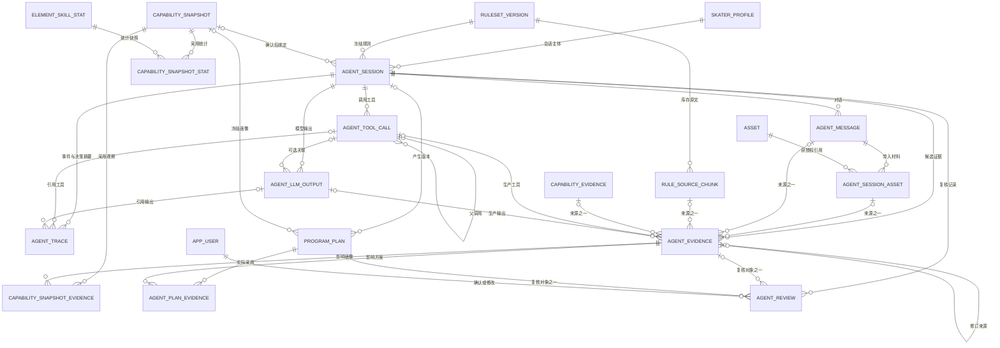

# 数据库设计文档 —— Skating Coach

| 项目 | 内容 |
| --- | --- |
| 目标数据库 | PostgreSQL 16 |
| 表数量 | 9 个业务域 / 44 张表（保留既有八域三十二表） |
| 对应 DDL | [db/schema/001_schema.sql](../db/schema/001_schema.sql) 与 [003_agent_schema.sql](../db/schema/003_agent_schema.sql)（合并构成全量结构） |
| 种子数据 | [db/schema/002_seed_minimal.sql](../db/schema/002_seed_minimal.sql) 与 [004_seed_agent_demo.sql](../db/schema/004_seed_agent_demo.sql)（可选合成血缘示例） |
| 文档版本 | v0.2（总体架构见 technical-design.md） |

---

## 1. 设计原则与范式选择

### 1.1 基线与原则
1. **3NF 为基线**：关系型核心以第三范式组织——实体属性依赖其键，关联事实单独建表；用于消除录入冗余与更新异常（这正是"数据库设计大赛"评审关注的基本功）。
2. **规则即数据**：已覆盖的基础分、参数和结构条款建模为数据行，绑定规则版本；新条款语义仍可能需要扩展编译器。历史重放依赖规则发布后不可变及输入快照保留策略，不能仅靠一个外键实现。
3. **时间版本化**：能力统计与画像采用快照和时间戳；追加式维护是应用及权限层约定，数据库并未自动禁止更新。历史复盘使用方案实际绑定的快照。
4. **证据链可追溯**：既有资产、ML、能力域继续保留；新增会话输入、工具、模型输出、人工确认、实际采用证据和画像统计关联，明确区分观察记录与方案实际输入。
5. **命名约定**：表/字段一律英文 `snake_case`；实体主键使用 `id BIGINT GENERATED ALWAYS AS IDENTITY`，纯关联表使用复合主键；事件时间使用 `TIMESTAMPTZ`，生日、训练日期等使用 `DATE`；外键列以 `_id` 结尾；布尔以 `is_`/`has_` 开头。
6. **枚举策略**：稳定且面向存储层校验的状态用 `TEXT + CHECK`（相对 PG ENUM 更易演进），同时以通用字典表 `dict_entry` 支撑界面展示与国际化。**不使用** PostgreSQL 原生 ENUM 类型的决策理由：修改枚举值需要专用 DDL 且无法回收，CHECK 约束可随迁移脚本平滑演进。

### 1.2 受控反范式（逐条理由）

| 位置 | 反范式做法 | 理由 |
| --- | --- | --- |
| `program_element_item.planned_base_value / est_goe / est_success_prob` | 冗余生成时点的 BV 与估计值 | 方案必须**冻结生成时点的分值与能力估计**，即使后续规则/能力更新，历史方案拆解不变（可复现性优先） |
| `program_score_breakdown.*` | 汇总行与明细并存 | 对比页高频读汇总，避免每次重复聚合元素明细与约束报告 |
| `asset.meta` (JSONB) | 非规范化多模态元数据 | 不同 asset_type 元数据结构差异大，JSONB 避免稀疏列；查询高频字段仍提为普通列 |
| `skater_competition_result.total_score` | 生成列（tes + pcs − deduction） | 由数据库保证一致性，非人工维护 |

新增 `agent_llm_output.structured_output`、工具输入输出和会话快照属于外部事件载荷的受控冗余；复合外键所需的 `session_id` 冗余用于阻止跨会话关联。不能把 JSONB 内部内容笼统宣称为 3NF。

---

## 2. 概念模型（ER 图）

> 关系标注：`||` 恰好一个，`o|` 零或一个，`}o` / `o{` 零或多。主要属性见逻辑模型章节，图中仅列关键属性。

```mermaid
erDiagram
    ROLE ||--o{ APP_USER : "授予角色"
    DICT_ENTRY {
        bigint id PK
        text dict_code
        text item_code
    }
    APP_USER o|--o| SKATER_PROFILE : "扩展为选手"
    APP_USER ||--o{ COACH_SKATER : "担任教练"
    SKATER_PROFILE ||--o{ COACH_SKATER : "被指导"
    SKATER_PROFILE ||--o{ BODY_MEASUREMENT : "身体测量"
    SKATER_PROFILE ||--o{ TRAINING_LOAD : "训练负荷"
    SKATER_PROFILE ||--o{ INJURY_RECORD : "伤病记录"
    SKATER_PROFILE o|--o{ ASSET : "拥有资产"
    APP_USER ||--o{ ASSET : "上传"
    ASSET ||--o{ ASSET_ANNOTATION : "被标注"
    ASSET o|--o{ ML_TASK : "被分析"
    ML_TASK ||--o| ML_TASK_RESULT : "产出结果"
    ML_TASK ||--o{ POSE_FRAME_FEATURE : "逐帧特征"
    SKATER_PROFILE ||--o{ ELEMENT_ATTEMPT_LOG : "试做日志"
    ELEMENT ||--o{ ELEMENT_ATTEMPT_LOG : "被试做"
    ELEMENT_ATTEMPT_LOG }o--o| ASSET : "来源视频"
    SKATER_PROFILE ||--o{ ELEMENT_SKILL_STAT : "元素统计"
    ELEMENT ||--o{ ELEMENT_SKILL_STAT : "统计对象"
    SKATER_PROFILE ||--o{ CAPABILITY_SNAPSHOT : "能力快照"
    SKATER_PROFILE ||--o{ CAPABILITY_EVIDENCE : "能力证据"
    ELEMENT o|--o{ CAPABILITY_EVIDENCE : "关联元素"
    ELEMENT_CATEGORY ||--o{ ELEMENT : "归类"
    RULESET_VERSION ||--o{ ELEMENT_LEVEL_VALUE : "定价"
    ELEMENT ||--o{ ELEMENT_LEVEL_VALUE : "基础分"
    RULESET_VERSION ||--o{ RULESET_PARAMETER : "参数"
    RULESET_VERSION ||--o{ WELL_BALANCED_RULE : "条款"
    PROGRAM_TYPE ||--o{ WELL_BALANCED_RULE : "适用节目"
    ELEMENT_CATEGORY o|--o{ WELL_BALANCED_RULE : "目标类别"
    ELEMENT o|--o{ WELL_BALANCED_RULE : "目标元素"
    RULESET_VERSION ||--o{ COMPETITION : "被采用"
    COMPETITION ||--o{ COMPETITION_CATEGORY : "下设组别"
    PROGRAM_TYPE ||--o{ COMPETITION_CATEGORY : "滑何种节目"
    COMPETITION_CATEGORY ||--o{ SKATER_COMPETITION_RESULT : "产生成绩"
    SKATER_PROFILE ||--o{ SKATER_COMPETITION_RESULT : "取得成绩"
    SKATER_PROFILE ||--o{ PROGRAM_PLAN : "生成方案"
    COMPETITION_CATEGORY o|--o{ PROGRAM_PLAN : "面向赛事"
    PROGRAM_TYPE ||--o{ PROGRAM_PLAN : "节目类型"
    RULESET_VERSION ||--o{ PROGRAM_PLAN : "依据规则"
    PROGRAM_PLAN o|--o{ PROGRAM_PLAN : "版本链(parent)"
    PROGRAM_PLAN ||--o{ PROGRAM_ELEMENT_ITEM : "元素序列"
    ELEMENT ||--o{ PROGRAM_ELEMENT_ITEM : "被选用"
    PROGRAM_PLAN ||--o| PROGRAM_SCORE_BREAKDOWN : "得分拆解"
    PROGRAM_PLAN ||--o{ PROGRAM_CONSTRAINT_CHECK : "约束检查"
    WELL_BALANCED_RULE o|--o{ PROGRAM_CONSTRAINT_CHECK : "对应条款"
    APP_USER o|--o{ AUDIT_LOG : "操作留痕"

    SKATER_PROFILE {
        bigint id PK
        bigint user_id FK "可空唯一"
        text full_name
        date birth_date
        text primary_discipline
    }
    ELEMENT {
        bigint id PK
        text code UK "如 3A / FSSp / StSq"
        bigint category_id FK
        smallint jump_rotations "仅跳跃非空"
    }
    RULESET_VERSION {
        bigint id PK
        text season_code "如 2026-27"
        int revision_no
        text discipline
        text status
    }
    ELEMENT_LEVEL_VALUE {
        bigint id PK
        bigint ruleset_version_id FK
        bigint element_id FK
        text level_code "N/B/1/2/3/4"
        numeric base_value
    }
    WELL_BALANCED_RULE {
        bigint id PK
        bigint ruleset_version_id FK
        bigint program_type_id FK
        text rule_key
        text constraint_kind
        smallint min_count
        smallint max_count
    }
    ASSET {
        bigint id PK
        bigint skater_id FK "可空"
        text asset_type
        text storage_key UK
        jsonb meta
    }
    ML_TASK {
        bigint id PK
        bigint asset_id FK
        text task_type
        text status
    }
    CAPABILITY_EVIDENCE {
        bigint id PK
        bigint skater_id FK
        text source_type "多态来源"
        bigint source_id "不设外键"
        text metric_key
        numeric metric_value
    }
    PROGRAM_PLAN {
        bigint id PK
        bigint skater_id FK
        bigint ruleset_version_id FK
        int version_no
        bigint parent_plan_id FK "版本链"
    }
    PROGRAM_ELEMENT_ITEM {
        bigint id PK
        bigint plan_id FK
        smallint seq_no "槽位"
        smallint combo_index "联合跳第几跳"
        numeric est_score
    }
```



---

## 3. 逻辑模型：完整表清单

| 域 | 表数 | 覆盖内容 |
| --- | --- | --- |
| A | 3 | 身份、角色与指导关系 |
| B | 4 | 选手健康与训练 |
| C | 8 | 动作、规则、参数与规则原文 |
| D | 3 | 赛事、组别与成绩 |
| E | 6 | 能力事实、快照及采用关系 |
| F | 5 | 资产、标注与运动分析任务 |
| G | 4 | 方案、元素、评分与检查 |
| H | 2 | 字典与审计 |
| I | 9 | 会话、调用、输出、轨迹、证据及复核 |
| 合计 | 44 | 既有 32 表与新增 12 表 |

### 域 A：身份与权限

#### A1. `role` 角色字典
- 用途：系统角色（admin/coach/skater/medic/viewer）。
- 主键：`id`。重要字段：`code`（UNIQUE）、`name_zh`、`description`。
- 约束/索引：`code` 唯一；预置行 `is_system = true` 禁止删除（应用层）。

#### A2. `app_user` 应用用户
- 用途：所有登录主体（教练、队医、管理员；选手可选关联账号）。
- 主键：`id`；外键：`role_id → role.id`。
- 重要字段：`username`（UNIQUE）、`password_hash`、`display_name`、`email`（UNIQUE）、`status`、`last_login_at`。
- 约束：`status IN ('active','disabled')`；触发器维护 `updated_at`。
- 索引：`role_id`；唯一索引 `username`、`email`。

#### A3. `coach_skater` 教练-选手关系（纯关联表）
- 用途：多对多指导关系（含时间段）。
- 主键：复合 `(coach_user_id, skater_id)`；外键 → `app_user`、`skater_profile`。
- 约束：`ended_at IS NULL OR ended_at >= started_at`。

### 域 B：选手健康与训练

#### B1. `skater_profile` 选手档案
- 用途：选手核心档案（1:0..1 关联登录账号，便于"无账号先建档"）。
- 主键：`id`；外键：`user_id → app_user.id`（UNIQUE、可空）。
- 重要字段：`full_name`、`gender`、`birth_date`、`height_cm`、`weight_kg`、`dominant_side`、`club_name`、`current_category`（novice/junior/senior，字典）、`primary_discipline`、`notes`。
- 约束：身高/体重 CHECK 合理区间；`gender IN ('F','M','X')`；`current_category IN (...)`。
- 设计说明：**不放** `photo_asset_id`（避免与 `asset.skater_id` 形成循环外键），头像照片由 `asset.purpose='profile_photo'` 表达。
- 索引：`user_id` 唯一；`current_category`。

#### B2. `body_measurement` 身体测量（时序）
- 外键：`skater_id`。字段：`measured_at TIMESTAMPTZ`、`height_cm`、`weight_kg`、`body_fat_pct`、`resting_hr`、`jump_reach_cm`、`flexibility_score(0-100)`、`notes`。
- 约束：`UNIQUE(skater_id, measured_at)`。索引：`(skater_id, measured_at DESC)`。

#### B3. `training_load` 训练负荷（日粒度）
- 字段：`train_date`、`duration_min`、`intensity(1-10)`、`fatigue_score(0-10)`、`soreness_score(0-10)`、`notes`。
- 约束：`UNIQUE(skater_id, train_date)`；各分值 CHECK 区间。

#### B4. `injury_record` 伤病记录
- 用途：伤病事实 + 编排风险标签来源。
- 字段：`body_part_code`（字典 body_part）、`injury_type_code`（字典 injury_type）、`severity('mild','moderate','severe')`、`occurred_on`、`recovered_on`、`status('active','recovering','recovered')`、`risk_tags TEXT[]`（如 `{avoid_layback, limit_quads_late}`，经有权限人员确认后由工具消费）、`medical_notes`、`recorded_by → app_user`。
- 约束：状态与恢复日期一致性 CHECK（recovered ⇒ recovered_on 非空，反之亦然）。
- 索引：`(skater_id, status)`。

### 域 C：ISU 规则域（规则数据化核心）

#### C1. `element_category` 元素类别
- 预置：`jump` / `spin` / `step` / `choreo`。字段：`code`(UNIQUE)、`name_zh`、`sort_order`。

#### C2. `element` 动作元素字典
- 用途：全部可选技术动作。跳跃含周数（如 3A）；旋转/步伐不含级别（级别在 C3 定价表展开，如 `FSSp` × level 4）。
- 重要字段：`code`(UNIQUE，如 `3Lz`/`FSSp`/`StSq`/`ChSq`)、`name_en`、`name_zh`、`category_id FK`、`jump_rotations(1-4，仅跳跃非空)`、`has_flying`、`has_change_foot`、`is_combinable`（能否进入联合跳）、`is_active`、`description`。
- 跨表业务规则（如"jump 类必须提供 jump_rotations"）由**触发器/应用层**保证——见 §4 约束分工。

#### C3. `element_level_value` 基础分定价表
- 用途：元素 × 级别 × 赛季规则集 → Base Value。级别域 `('N','B','1','2','3','4')`：跳跃恒为 `N`（不分级），分级旋转/接续步为 `B`/`1`~`4`；不分级元素也可使用 `N`。
- 外键：`ruleset_version_id`、`element_id`。
- 约束：`UNIQUE(ruleset_version_id, element_id, level_code)`；`base_value >= 0`。
- 索引：`element_id`；`(ruleset_version_id, level_code)`。

#### C4. `ruleset_version` 规则集版本
- 用途：一个赛季 × 项目 × 修订的规则集合（版本化的锚点）。
- 字段：`season_code`（如 `2026-27`）、`revision_no`（正整数，默认 1）、`discipline('singles','pairs','ice_dance')`、`name`、`isu_communication_no`、`effective_from/to`、`source_url`、`status('draft','active','retired')`。
- 约束：`UNIQUE(season_code, discipline, revision_no)`；同一 `(discipline)` 至多一个 `active`（应用层/部分唯一索引 `CREATE UNIQUE INDEX ... WHERE status='active'`）。

#### C5. `ruleset_parameter` 规则参数
- 用途：GOE 每级比例、PCS 因子、跌倒扣分、节目时长等键值参数；`program_type_id` 可空表示对 SP/FS 通用。
- 约束：`UNIQUE NULLS NOT DISTINCT (ruleset_version_id, program_type_id, param_key)`（PG15+ 特性，防止"通用参数"重复插入）。

#### C6. `program_type` 节目类型
- 预置：`SP`（短节目）、`FS`（自由滑）。字段：`code`(UNIQUE)、`name_zh`、`discipline`、`duration_min_sec/max_sec`（参考值，细分组别时长以 `ruleset_parameter` 或赛事规程为准）。

#### C7. `well_balanced_rule` 均衡节目条款（结构规则数据化）
- 用途：把 well-balanced 的每条限制表达为一行数据，规则工具经白名单编译器生成约束。
- 重要字段：`rule_key`（机器可读，如 `element_total` / `jump_element` / `combo_jump` / `triple_combo` / `same_jump_repeat` / `spin_type_min` / `step_seq_required`）、`constraint_kind('count_min','count_max','required','forbidden','value')`、`target_category_id → element_category`（可空）、`target_element_id → element`（可空，用于"SP 必含 2A"这类条款）、`skater_category`（可空=通用）、`min_count` / `max_count`、`penalty_note`（不满足时的后果描述，入约束检查报告）。
- 约束：`UNIQUE NULLS NOT DISTINCT (ruleset_version_id, program_type_id, skater_category, rule_key)`；`(constraint_kind='required' ⇒ min_count IS NOT NULL)` 之类的形态校验由应用层完成。
- 索引：`(ruleset_version_id, program_type_id)`。

### 域 D：赛事域

#### D1. `competition` 赛事
- 字段：`name`、`level('school','city','provincial','national','international')`、`start/end_date`、`location`、`organizer`、`ruleset_version_id FK`、`status('planned','ongoing','finished')`。
- 约束：`end_date >= start_date`。

#### D2. `competition_category` 赛事组别
- 用途：一次赛事的竞赛单元（如"成年组女子单人自由滑"），是编排任务的瞄准目标。
- 外键：`competition_id`、`program_type_id`。约束：`UNIQUE(competition_id, name)`。

#### D3. `skater_competition_result` 比赛成绩
- 外键：`competition_category_id`、`skater_id`。字段：`tes`、`pcs`、`deduction`、`total_score`（**生成列** `tes + pcs - deduction`）、`rank`、`detail JSONB`。
- 约束：`UNIQUE(competition_category_id, skater_id)`；`rank >= 1`。

### 域 E：能力域（时间版本化 + 证据链）

#### E1. `element_attempt_log` 元素试做日志（原始事实）
- 用途：一次可观测的动作尝试（训练/测试/比赛），是统计的原始数据。
- 外键：`skater_id`、`element_id`、`video_asset_id → asset`（可空，追溯来源）。
- 字段：`level_code`、`attempted_at`、`context('training','test','competition')`、`is_success`、`goe`、`quality_score(0-10)`、`position_in_program(1-20)`（供位置衰减建模）、`fatigue_before(0-10)`、`notes`。
- 索引：`(skater_id, element_id, attempted_at DESC)`；`video_asset_id`。

#### E2. `element_skill_stat` 元素统计快照（时间版本化）
- 用途：按窗口聚合的能力统计——Agent 画像构建与确定性工具的输入。
- 字段：`stat_window('recent_30d','recent_90d','all_time')`、`attempt_count`、`success_rate(0-1)`、`avg_goe`、`std_goe`（稳定性/"抖动"）、`avg_quality`、`computed_at`。
- 约束：`UNIQUE(skater_id, element_id, level_code, stat_window, computed_at)`——同一快照时点不重复；历史快照永不 UPDATE（追加式）。
- 索引：`(skater_id, element_id, stat_window, computed_at DESC)`。

#### E3. `capability_snapshot` 能力画像快照
- 用途：选手级综合画像（决策摘要），同样时间版本化。
- 字段：`jump_consistency`、`max_jump_rotations`、`spin_quality`、`step_quality`、`stamina`、`flexibility`、`artistry_baseline`（质量指标 0-10；`jump_consistency` 为 0-1）、`injury_risk_level('low','medium','high')`、`risk_tags TEXT[]`、`model_version`、`source_summary JSONB`、`snapshot_at`。
- 约束：`UNIQUE(skater_id, snapshot_at)`。

#### E4. `capability_evidence` 能力证据（多态来源，追溯链起点）
- 用途：把"某个结论/测量"绑定到来源（ML 任务、资产、人工、表单、比赛成绩）。
- 字段：`source_type('ml_task','asset','manual','form','competition_result')`、`source_id`（**多态引用，不设外键**，理由与补偿见 §4）、`element_id`（可空）、`metric_key`（如 `air_time`、`spin_speed`、`self_report_success`）、`metric_value`、`unit`、`confidence(0-1)`、`captured_at`。
- 约束：`confidence BETWEEN 0 AND 1`。索引：`(skater_id, metric_key, captured_at DESC)`；`(source_type, source_id)`。

### 域 F：资产与 ML 域

#### F1. `asset` 多模态资产
- 用途：视频/图片/文档/文本的元数据登记（文件本体在对象存储）。
- 外键：`skater_id`（可空，团队级资产）、`uploaded_by → app_user`。
- 字段：`asset_type('video','image','document','text')`、`storage_key`（对象存储键，UNIQUE）、`original_filename`、`mime_type`、`size_bytes`、`duration_sec`、`captured_at`、`sha256 CHAR(64)`（去重/完整性）、`purpose`（如 `training`/`competition`/`profile_photo`/`intake_form`）、`meta JSONB`、`deleted_at`（软删除）。
- 索引：`(skater_id, asset_type)`；部分索引 `WHERE deleted_at IS NULL`；`sha256`（查重）。

#### F2. `asset_annotation` 资产标注
- 用途：人工/半自动标注：时间段元素标签、关键点、文本备注。
- 外键：`asset_id`、`annotator_id → app_user`（可空=系统生成）、`element_id`（可空）。
- 字段：`annotation_type('time_span','element_tag','keypoint_set','text_note')`、`t_start`/`t_end`（秒）、`payload JSONB`。
- 约束：`t_end IS NULL OR t_start IS NULL OR t_end >= t_start`。

#### F3. `ml_task` 机器学习任务
- 用途：异步分析任务（姿态估计、特征抽取等）的状态机。
- 外键：`asset_id`（可空）、`submitted_by → app_user`。
- 字段：`task_type('pose_estimation','feature_extraction','capability_eval')`、`status('pending','running','succeeded','failed','cancelled')`、`algorithm`、`algorithm_version`、`params JSONB`、`started_at`、`finished_at`、`error`。
- 约束：`finished_at IS NULL OR started_at IS NULL OR finished_at >= started_at`。
- 索引：部分索引 `WHERE status IN ('pending','running')`（队列轮询）；`asset_id`。

#### F4. `ml_task_result` 任务结果
- 外键：`task_id`（UNIQUE，1:1）。字段：`summary JSONB`（结构化摘要，直接可查询）、`artifact_key`（原始大结果文件的对象存储键，可空）、`created_at`。

#### F5. `pose_frame_feature` 逐帧姿态特征（大表，可分区）
- 用途：逐帧关键点（骨架以 JSONB 存关键点，数量由工具与版本定义；生产建议按 `task_id` 范围分区或下沉对象存储 Parquet，库内留摘要）。
- 外键：`task_id`。字段：`frame_ts NUMERIC(10,3)`、`keypoints JSONB`、`quality(0-1)`。
- 约束：`UNIQUE(task_id, frame_ts)`。

### 域 G：编排域（系统输出）

#### G1. `program_plan` 编排方案（版本链根）
- 用途：一次"面向某赛事组别/节目类型"的完整方案（版本化）。
- 外键：`skater_id`、`competition_category_id`（可空=训练方案）、`program_type_id`、`ruleset_version_id`（**冻结**生成时规则集）、`parent_plan_id`（自引用：教练微调/重新生成形成链）、`created_by → app_user`；新增 `capability_snapshot_id` 与 `agent_session_id`，冻结实际使用的画像与会话。
- 字段：`version_no`、`origin('agent','solver','manual','hybrid')`（默认 `agent`）、`status('draft','generated','coach_review','finalized','archived')`、`solver_config JSONB`（风险系数、时间限制等工具配置，配合冻结输入支持复算）、`objective_value`、`est_total_score`、`risk_score`、`notes`。
- 约束：`UNIQUE NULLS NOT DISTINCT (skater_id, competition_category_id, program_type_id, version_no)`。

#### G2. `program_element_item` 方案元素序列
- 用途：方案内元素明细。**槽位建模**：`seq_no` = 节目中的元素槽位（1..P），联合跳占一个槽位，`combo_index`(1..3) 区分联合跳内第几跳。
- 外键：`plan_id`（ON DELETE CASCADE）、`element_id`。
- 冗余冻结字段（理由见 §1.2）：`planned_base_value`、`est_success_prob`、`est_goe`、`est_score`、`risk_penalty`。
- 约束：`UNIQUE(plan_id, seq_no, combo_index)`；`seq_no BETWEEN 1 AND 20`；概率/分值 CHECK 区间；`is_alternate`（是否替补建议）。

#### G3. `program_score_breakdown` 得分拆解（1:1）
- 字段：`tes_base_total`、`tes_goe_expected`、`tes_expected`、`pcs_expected`、`pcs_components JSONB`（三分项，强制数值键 `composition` / `presentation` / `skating_skills`；2022/23 赛季起采用三项，未来若改变需同步迁移 CHECK 与工具）、`deduction_expected`、`total_expected`、`engine_version`、`computed_at`。
- 外键：`plan_id` UNIQUE CASCADE。

#### G4. `program_constraint_check` 约束检查结果
- 用途：方案 vs 规则条款的逐条校验报告（可解释性核心证据）。
- 外键：`plan_id` CASCADE；`well_balanced_rule_id`（可空——节目时长等临时检查无条款行）。
- 字段：`check_key`、`status('pass','warn','violation')`、`detail JSONB`、`checked_at`。
- 索引：`(plan_id, checked_at DESC)`（同一方案可多次复检；每批共享 checked_at，detail 记录校验工具调用编号与输入摘要，应用按最新完整成功批次判断）。

### 域 H：支撑域

#### H1. `dict_entry` 通用字典
- 用途：body_part、injury_type、age_category、metric_unit 等界面字典。
- 字段：`dict_code`、`item_code`、`label_zh`、`label_en`、`sort_order`、`is_active`。约束：`UNIQUE(dict_code, item_code)`。

#### H2. `audit_log` 审计日志（追加式）
- 用途：关键实体变更与敏感操作留痕（谁在何时把方案从 draft 改成 finalized）。
- 字段：`actor_user_id`（可空=系统）、`entity_type` + `entity_id`（多态，同 E4 说明）、`action('create','update','delete','login','generate','export')`、`old_value` / `new_value` JSONB、`ip INET`、`created_at`。
- 索引：`(entity_type, entity_id, created_at DESC)`；`(actor_user_id, created_at DESC)`；按月范围分区（RANGE）为生产建议，MVP 单表。

---

### 域 C 扩展：`rule_source_chunk` 规则原文片段

- 外键：`ruleset_version_id → ruleset_version`；`reviewed_by → app_user`。
- 字段：`chunk_key`、`source_url`、`source_locator`（页码或条款）、`content`、`content_sha256`、`applicability JSONB`、`structured_refs JSONB`、`review_status`、`reviewed_at`。
- 约束：`UNIQUE(ruleset_version_id, chunk_key)`；哈希格式 CHECK；确认状态必须有确认人和时间。`structured_refs` 的表名、行号、字段映射由应用检查，JSONB 不提供外键保证。
- 作用：库存规则检索的出处。结构化规则用于计算，原文用于引用；冲突需要复核，不能让模型自行选择。规则版本增加 `revision_no`，支持同赛季修订；发布后不可变由应用权限落实。

### 域 E 扩展：冻结画像血缘

| 表 | 主外键及约束 | 用途 |
| --- | --- | --- |
| `capability_snapshot_evidence` | 复合主键 `(snapshot_id, evidence_id)`；分别 FK → `capability_snapshot`、`agent_evidence`；`influence_summary` 必填 | 记录构建画像实际采用的已确认观察，不以来源时间邻近推断关系 |
| `capability_snapshot_stat` | 复合主键 `(snapshot_id, stat_id)`；分别 FK → `capability_snapshot`、`element_skill_stat` | 记录画像实际采用的统计窗口和快照 |

构建服务必须核对两端同选手、证据确认状态和统计窗口去重，DDL 外键只保证存在性。已有 `capability_evidence` 仍表达测量事实；`source_summary` 可记录导出的能力证据编号，但其 JSONB 引用需应用校验。新链路对原始 Agent 观察使用显式关联表。已有多态 `source_type/source_id` 维持兼容，不能宣称旧链路已经具备完整数据库外键保障。

### 域 I：Agent 会话与证据域

九张表构成新增域；加上规则域一表、能力域两表，总计四十四表。所有实体表为 identity 主键，纯关联表按关系键建主键。

| 表 | 主要字段与外键 | 完整性与主要查询索引 |
| --- | --- | --- |
| `agent_session` | `skater_id`、`created_by`、`competition_category_id`、`program_type_id`、`ruleset_version_id`、`capability_snapshot_id`；`goal`、`input_snapshot`、`config_snapshot`、`status`、`revision`、`budget_limit`、`cost_used`、`currency`、`error_code`、时间戳 | 画像与选手复合 FK；非负预算及修订号；状态 CHECK；选手时间索引、活动状态部分索引、更新时间触发器 |
| `agent_message` | `session_id`、`seq_no`、`role`、`author_user_id`、`content`、`created_at` | 会话内序号唯一；`UNIQUE(id, session_id)` 支撑同会话外键；角色 CHECK |
| `agent_session_asset` | `session_id`、`message_id`、`asset_id`、`consent_scope`、`consented_by`、`consented_at`、`revoked_at`、`created_at` | 复合 FK 保证消息属于当前会话；同会话同消息同资产唯一；撤回不早于授权；资产查询索引 |
| `agent_tool_call` | `session_id`、`parent_call_id`、`tool_name`、`tool_version`、`idempotency_key`、`attempt_no`、`status`、`input_payload`、`output_payload`、`is_cache_hit`、`error_code`、起止时间 | 父调用属于同会话且不能引用自身；幂等键与尝试次数会话内唯一；成功必须有输出和结束时间；会话时间索引 |
| `agent_llm_output` | `session_id`、可空 `tool_call_id`、`agent_role`、`model_alias`、`adapter_version`、`deployment_revision`、`prompt_version`、`request_sha256`、`generation_config`、`structured_output`、`validation_status`、`usage`、`cost_amount`、`currency`、`latency_ms`、`created_at` | 关联工具属于同会话；部署别名由环境注入；哈希格式与非负成本时延 CHECK；会话时间索引 |
| `agent_trace` | `session_id`、`seq_no`、`event_type`、`decision_summary`、可空 `tool_call_id` 与 `llm_output_id`、`payload`、`created_at` | 会话序号唯一；工具和输出各有同会话复合 FK；保存事件与公开决策摘要，不保存隐藏思维链 |
| `agent_evidence` | `session_id`；来源 `session_asset_id`、`message_id`、`rule_source_chunk_id`、`capability_evidence_id` 四选一；生产者 `tool_call_id`、`llm_output_id`；`supersedes_evidence_id`、`claim`、`payload`、`t_start`、`t_end`、`confidence`、`review_status`、`created_at` | `num_nonnulls = 1` 防止来源歧义；生产者与被修订证据同会话；置信度范围 CHECK；时间段必须成对非负且用于资产；会话复核状态及资产索引 |
| `agent_plan_evidence` | `plan_id`、`session_id`、`evidence_id`、`usage_kind`、`influence_summary` | 主键 `(plan_id, evidence_id, usage_kind)`；方案与证据同会话复合 FK；用途 CHECK；证据正向追踪索引 |
| `agent_review` | `session_id`、`evidence_id` 或 `plan_id`、`reviewer_user_id`、`decision`、`reason`、`proposed_changes`、`created_at` | 审核对象恰好一种且属于当前会话；确认、拒绝、请求修改三种决定；会话时间索引 |

`agent_session` 状态取值为 `created`、`understanding`、`awaiting_confirmation`、`planning`、`validating`、`awaiting_finalization`、`completed`、`failed`、`cancelled`。状态转换、租约恢复和预算预留由应用实现，CHECK 仅约束取值。复核、取消、修改等事务必须带 `revision`，并在一个事务内写业务状态和审计记录。

`program_plan` 新增 `agent_session_id` 与 `capability_snapshot_id`，来源增加并默认 `agent`。Agent 方案必须关联会话，有会话就必须绑定画像；复合 FK 校验会话、选手、规则、节目类型和画像一致。`competition_category_id` 与赛事规则适配、父子版本同一选手及防环、分支版本号并发分配仍由应用检查。`version_no` 在既有选手、目标组别、节目类型范围内递增，不是每个分支从一重新计数。

`program_score_breakdown.pcs_components` 必须包含且只包含 `composition`、`presentation`、`skating_skills` 三个数值键，不能使用旧五项，也不能省略某项或用空对象冒充得分。数值范围、PCS 因子及汇总按适用规则由评分工具检查；数据库另外 CHECK `total_expected = tes_expected + pcs_expected - deduction_expected`。三项制始于 2022/23 赛季。[ISU 官方说明](https://isu-d8g8b4b7ece7aphs.a03.azurefd.net/isudamcontainer/CMS/Corporate-Site/Press/FAQ/ISU-FAQ-Components--1755779090-5261.pdf)

### 扩展 ER 图：会话输入到方案实际采用

下图补充前面的八域图；大小写实体名映射同名小写表。仅绘制关键关系，精确可空性和全部属性以表清单及 DDL 为准。



### 新增约束分工与事务边界

| 约束或行为 | 当前 DDL 保证 | 后续应用必须实现 |
| --- | --- | --- |
| 证据来源与引用存在性 | 来源互斥、普通 FK 和会话复合 FK | 资产属于选手或已授权共享；片段不越过媒体时长；引用规则属于当前版本 |
| 画像与统计血缘 | 显式关联 FK；会话画像与选手复合 FK | 画像采用的证据与统计同选手、已确认；无重复统计窗口 |
| 人工确认 | 审核人存在、目标同会话、决定枚举 | 审核人有权限且账号有效；确认记录与证据状态原子更新；修改产生新证据并重新确认 |
| 定稿门禁 | 方案、会话上下文匹配；状态取值约束 | 规则正式发布、检查覆盖完整且无违规、评分报告对应当前版本、教练明确确认；种子草稿不得定稿 |
| 版本与不可变 | 规则修订唯一、方案版本唯一、输入输出留存 | 发布规则与冻结画像禁止改写；工具终态、输出、轨迹和复核仅追加；必要隐私清理按独立权限执行 |
| 成本与恢复 | 非负数值、幂等键、步骤记录 | 额度原子预留及结算、超时取消、有限重试、服务重启恢复；不在数据库事务中等待模型响应 |
| 历史版本链 | 父记录存在、部分自引用禁止自身 | 多节点环检测、父版本同选手、锁定或重试分配版本号 |

使用复合外键是为了让会话范围错误直接失败；CHECK 只检查行内条件，不承担跨表业务状态验证。相关语义见 [PostgreSQL 16 约束文档](https://www.postgresql.org/docs/16/ddl-constraints.html)。当前尚无应用账号授权脚本，不能声称已实现行级隔离、不可变审计或全部定稿门禁。


---

## 4. 完整性约束与业务规则的落地分工

| # | 规则 | 落地层 | 具体实现 |
| --- | --- | --- | --- |
| 1 | 值域校验（成功率 0-1、等级枚举、日期序） | **数据库 CHECK** | 值域、来源互斥、时间段与状态等 CHECK，完整定义以 DDL 为准 |
| 2 | 唯一性（资产存储键、规则集内定价唯一、方案版本唯一、窗口快照唯一） | **数据库 UNIQUE（含 NULLS NOT DISTINCT）** | 见 §3 各表 |
| 3 | 参照完整性 | **数据库 FK** | 既有命名与新增自动命名 FK 并存；指定的明细使用 CASCADE，其余默认为 NO ACTION |
| 4 | 派生一致性（成绩总分） | **数据库生成列** | `total_score GENERATED ALWAYS AS (...) STORED` |
| 5 | 派生时间戳 | **数据库触发器** | `set_updated_at()` 统一触发器函数 |
| 6 | 形态规则（jump 元素周数；伤病恢复日期） | **触发器或应用层** | 元素类别与周数由触发器检查；伤病状态与恢复日期是同一行 CHECK |
| 7 | "同一 discipline 至多一个 active 规则集" | **部分唯一索引** | `CREATE UNIQUE INDEX ... ON ruleset_version(discipline) WHERE status='active'` |
| 8 | 复杂业务校验（方案满足 well-balanced） | **应用层（已编码约束求解 + 独立复检 + 覆盖检查）** | 结果落 `program_constraint_check`，双重留痕 |
| 9 | 多态引用完整性（capability_evidence / audit_log 的 source） | **应用层** | 不设 FK 的理由：一列多目标表无法声明；补偿：`(source_type, source_id)` 组合校验服务 + 定期孤儿检测查询 |
| 10 | 审计日志只增不改 | **权限层** | `REVOKE UPDATE, DELETE ON audit_log FROM app_role`（权限脚本尚未实现，不声称已强制追加） |

---

## 5. 示例查询（支撑答辩的可执行查询）

完整脚本见 [trace_queries.sql](../db/examples/trace_queries.sql)，以下内容与脚本一致。按顺序初始化四个 SQL 文件后，合成选手为 `42`、视频资产为 `9001`、方案为 `101`。Q1、Q3、Q4、Q5、Q7、Q8 有血缘或规则结果；Q2、Q6 在合成种子中为空，因为没有伪造完整节目评分或原始试做。工具和模型记录均标记 `synthetic_fixture`，不是已接入智能体的证明。

Q4 明确区分直接影响方案与通过画像影响方案；它只报告已记录的采用关系，不推断因果效果大小。Q7 包含会话中所有调用（包括未采用结果），Q8 才是方案实际采用的证据。查询用于具有权限的开发与评审账号，面向用户的接口需要裁剪敏感载荷。

```sql
-- Q1：使用方案冻结画像中的统计筛选候选，不把 GOE 等级直接加到基础分。
SELECT p.id AS plan_id, e.code, st.level_code, st.attempt_count,
       st.success_rate, st.avg_goe AS avg_goe_grade, v.base_value
FROM program_plan p
JOIN capability_snapshot_stat cs ON cs.snapshot_id = p.capability_snapshot_id
JOIN element_skill_stat st ON st.id = cs.stat_id
JOIN element e ON e.id = st.element_id
JOIN element_level_value v ON v.element_id = st.element_id
    AND v.level_code = st.level_code AND v.ruleset_version_id = p.ruleset_version_id
WHERE p.id = 101 AND st.attempt_count >= 10 AND st.success_rate >= 0.70
ORDER BY st.success_rate DESC;

-- Q2：读取已经由工具计算的方案明细和总分；合成草稿没有评分，返回零行是预期结果。
SELECT i.seq_no, i.combo_index, e.code, i.level_code, i.planned_base_value,
       i.est_goe, i.est_success_prob, i.est_score
FROM program_element_item i JOIN element e ON e.id = i.element_id
WHERE i.plan_id = 101 AND i.is_alternate = FALSE
ORDER BY i.seq_no, i.combo_index;
SELECT tes_expected, pcs_components, pcs_expected, deduction_expected, total_expected, engine_version
FROM program_score_breakdown WHERE plan_id = 101;

-- Q3：对比方案，同时呈现未检查与警告，不能将无违规行等同于合法。
SELECT p.id, p.version_no, p.status, b.total_expected,
       COUNT(c.id) AS check_count,
       COUNT(c.id) FILTER (WHERE c.status = 'violation') AS violations,
       COUNT(c.id) FILTER (WHERE c.status = 'warn') AS warnings
FROM program_plan p
LEFT JOIN program_score_breakdown b ON b.plan_id = p.id
LEFT JOIN program_constraint_check c ON c.plan_id = p.id
WHERE p.skater_id = 42
GROUP BY p.id, b.total_expected
ORDER BY p.version_no;

-- Q4：某视频经哪条消息进入会话，又通过哪条证据影响方案或画像。
WITH adopted AS (
    SELECT plan_id, evidence_id, 'plan' AS adopted_path, influence_summary
    FROM agent_plan_evidence
    UNION ALL
    SELECT p.id, se.evidence_id, 'snapshot', se.influence_summary
    FROM program_plan p
    JOIN capability_snapshot_evidence se ON se.snapshot_id = p.capability_snapshot_id
)
SELECT a.id AS asset_id, sa.session_id AS input_session_id, sa.message_id,
       e.id AS evidence_id, e.t_start, e.t_end, e.claim, e.review_status,
       ap.plan_id, p.agent_session_id AS plan_session_id, ap.adopted_path, ap.influence_summary
FROM asset a
JOIN agent_session_asset sa ON sa.asset_id = a.id
JOIN agent_evidence e ON e.session_asset_id = sa.id AND e.session_id = sa.session_id
JOIN adopted ap ON ap.evidence_id = e.id
JOIN program_plan p ON p.id = ap.plan_id
WHERE a.id = 9001
ORDER BY ap.plan_id, e.id, ap.adopted_path;

-- Q5：读取某方案实际绑定的规则，包含草稿状态，不偷换成当前 active 版本。
SELECT p.id AS plan_id, rv.season_code, rv.revision_no, rv.status,
       pt.code, w.skater_category, w.rule_key, w.constraint_kind,
       w.min_count, w.max_count, w.penalty_note
FROM program_plan p
JOIN ruleset_version rv ON rv.id = p.ruleset_version_id
JOIN well_balanced_rule w ON w.ruleset_version_id = rv.id AND w.program_type_id = p.program_type_id
JOIN program_type pt ON pt.id = w.program_type_id
WHERE p.id = 101
ORDER BY w.rule_key;

-- Q6：原始试做的近九十天趋势；与方案实际使用的冻结统计是不同查询目的。
SELECT date_trunc('month', l.attempted_at) AS month, e.code,
       COUNT(*) AS attempts,
       ROUND(AVG(CASE WHEN l.is_success THEN 1.0 ELSE 0.0 END), 3) AS success_rate,
       ROUND(AVG(l.goe), 2) AS avg_goe_grade
FROM element_attempt_log l JOIN element e ON e.id = l.element_id
WHERE l.skater_id = 42 AND l.attempted_at >= now() - INTERVAL '90 days'
GROUP BY 1, 2 ORDER BY 1, 2;

-- Q7：方案的完整会话工具与模型记录；分别聚合，避免多对多展开造成重复计费。
SELECT p.id AS plan_id, s.id AS session_id, s.config_snapshot,
       s.input_snapshot, s.cost_used, s.currency,
       (SELECT jsonb_agg(jsonb_build_object(
           'id', t.id, 'tool', t.tool_name, 'version', t.tool_version,
           'attempt', t.attempt_no, 'status', t.status, 'input', t.input_payload,
           'output', t.output_payload) ORDER BY t.id)
        FROM agent_tool_call t WHERE t.session_id = s.id) AS tool_calls,
       (SELECT jsonb_agg(jsonb_build_object(
           'id', o.id, 'role', o.agent_role, 'model_alias', o.model_alias,
           'deployment_revision', o.deployment_revision, 'prompt_version', o.prompt_version,
           'validation_status', o.validation_status, 'output', o.structured_output,
           'usage', o.usage) ORDER BY o.id)
        FROM agent_llm_output o WHERE o.session_id = s.id) AS model_outputs
FROM program_plan p JOIN agent_session s ON s.id = p.agent_session_id
WHERE p.id = 101;

-- Q8：只追溯实际采用的证据及其生产调用、模型输出和人工复核。
SELECT pe.plan_id, pe.usage_kind, pe.influence_summary, e.id AS evidence_id,
       e.claim, e.review_status, t.id AS tool_call_id, t.tool_name,
       o.id AS llm_output_id, o.structured_output,
       r.reviewer_user_id, r.decision, r.reason
FROM agent_plan_evidence pe
JOIN agent_evidence e ON e.id = pe.evidence_id AND e.session_id = pe.session_id
LEFT JOIN agent_tool_call t ON t.id = e.tool_call_id AND t.session_id = e.session_id
LEFT JOIN agent_llm_output o ON o.id = e.llm_output_id AND o.session_id = e.session_id
LEFT JOIN agent_review r ON r.evidence_id = e.id AND r.session_id = e.session_id
WHERE pe.plan_id = 101 ORDER BY e.id, r.created_at;
```

---

## 6. 物理设计与运维要点（简述）

- **索引策略**：按主要查询路径建立外键索引（PostgreSQL 不自动索引 FK）；低频外键未逐一建索引，需据执行计划补充；时序表按 `(主体, 时间 DESC)` 复合索引；队列/软删除用部分索引。
- **大表治理**：`pose_frame_feature`、`audit_log`、`element_attempt_log` 为预期 Top3 大表——生产建议按时间/任务范围分区（声明式分区），原始关键点数据下沉对象存储，库内只留摘要（MVP 不分区，设计预留）。
- **JSONB 使用边界**：仅用于"同一列结构异构"的场景（多模态 meta、求解器配置、检查明细），可作为整体读出；稳定且高频过滤或聚合字段提升为普通列；异构事件载荷保留 JSONB。
- **备份与演示**：演示库用 Docker 卷快照；正式环境每日 `pg_dump` + 对象存储归档。

## 7. 与 db/schema/ 的对应关系

- [db/schema/001_schema.sql](../db/schema/001_schema.sql)：既有八域三十二表的基础 DDL（含约束、索引、COMMENT ON 与 `set_updated_at` 触发器），按域分节，与本文表名一一对应。
- [db/schema/002_seed_minimal.sql](../db/schema/002_seed_minimal.sql)：最小种子数据（角色、类别、元素字典、示意规则集、示意条款）。**其中分值与数量限制为演示示意值，正式数据以当季 ISU 通讯双人核对录入为准。**
- [003_agent_schema.sql](../db/schema/003_agent_schema.sql)：新增十二表及会话上下文关联，形成九域四十四表。
- [004_seed_agent_demo.sql](../db/schema/004_seed_agent_demo.sql)：可选的合成会话、视频引用、工具输出、证据采用与人工复核；不含真实媒体、正式规则或生成能力。

所有文件是空库初始化快照，按 001、002、003、004 顺序执行一次，使用 `psql -v ON_ERROR_STOP=1`。本次已修改基础快照，不能把 003 单独作为旧部署库升级脚本；已有业务数据需要另写受审阅的迁移，不可直接重放初始化文件。种子规则状态为 `draft`，正式运行前需要核对适用条款、来源与完整覆盖后才能发布。

后续以 Alembic 维护增量迁移；当前仓库尚未生成迁移环境。
