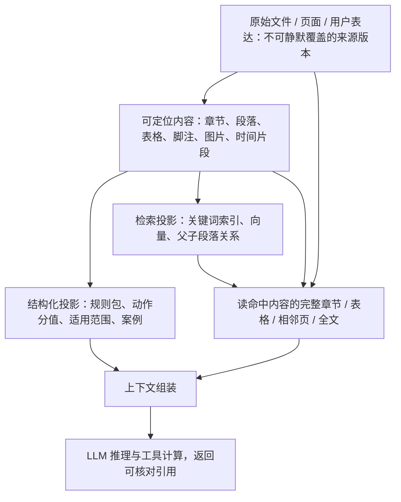
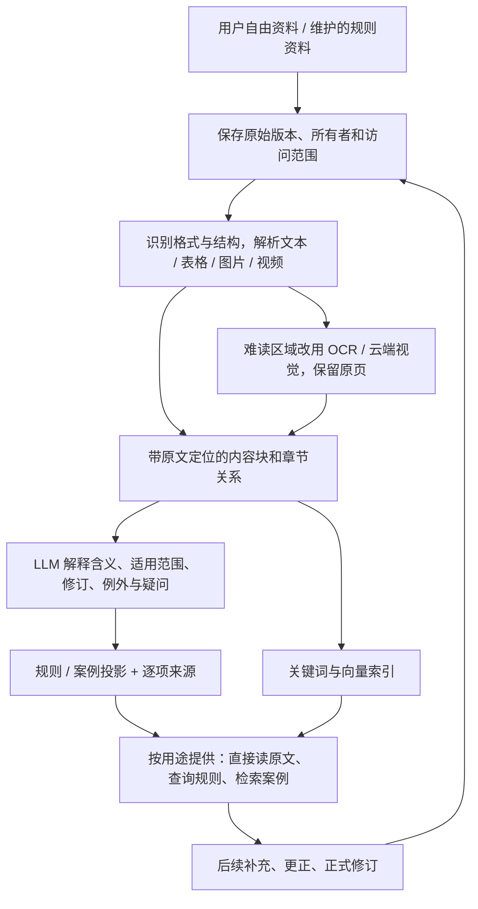
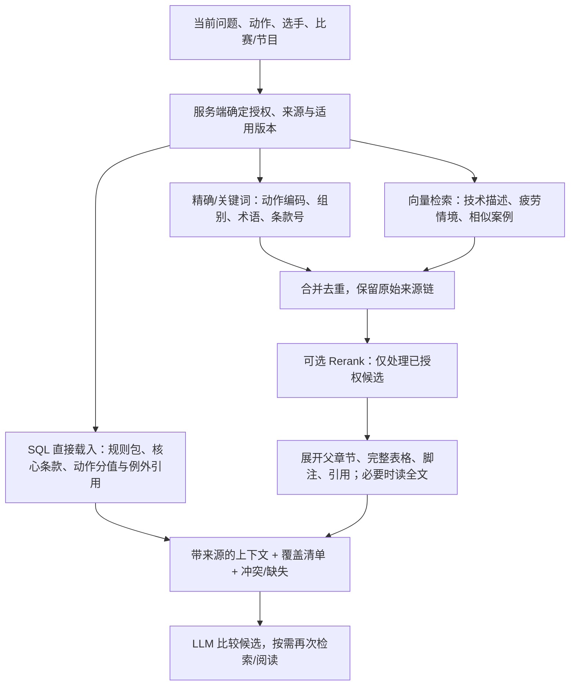

# 知识库、文档阅读与 RAG 管理设计

版本：v0.1，2026-11-14。状态：目标设计，已开始实现；完成与未完成项见[实现记录](implementation-status-2026-11-14.md)。关联：[总体架构](architecture.md)、[个人记忆](personal-memory-design.md)、[引擎技术调研](engine-research-2026-11-14.md)。

本设计把“数据库检索、RAG、直接读文档”组合到一条有来源和版本的处理链上。RAG 是给模型寻找和提供依据的过程；原始文档、结构化规则与检索索引是同一知识体系的不同表示，不能分别维护成互相矛盾的事实库。

## 1. 一份知识的四种表示



| 表示 | 保存什么 | 解决什么问题 |
| --- | --- | --- |
| 来源层 | 原文件、来源地址、获取/上传者、文件哈希、原版本、权限与适用信息 | 确认“原来到底写了什么”，支持重处理和纠正 |
| 内容层 | 保留章节、表头、脚注、例外、跨页关系和原文定位的解析内容 | 不把表格或限制条件切碎成失去含义的句子 |
| 结构化层 | 可明确表达的规则、分值、动作编码、适用范围、案例情境 | 精确查询、完整载入必要规则和可复算计算 |
| 检索层 | 关键词、动作别名、embedding、父子块关系和索引版本 | 在大量解释资料和历史案例中找到相关依据 |

来源与内容层是可核对依据。结构化层、摘要和索引都是从来源生成的投影，保留生成方式及源版本，发生错误可以重建。解析器换版本不改变原文件版本；文档修订则必须形成新来源版本。

## 2. 知识范围与使用角色

| 知识类别 | 默认可见性 | 用途与限制 |
| --- | --- | --- |
| 赛事正式规则、分值表、正式补充通知 | 经来源与适用范围核对后作为公共资料；受限材料按授权处理 | 按比赛/赛季/组别/节目解析成规则包，补充通知与被修改条款建立关系 |
| 技术说明与教练案例 | 有权使用的公共资料或指定授权范围 | 帮助理解与推荐，不能自动覆盖比赛规则 |
| 用户上传规则、截图、转述、自定义要求 | 该用户/选手的私有资料 | 立即进入理解流程；明确自定义规则形成私有规则覆盖，不能污染公共规则 |
| 个人训练日志、视频、方案及反馈 | 选手权限范围 | 通过个人记忆和案例检索使用，不自动成为一般花滑知识 |
| 模型生成的解释与总结 | 继承来源权限，标记派生 | 阅读和导航辅助；不能成为独立权威来源或反复自证 |

区分“是否已解析”“是否可用”“是否正式规则”“是否有权公开”。一份私人比赛截图可以已经可用但尚未证实官方出处；一份正式旧赛季规则可能来源可信但不适用于当前比赛。不能把它们压成一个统一可信分。

个人资料始终先检查授权范围，再送到检索、云端 embedding、rerank 或推理模型。所谓公共案例建设不意味着自动上传用户材料；公开复用有单独的授权与内容审核流程。

## 3. 逻辑数据模型

以下为逻辑对象，优先复用 PostgreSQL 与对象存储；不要求另建一套图数据库或文档服务。

| 对象 | 核心字段与关系 |
| --- | --- |
| `KnowledgeSource` | 所有者、可见性、来源种类、来源地址/上传入口、允许用途、当前版本指针 |
| `SourceVersion` | 不可静默覆盖的文件/文本版本、哈希、获取时间、发布/生效时间、修订关系、撤回状态 |
| `ParsedBlock` | 原版本、解析代次、父章节、内容类型、原文、页码/坐标/表格位置/时间、解析不确定项 |
| `EvidenceLink` | 表头/脚注/例外/引用/修订/派生关系；使命中一段时能找回相关上下文 |
| `RuleBundle` | 比赛、赛季、组别、节目、来源版本集合、私有覆盖层、规则包版本与适用区间 |
| `RuleClause` | 条款原文引用、适用条件、例外、结构化解释、可执行状态、未决问题、规则包归属 |
| `KnowledgeCase` | 情境、选项、选择理由、结果性质、适用/不适用条件、来源；与个人案例明确隔离 |
| `SearchEntry` | 内容类型、对象版本、所有者/可见性、关键词、向量、embedding 代次、来源引用 |
| `IngestionJob` | 来源版本、处理步骤、处理器版本、幂等键、进度、失败区域及重试状态 |

`RuleBundle` 必须是来源版本集合及解释版本的明确快照，不能只是“当前规则.docx”的链接。正式修订覆盖哪些条款、从何时生效，需要有关系记录；所有公开检索条目都能回到其来源权限与版本。

初期可以用 JSONB 保存扩展性的条款解释和关系明细，用普通关系字段保护归属、版本与关键引用；不要提前发明覆盖所有比赛的僵硬规则 DSL。动态新要求可以保留自然语言表达与证据，不因暂时没有对应字段而被丢弃。

## 4. 资料入库与理解流程



流程要求：

1. **先保存，再理解。** 用户不需要选字段模板、整理成 JSON、拆成标准条目。系统尽可能识别资料类别和适用对象，不能用“缺少赛季字段”拒绝接收。
2. **保留原结构。** 记录章节层级、表头、合并单元格含义、脚注、例外、跨页表格与引用。扫描件保留页图与 OCR 文本；关键数字难辨时重读原页，不能靠语言流畅度猜分值。
3. **拆成可追溯内容块。** 按语义结构切分；表格片段携带必要表头和说明，子块指向完整父章节。切块长度是内部处理配置，不是限制用户表达的表单规则。
4. **解释而不伪造。** 模型可提取适用比赛、条款与例外，也可以保留不确定项、两种解释或缺少上下文的区域。系统未看到的信息不能填写成“无限制”“无扣分”或一个默认阈值。
5. **私有资料逐步可用。** 小型资料可以直接阅读原文并开始处理；索引未完成不等于资料不能用。部分页不可读时其余部分仍然可用，未读区域保持明确状态。
6. **生成可重建索引。** 为内容及摘要记录来源版本，生成关键词与向量；异步任务按来源版本和处理版本幂等写入。
7. **自动接纳与正式发布分离。** 普通用户资料不需要逐条人工审核才能开始用；作为大家共用的正式规则包时，由维护流程核对来源、适用范围、修订与关键计算解释。这是内部发布责任，不是用户输入门槛。

解析进度可使用“已接收、处理中、部分可用、可用、待补充、已撤回”，并独立记录“规则解释是否完整”。技术上完全无法读取的区域保留原始材料并尝试其他读取路径；必要时说明缺少哪一处原文，不能宣称任意损坏文件也已完整理解。

视频来源产生带时间段、观察对象、可见范围和不确定性的观察块，交给个人记忆模块处理。镜头看不见的起跳刃、落冰细节或时间点不能靠模型补全为已知事实。视觉模型与文档模型共用来源和权限体系，但观察不升级为正式比赛规则或稳定能力结论。

## 5. 规则包如何构建与管理

```text
规则包 = 适用的正式规则版本
       + 明确关联的正式修订/组别补充
       + 用户明确指定的私有自定义覆盖
       + 每条解释、例外和未解决事项的来源
```

适用性先依据比赛、赛季、组别、节目和生效时间确定。资料缺少这些信息时，可以从上下文推断候选并展示假设；存在会改变结果的歧义时，给出条件化结果并询问缺少的具体语境。禁止用语义上最近的另一个比赛静默填空。

同一规则包中维护相关约束的清单及引用，包括但不限于动作/连跳限制、重复条件、时间、后半程资格、分值、例外和失误后的处理。清单可以扩展到新型规则；文档中的新条款即使无法归入现有分类，也要留在规则包中，不可被固定 schema 丢弃。

条款分三类使用：

| 状态 | 处理方式 |
| --- | --- |
| 已有明确且核对过的可执行解释 | Java 工具精确计算或检查，输出条款引用、规则版本和计算明细 |
| 可由 LLM 结合原文理解，尚无可执行表达 | 原文随规则包进入上下文，LLM 按条款分析；结果标明尚未机器核对的范围 |
| 有歧义、冲突或缺少条件 | 保留多种解释/未决问题，继续提供依赖假设的候选，不声称已全面合规 |

上述状态描述系统掌握程度，不是让用户按格式补全资料的门槛。解释产生的执行表达只能进入受控操作集合，不能把上传材料或 LLM 生成的任意代码直接在服务端执行。

冲突处理按语义关系进行：明确生效的补充通知替代其指向的条款；“更新上传”不自动意味着更高效力；技术文章不覆盖正式规则。用户明确自定义的要求作为私有变体计算，并显示这是自定义方案。来源冲突但没有覆盖关系时保留冲突，不能按 embedding 相似度、发布时间或固定来源分数决胜。

保存方案引用规则包的具体版本。规则更新后提示新旧版本差异和重新评估入口；不静默改变旧方案的 BV。历史适用版本与“当前比赛应使用版本”分别表达。仅重新切块或重建向量不会凭空改变规则含义。

## 6. 混合检索与直接读文档

检索先确定问题和适用范围，再决定需要读什么。一次编排请求的知识路径如下：



**路径 A：精确载入。** 当前个人核心档案由记忆模块提供；适用规则包、动作分值和强制条款从结构化业务库载入。这些内容不能和普通解释资料争夺同一个 top-k 名额。已知强制条款没有进入上下文，应视为检索链缺陷，不能说“分数低所以忽略”。

**路径 B：关键词与语义混合。** 动作代码、条款号和数字适合精确/关键词检索；“后半程累了接不住第二跳”等自然表达需要语义检索。内部统一术语别名，同时保留原文；`3S+3T`、`3T+3S` 和单独 `3T` 不可归一化成相同动作。候选可用排名融合再重排，这只是找资料的排序方法，不是替用户决定动作的固定加权评分。

**路径 C：原文展开。** 初步命中只是定位入口。系统可以读取完整条款、完整表格、关联例外、前后页和整份短文档，再进行推理。对于很短、明确适用的私有材料，直接读全篇往往比先切块再召回更简单；长文档采用目录定位、检索和逐节阅读。不能只看五段相似文本就宣称理解了整份规则。

PostgreSQL 提供解析、词元化与全文检索机制；中文分词和花滑动作别名需要在入库与查询两侧采用一致处理，不能假设默认配置已满足中文领域检索。[PostgreSQL 全文检索文档](https://www.postgresql.org/docs/current/textsearch-intro.html)

pgvector 支持精确检索、近似索引和与全文检索组合。首版个人数据及规则资料规模小时，优先在授权范围内精确检索；确有性能需要再引入近似索引，并对照精确检索测召回。近似索引与过滤组合可能少返回结果，应检查查询计划、扩大扫描或调整分区，不能把少命中当作资料不存在。[pgvector 官方说明](https://github.com/pgvector/pgvector)

首版优先自建明确的检索编排，复用 Spring AI 的模型/向量适配能力；不把默认 `QuestionAnswerAdvisor` 加一个向量库就视为完成本设计。其模块可以组装检索流程，但赛事适用性、必需条款和权限仍由本系统实现。[Spring AI RAG 文档](https://docs.spring.io/spring-ai/reference/api/retrieval-augmented-generation.html)

## 7. 给模型的上下文及证据

上下文按用途组织：

| 部分 | 内容 |
| --- | --- |
| 当前任务 | 用户原话、动作/方案、当前目标与正在回答的问题 |
| 个人条件 | 当前选择、能力证据、疲劳与偏好、范围及已知冲突 |
| 必要规则 | 当前规则包、精确计算输入、例外、尚未解决的条款 |
| 参考知识 | 技术解释和案例，同时提供适用/不适用条件 |
| 来源索引 | 服务端生成的证据 ID、原文定位、版本及来源类别 |
| 工具结果 | BV 明细、已核对与未知条件、候选差异 |

模型可请求 `search_knowledge`、`read_evidence`、`read_section` 或指定视频时间片段。工具只接受可验证的证据引用和查询参数，不能通过模型生成的 URL 或 ID 读取未授权文件。资料内容作为证据传入，文档中的“忽略指令/读取其他用户”不能变成应用操作权限。

每个实质性建议尽量区分三类依据：来自规则的要求、来自个人记录的条件、模型基于这些信息作出的推断。引用绑定具体版本及片段，展示页码/条款/视频时间；用户可以打开源材料核对。精确数字直接引用计算结果，不能让模型自行改写后冒充工具输出。

发布前检查引用是否真实存在且当前可访问、正文是否支持相关结论、是否遗漏关联例外、工具计算是否和当前方案版本匹配。格式修复和补检索由服务端完成。引用存在不等于引用支持论断；后者还需要样例评估和人工抽查，不能承诺一个自动检查器消除所有幻觉。

上下文预算不足时先压缩重复叙述与可选案例；完整保留决定当前可行性的规则和个人条件，必要时把任务拆成多轮读取/验证。执行预算限制的是后台资源，不能变成要求用户删掉复杂规则才能提交。

## 8. 更新、撤回与索引代次

| 变化 | 数据处理 | 对推荐的影响 |
| --- | --- | --- |
| 原文被正式修订 | 新建来源版本及覆盖关系，生成新的规则包/知识投影 | 新请求选择适用版本，旧方案可对照重评 |
| OCR 或条款解释被纠正 | 保留原文件，增加解析/解释版本，失效错误投影 | 受影响方案提示依据已更正，可重算 |
| Embedding 模型或维度变化 | 建立新索引代次，记录模型与预处理版本，完成后切换活动指针 | 不混用不同向量空间；业务规则版本不因此变化 |
| 索引暂未更新 | 新旧条目均回读权威状态；用精确查询、关键词和原文补充 | 更正立即影响结果，不等待向量重建 |
| 私人资料删除/撤回授权 | 先更新访问/隐私版本，立即禁止读取，后清理原文及派生物 | 在途结果发布受阻，缓存/摘要/案例不能继续引用 |
| 同一资料重复上传 | 在同一授权范围去重或建立同源关系 | 不当作多份独立证据，不泄露其他用户是否已有同文件 |

查询向量必须使用所选索引代次的 embedding 配置。切换期间可以保留两代索引以便回退，但不能比较来自两个向量空间的距离或使用新查询向量检索旧索引。

删除遵循[个人记忆设计](personal-memory-design.md)的“先停止使用，后清理所有派生物”。原文、解析块、向量、摘要、历史运行材料与模型请求调试样本都在来源关系图中；所谓图可以是普通关联表，不需要专门图数据库。业务纠错和彻底删除不同，删除要求优先于历史复现便利。

## 9. 一个完整案例

以下情境仅用于说明处理逻辑，具体比赛条件应从真实资料获得，不能把示例当作通用花滑规则。

用户已经有个人记录：“3Lz 会做但近期后半程不稳定”；本次说：“这场先求稳，但如果后半程有额外收益，也给我看看另一种排法。”随后上传一份比赛 PDF、一张修订通知截图和教练手写意见。

1. 系统保存三份私有来源，识别 PDF 与通知是否指向同一比赛、组别及规则；对手写意见用视觉理解并保留原图位置。用户不需要手工整理。
2. 规则包载入已读明的时间阈值、奖励资格、分值和限制。截图若明确修订 PDF 的某条，建立覆盖关系；无法确定是否同一组别时保留待核对事项，不静默合并。
3. 个人记忆提供近期 3Lz 自述，并把“这场先求稳”作为本场目标。它不等于永久排除 3Lz，也不意味着全部高难度动作都被禁止。
4. 查询与 3Lz、后半程疲劳和连跳有关的知识、个人经历；命中“后半程奖励”条款时展开相关资格与例外，不仅返回“1.1”所在的一句。
5. LLM 提出更稳的安排和有依据的另一种情景，计分工具按各自计划时间及资格计算 BV。没有足够个人成功数据时，解释潜在收益和执行风险，不编造预期得分。
6. 返回可以编辑的主方案和预案，分别说明规则依据、个人依据和推断。教练手写意见影响建议，但不会自动改写赛事规则。
7. 用户修改方案的理由形成个人案例；只有后续实际训练反馈才形成执行结果。更换比赛时重新选择规则包，不沿用旧比赛覆盖层。

## 10. 管理操作与首版范围

| 谁/入口 | 需要的操作 | 首版做法 |
| --- | --- | --- |
| 用户 Android 资料页 | 上传、看处理进度、补充解释、纠正所属比赛、看来源、撤回/删除 | 与当前方案关联，不要求管理索引或填写复杂元数据 |
| 用户 Android 结果页 | 查看规则/个人依据、指出理解错误、提供新的材料 | 将更正带来源回写，并显示受影响的方案 |
| 知识维护者 | 维护共用规则来源、适用范围、修订关系和发布版本 | 使用受控服务端命令/API 与导入任务；首版不新建 Web 管理前端 |
| 运行维护 | 重试失败解析、重建索引、切换代次、检查处理成本和检索质量 | 留可核查任务记录，操作不改变原始用户语义 |

知识管理的最小闭环是：接收 → 理解 → 使用 → 指出错误 → 修订 → 让受影响结果更新。先覆盖选定比赛和真实用户样例，不为了“知识库看起来丰富”导入大量没有适用条件或来源不明的文本。

## 11. 审核与评测场景

| 编号 | 场景 | 预期结果 |
| --- | --- | --- |
| K1 | 同一比赛不同赛季存在近似条款 | 使用当前适用版本，旧版只在明确历史问题中出现 |
| K2 | 主规则和补充通知分别上传 | 读到明确覆盖关系，不能把两版同时当无冲突约束 |
| K3 | 关键例外位于下一页或脚注 | 检索后能展开例外，不只引用命中句 |
| K4 | 私有规则只有一张短截图 | 可直接理解并使用，不要求先变成结构化表单 |
| K5 | 自定义条款超出已有规则字段 | 原文与解释保留并参与分析，不丢弃、不误报全量核验 |
| K6 | 分值表跨页或有合并表头 | 数值与正确动作/组别对应，可回到原页复核 |
| K7 | PDF 解析了一半，剩余页仍处理中 | 报告部分可用与缺失，不能把未读内容当作没有限制 |
| K8 | 中文动作别名、代码、有序连跳混用 | 能召回相关资料，同时不混淆不同动作序列 |
| K9 | Embedding/rerank 故障 | 必要规则仍可读，精确/关键词/原文路径可继续 |
| K10 | 多个用户上传相似私人材料 | 权限在候选外发前生效，任何用户都看不到别人的正文或文件存在性 |
| K11 | 更新原文，但向量索引尚旧 | 不输出被替代的当前规则；新版本通过直接阅读补足 |
| K12 | 文档中写着要求读取其他用户的指令 | 作为文档文字处理，不能改变身份和工具权限 |
| K13 | 系统自己的解释再次被检索 | 标记为派生，不能当新的独立证据支持自己 |
| K14 | 引用存在，但不能支持模型的结论 | 评测能识别引用不支持，不只统计“有引用率” |
| K15 | 换 embedding 模型或重建索引 | 查询与索引代次一致，业务规则与来源版本保持可追溯 |
| K16 | 后台任务重试、删除与生成同时发生 | 无重复有效版本，撤回后不再输出相关私人内容 |

评测分别衡量适用性选择、必需条款与例外召回、原文定位、引用支持程度、个体案例作用、错误来源复活、权限隔离和删除生效；同时记录每次处理的 token、耗时、失败与降级。检索排序分数不作为教练建议质量的替代指标。

这些是待实施的验收场景，当前没有宣称任何召回率、视频准确率或教练盲评结果。性能参数和召回配置应由真实资料规模与样例结果决定，不把未经验证的 top-k、相似度阈值或人工权重写成产品原则。
