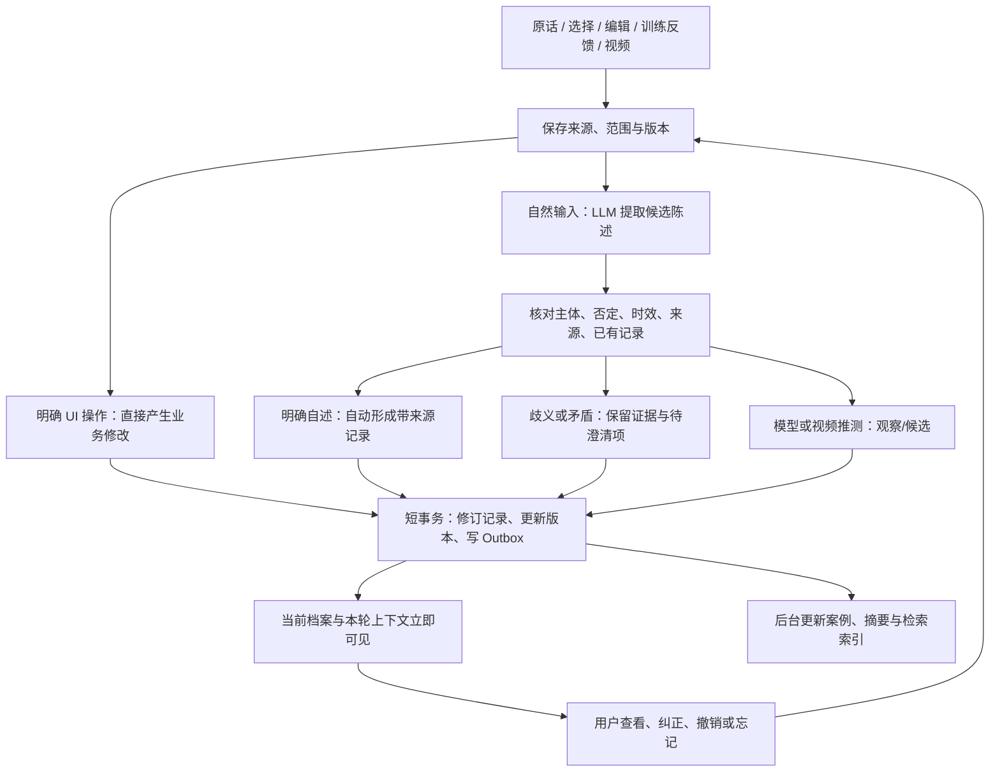
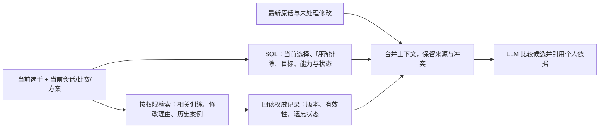

# 每位选手的个性化记忆设计

版本：v0.1，2026-11-14。状态：目标设计，已开始实现；完成与未完成项见[实现记录](implementation-status-2026-11-14.md)。总架构见[架构设计](architecture.md)，文档和知识检索见[知识库设计](knowledge-rag-design.md)。

本设计解决四个问题：系统长期记住什么，什么只影响眼前一次建议，信息矛盾时怎么处理，以及用户如何纠正或让系统忘记。目标是让建议持续贴合选手，不把用户锁在某次错误提取形成的档案里。

## 1. 记忆的组成

**个人记忆由有来源的记录及其当前解释组成。向量库负责查找相关历史，不能成为判断“这个人现在是什么情况”的唯一依据。**

| 层 | 记录内容 | 使用方式 |
| --- | --- | --- |
| 原始输入 | 用户原话、动作选择/取消、资料、视频观察出处、明确修改 | 保留真实来源，支持重新解释和纠错；不能全部无差别灌入上下文 |
| 当前情境 | 今天疲劳、这场比赛目标、当前方案、本轮临时排除 | 按会话、日期、比赛或方案范围生效；本次推荐直接载入 |
| 长期个人陈述 | 已选动作、能力自述、习惯、持续偏好、目标及其证据 | 业务库读取当前有效投影，保留陈述来源、范围与时间 |
| 历史经历与案例 | 某次训练结果、比赛经历、教练修改、方案采用或拒绝理由 | 按当前问题检索；发生过一次不等于普遍规律 |
| 派生摘要与索引 | 个人摘要、案例向量、检索文本 | 加速上下文组装，可重建；不独立产生事实 |

完整聊天历史、当前对话窗口和长期档案分开。Spring AI 的 `ChatMemory` 可管理模型本轮看到的会话上下文，但不替代完整历史和本设计的个人业务记忆；会话范围也需要应用正确隔离。[Spring AI 聊天记忆文档](https://docs.spring.io/spring-ai/reference/api/chat-memory.html)

首版只记录与跳跃编排、训练反馈和推荐有关系的个人信息，不为了“更了解用户”而无差别提取生活信息。用户可以直接说“这段只用于本次，不要长期记住”，系统据此控制长期写入。

## 2. 必须分别表达的含义

| 用户表达/行为 | 应保存的含义 | 禁止的误推断 |
| --- | --- | --- |
| 勾选某个单跳或连跳 | 该项目进入对应候选范围，保存选择来源 | 每次编排都必须用到；已经有客观稳定性证明 |
| 未选择/取消某个项目 | 在对应范围内不选它 | 这个人永远不会这个动作 |
| 取消单跳 3T，仍勾选 `3S+3T` | 单跳与有序连跳分别记录，按已定义选择逻辑使用 | 自动删掉所有含 3T 的连跳 |
| “这场任何地方都不要 3T” | 比赛范围的全局动作排除，覆盖相关连跳 | 永久不会 3T |
| “我已经会 3Lz，但不稳定” | 掌握自述与稳定性描述两条信息，来源均为本人 | 因为会做就总是推荐；自动编造一个成功率 |
| “我想学 3A” | 学习目标 | 已掌握 3A |
| “今天很累” | 当日/当前训练的疲劳自述 | 长期体能差 |
| “后半程更容易掉 3Lz” | 与动作和时段有关的能力自述 | 所有动作后半程统一衰减相同比例 |
| “最近比赛先求稳” | 当前阶段或当前比赛的目标；范围不清时保留原话 | 永久禁止高难度尝试 |
| “教练说我可以尝试这个连跳” | 用户转述的教练建议，保存转述关系 | 教练本人已确认稳定掌握 |
| 视频里一次落冰成功 | 本段视频中的一次观察 | 训练成功率 100%，或已经稳定掌握 |
| 用户保存了推荐方案 | 接受/保存行为 | 已经执行成功 |

自动带出低周数动作等产品逻辑应记录 `derived_selection` 及其上游选择；显式取消覆盖派生默认值。单跳、连跳、有序动作序列、偏好、能力、比赛目标使用不同的键，避免“同一个 3T 字符串”把它们错误合并。

## 3. 逻辑数据结构

下表是业务对象划分。原始消息和附件可复用输入模块，派生检索条目可复用知识检索基础设施，首版无需为每一行建立独立服务。

| 对象 | 关键字段/职责 |
| --- | --- |
| `SourceEvent` | `source_id/revision`、操作者、选手、消息/附件/选择事件、原始时间、收到时间、允许用途、撤回状态 |
| `MemoryClaim` | 一条有范围的个人陈述；保存原文定位、提取结果、来源类别、生命周期和修订关系 |
| `ClaimRelation` | `supports`、`contradicts`、`supersedes`、`derived_from`；可用关联表或受约束结构实现 |
| `ContextFrame` | 当前会话/比赛/方案的状态与临时覆盖，以及 `session_revision` |
| `PersonalEpisode` | 情境、原方案、实际结果/用户修改、理由、时间、来源；区分计划、已执行、本人反馈、教练反馈 |
| `ProfileProjection` | 当前有效记录的合成视图，带 `memory_revision`，每个字段能回溯来源；初期可按需查询构建 |
| `MemoryDerivative` | 摘要/向量/缓存的来源 ID、来源版本、处理版本及过期状态 |
| `ForgetRequest` | 遗忘范围、立即失效时间、清理进度、来源排除标记；不保存待遗忘正文的副本 |

`MemoryClaim` 的最小语义结构：

| 字段组 | 含义 |
| --- | --- |
| 归属 | `athlete_id` 是被描述的人，`actor_id` 是提供信息的人；二者不能互换 |
| 内容 | `kind`、`subject_key`、`statement`、可选 `value`、否定/目标/假设等表达类型；允许保留自然语言，不能只剩枚举 |
| 范围 | 长期、阶段、比赛、节目、方案、训练或会话；绑定明确对象或时间段 |
| 时间 | `observed_at` 事实发生时间、`recorded_at` 系统收到时间、`valid_from/to` 适用区间、可选复查提示 |
| 来源 | `source_refs` 指向消息片段、选择事件或视频时间；`evidence_kind` 区分本人自述、直接教练记录、转述、视频观察、模型推测 |
| 状态 | `candidate / active / disputed / superseded / expired / retracted`，状态表示当前使用方式，不表示客观真理 |
| 修订 | `revision`、`supersedes_id`、写入所基于的原版本和提取器版本 |

`active + user_report` 只表示“当前可使用的本人自述”，不表示系统已经验证为事实。模型自报的 0.95 置信度不能充当真实能力概率或自动通过阈值。

“这次比赛不排 3Lz”的示例：

```json
{
  "athlete_id": "athlete_demo",
  "kind": "selection_override",
  "subject_key": "jump:3Lz",
  "statement": "这次比赛不排 3Lz",
  "value": "excluded",
  "scope": { "type": "competition_entry", "id": "entry_demo" },
  "evidence_kind": "user_report",
  "status": "active",
  "source_refs": [{ "type": "message", "id": "message_demo", "revision": 1 }]
}
```

这是系统内部生成的对象，不是给用户的填报模板。它只改变这场比赛的使用选择，不删除已有 3Lz 能力记录；当用户表达的是所有相关组合均排除时，记录覆盖这些连跳的范围。系统理解完整语义，不要求用户使用“任何地方”等特定关键词。

## 4. 写入与更新流程



1. 输入模块保存消息/事件及其版本，递增当前会话版本；上传资料默认只属于该用户授权的选手范围。
2. 对明确 UI 选择直接应用产品语义。自然输入提取时同时识别“谁、什么动作、是事实还是目标/假设、什么时候、适用哪次事情、来自谁”。提取失败由系统重试或换处理方式，原文仍用于本次理解。
3. 将候选与同一选手、同一字段和相容范围内的既有记录比较；不能只凭文本相似就合并。
4. 清楚的本人自述可以自动写入，显示轻量的“已记住/仅本次使用”提示并可撤销，不要求每句话都人工确认。含糊描述保留为候选；只有歧义会改变当前决策时才问一个具体的自然语言问题。
5. 视频或模型推测保留观察出处，可用于说明不确定性或建议复查，不可自动改写用户明确选择、认定稳定能力或生成永久禁用项。用户/教练补充确认时增加新的陈述与支持关系，保留原始观察的性质。
6. 当前修改与 outbox 在同一个短事务里提交。摘要、案例整理和 embedding 异步进行；任何异步失败都不能回滚已经明确保存的选择和更正。

同一轮需要使用的新信息，优先完成相关陈述提取再生成建议。若解析需要较长时间，当前原话及“尚未定型”的状态始终进入上下文；不能等后台索引完成才让模型看见用户刚刚说的话，也不能误报档案已经保存完成。

## 5. 冲突、范围与时间

**范围优先用于解释意图，不能成为统一覆盖所有证据的真伪排序。**

| 情况 | 处理规则 |
| --- | --- |
| 长期喜欢 3Lz，本场明确不选 | 本场选择覆盖长期偏好；长期偏好仍保留，其他场景不受影响 |
| “我刚才说错了，实际是 3Lo” | 针对同一陈述建立修订关系，旧版本标为被替代；本轮立即使用修正 |
| “以前不稳定，最近稳定了” | 记录时间变化；旧记录作为过去经历，不强行解释为同时冲突 |
| 独立单跳稳定，某连跳不稳定 | 不同主体键，两条并存 |
| 用户说稳定，视频显示一次失误 | 不直接认定矛盾；单次表现不足以否定总体自述，分别交代证据 |
| 用户和教练对同一近期能力有相反描述 | 两条带来源并存，标记待澄清；推荐呈现不同情景，不能机械地永远相信某一方 |
| 昨天训练的视频今天才上传 | `recorded_at` 晚不代表 `observed_at` 新；不能覆盖今天的明确状态 |
| 引用朋友经历、转发范例、假设情景 | 保存为对应素材或假设，不写成该选手个人事实 |

时间策略：

- “这场/这个方案”绑定相应对象，在其他比赛/方案不生效；查看历史方案时保留当时适用上下文。
- “今天累”按明确训练情境或用户时区的当日生效。跨日查看显示为昨日情况，不能默认为今天仍疲劳；没有训练对象时采用当日范围并让用户可修改。
- “最近不稳定”保留发生时间与原话。随时间降低作为当前判断的代表性，并在再次影响建议时提示是否仍成立；不凭一个全局天数自动宣布能力恢复或失效。
- 持续偏好与动作选择延续到明确更正、撤销或范围终止；不会因为用户多日没打开 App 自动消失。
- 内部保存可比较的时间戳并保留来源时区；资料缺少拍摄日期时不得把上传日期冒充训练日期。

不设置“超过 X 次失败即永久不会”“低于某置信分就拒绝入库”等统一门槛。真实训练次数和成功次数可以保留原始分子/分母及情境；自述“很稳”不转换成虚构统计数据。

## 6. 每轮如何读取个人记忆



核心动作选择、明确排除项和当前目标不能因为向量相似度不高或 token 排名低而被省略。个人长期档案按当前有效范围直接读取；相关训练经历才做语义/关键词检索。上下文过长时先压缩重复叙述和历史案例，不截掉决定可选动作和适用规则的必要信息。

给模型的个人信息包含：当前值/原话、来源类别、适用时间、证据引用、已知冲突和未知项。摘要中每一条个人结论必须能回到这些记录；只要相关来源改了，旧摘要立即不再作为当前摘要使用，等待重建期间直接读取权威记录。

模型建议、用户保存、用户实际训练结果是不同事件。只有实际反馈才形成对应训练结果；同一段视频、其字幕和模型摘要是同一个来源链，不能当三份独立证据增加可信度。

## 7. 并发、乱序和可追溯性

- 每位选手有 `memory_revision`，会话有 `session_revision`。界面修改和工作流产物都带预期版本；冲突时保留用户的新输入并展示当前差异，不无声覆盖。
- 提取任务携带来源 ID、来源版本、提取器版本和所基于的陈述版本。相同任务重试不重复创建；旧来源任务完成时先检查是否被编辑、撤回或替代。
- 单纯“任务最后完成”不能决定哪条记录有效。修订按明确纠正关系、语义范围、事实时间和乐观并发控制应用；必要时重新归并。
- 一次推荐冻结需要的个人记录引用与版本，不在推理一半换成另一份档案。发布前核对相关版本；过期产物只作为过期草稿，不能盖过新结果。
- 摘要、向量和缓存保存 `source_refs + source_revisions`，任何读取都校验权威记录。索引即使尚未删除旧条目，也不能把已撤回正文交给 LLM 或 reranker。
- 缓存至少包含选手、授权范围版本、相关记忆/会话/规则版本和处理版本。禁止仅用问题文本当跨用户的个性化答案缓存键。

示例：A 设备说“今天不排 3Lz”，随后 B 设备更正“本场可以排，但放前半程”。A 的慢速提取任务晚完成时，不能覆盖 B 的新范围。系统对两个输入建立明确关系；关系不明时并存并澄清，绝不按照网络响应先后来决定用户意图。

## 8. 用户可见的管理与遗忘

“系统记住了什么”页面按当前能力、使用偏好、目标、近期状态和待澄清项展示。每项提供来源、适用范围、最后变化时间，以及纠正、仅本次使用、撤销、忘记。无需展示数据库状态名或要求用户编辑 JSON。

区分三种操作：

| 操作 | 效果 |
| --- | --- |
| 更正 | 新版本替代旧的当前解释，旧版本仅作历史，后续建议使用新版本 |
| 仅本次不用/改范围 | 调整适用情境，不等于能力消失或抹除历史 |
| 忘记这条个人记忆 | 立即停止在后续模型上下文、检索与衍生个性化中使用，并清理相关记忆派生物；不能只删向量 |

遗忘流程：

1. 在事务中登记遗忘范围、撤回受影响记录，更新 `privacy_epoch` 和记忆版本，写清理任务；立即阻断新的检索、缓存命中和依赖这些记录的在途结果发布。
2. 沿来源关系失效并清理个人记录、摘要、向量、案例副本、模型可见缓存和运行材料中的相关正文。历史方案中的个性化解释/快照也在清理范围，不能以“审计不可变”为由继续保留待遗忘内容。
3. 标记原消息/原资料中相关片段不再供 AI 读取或提取，防止下次从旧聊天重新记住。无法精确隔离时，先排除整条来源，再生成不含该信息的可用片段。新提交同类信息是否重新记住，遵循用户是否同时要求“今后也不要记”的偏好。
4. “忘记记忆”默认不等于删除用户保存的原始文件和聊天展示；界面明确这个区别。用户要求删除来源时，同步删除相应消息/对象及派生物，清理流程与知识库删除相通。不能声称原始资料也已删除，实际只禁止模型读取。
5. 展示“已停止使用”和后台清理的实际状态；失败任务继续重试。备份按部署时明确的保留周期处理，恢复时先重放删除记录再开放服务；审计只保留操作 ID、范围标识和进度等最小信息，不留待遗忘正文。

已经发送给云端服务的数据、已经展示或用户自行导出的内容不能被本地删除操作追溯收回。提供商的数据保留和删除能力在接入时核实并如实说明，不能把“本系统停止使用”冒充“所有副本即时消失”。

## 9. 选手隔离与访问边界

模型、用户原话和上传文档不能指定另一个选手作为有效查询身份。服务端先从登录状态和授权关系得到 `athlete_id` 及允许的资料范围，再执行 SQL、关键词和向量查询；候选文本交给云端 rerank 前已完成授权，读取原文时再次校验。

数据库使用最小权限应用角色，并以行级策略保护个人数据。连接池上下文应在事务范围内设置与清理；API、后台任务和删除任务各自验证授权/用途。PostgreSQL 的表所有者及具有特殊权限的角色可能绕过 RLS，因此不能让普通应用连接使用这些身份。[PostgreSQL 行级安全文档](https://www.postgresql.org/docs/current/ddl-rowsecurity.html)

个人案例默认不进入公共知识。将匿名化案例用于公共经验库是单独的内容发布流程，需有明确授权和适用条件；仅删除姓名不自动完成匿名化。本设计不自动向其他选手分享个人训练资料。

## 10. 审核案例与通过条件

| 编号 | 输入/变化 | 必须观察到的结果 |
| --- | --- | --- |
| M1 | 新用户说“我想练 3A” | 记录目标，不新增已掌握 3A |
| M2 | 用户说“今天累”，隔日打开 | 今天没有自动继承昨日疲劳；昨日记录仍可解释历史方案 |
| M3 | 长期偏好 3Lz，本场不排 | 本场排除，其他比赛的偏好不被抹掉 |
| M4 | 取消单跳 3T，保留指定含 3T 连跳 | 保持两种选择各自语义；明确全局排除时再作用于所有相关连跳 |
| M5 | 视频里一次成功，同时自述不稳定 | 记录一次观察与不稳定自述，不产生虚构成功率 |
| M6 | 推荐被保存但没有执行反馈 | 不产生一次成功训练记录 |
| M7 | 更正 3Lz 为 3Lo，但向量更新失败 | 下一次建议立即使用新内容，旧摘要不能复活错误 |
| M8 | 同一来源重试三次，或任务乱序完成 | 不重复记忆，不让旧提取覆盖明确修订 |
| M9 | 两位选手问完全相同的问题 | 各自档案、案例与缓存互不串用 |
| M10 | 用户遗忘一条信息后再次读取旧聊天 | AI 不重新提取被排除片段，派生摘要与在途结果受控 |
| M11 | 引用朋友或教练的假设案例 | 不把案例角色的能力记到当前选手身上 |
| M12 | 明确自述跨会话再使用 | 能自动记住并引用来源，无逐条强制确认流程 |
| M13 | 一条资料既产生摘要又产生向量 | 不作为两份独立证据重复增强结论 |
| M14 | 删除或收回资料授权时已有生成任务 | 新结果不发布已失去授权的内容，历史引用状态正确 |

以上是实施后的验收要求，不是已经通过的测试结果。质量评估分别记录错误记住、漏记、错误范围、过期信息、纠正延迟、删除生效和跨选手泄漏；不能只评“模型的回答看起来很像教练”。
