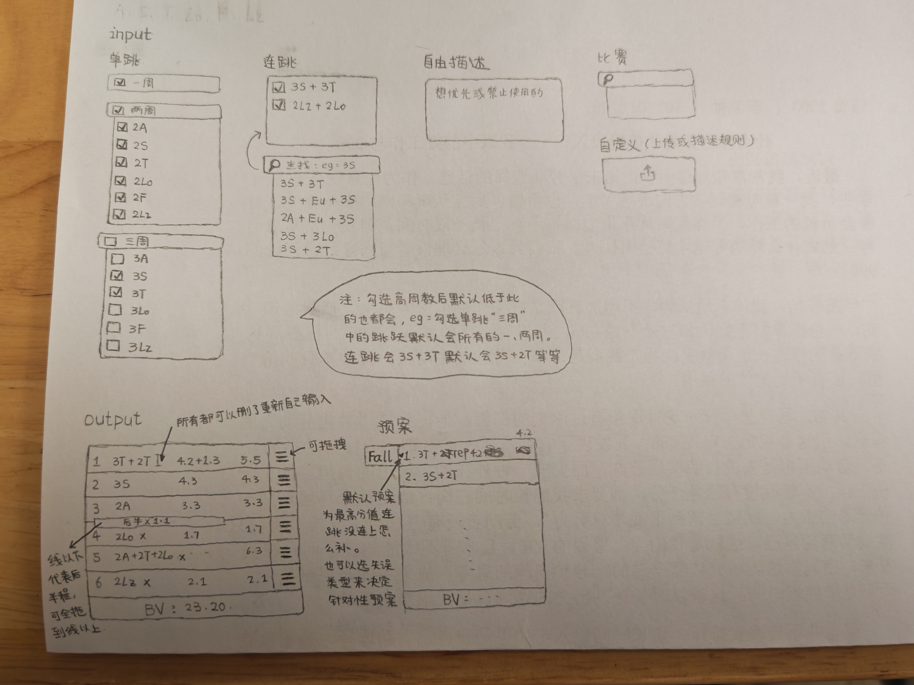

# 截图需求对照

需求来源：2026-11-14 提供的手绘界面及本次对话。
当前产品定义：[Skating Lab 产品需求文档](PRD.md)。

本轮以截图为核心重新定义产品。此前文档中的功能与架构不作为本版的需求来源。

2026-11-14 后续评审修正已纳入 PRD v0.6：优化须考虑个人能力、稳定性和疲劳；后半程由比赛时间决定；不选表示不用，选中表示可用与偏好；自由规则资料由系统负责理解，不要求用户满足固定模板。载体排除 Web，后端排除 Python。出现差异时，以这些后续修正为准。

## 需求原图

[查看原始尺寸的手绘需求](requirements-sketch-2026-11-14.jpg)。

## 截图到产品行为

| 截图内容 | 对应产品行为 | PRD 章节 |
| --- | --- | --- |
| 单跳按一周、两周、三周分组 | 按周数展开，支持整组和逐项选择 | 输入能力与偏好 |
| 两周组的 2A、2S、2T、2Lo、2F、2Lz | 以动作代码选择，并可查看中文名称 | 输入能力与偏好 |
| 三周组中部分动作被勾选 | 同组动作可以独立选择 | 输入能力与偏好 |
| 勾选高周数，默认会更低周数 | 自动补选全部低周数单跳，允许逐项取消 | 输入能力与偏好 |
| 连跳已选框 | 独立维护可用连跳清单 | 输入能力与偏好 |
| 搜索框中输入 3S | 搜索包含该动作的组合 | 输入能力与偏好 |
| 3S+3T、3S+Eu+3S、2A+Eu+3S 等候选 | 从组合候选中点选加入 | 输入能力与偏好 |
| 会 3S+3T，默认会 3S+2T | 补选低难度组合并允许取消 | 输入能力与偏好 |
| 自由描述中填写优先或禁止项 | 表达偏好、必用、禁用和固定位置 | 输入能力与偏好 |
| 比赛搜索框 | 搜索并选择比赛及对应条件 | 选择比赛与自定义规则 |
| 自定义规则的上传或描述入口 | 自由资料由系统读取、理解和推演，形成可编辑解释，不要求用户套模板 | 选择比赛与自定义规则 |
| Output 下方的顺序表格 | 生成主编排，逐行展示跳跃元素 | 主编排的结果与编辑 |
| “所有都可以删了重新自己输入” | 各行可删除重写，也可手工编写方案 | 主编排的结果与编辑 |
| 右侧拖拽手柄 | 拖动整行改变顺序 | 主编排的结果与编辑 |
| 每行分值明细与小计 | 查看单跳分值、组合小计和调整 | 主编排的结果与编辑 |
| 后半程分界线，动作可跨线移动 | 时间阈值由比赛固定，拖动调整动作时间规划，同步考虑加成与疲劳 | 主编排的结果与编辑 |
| 列表底部 BV | 显示当前跳跃 BV 总和 | 主编排的结果与编辑 |
| 独立预案区域 | 主编排与补救方案可以对照查看 | 失误预案 |
| 默认处理最高分值连跳没接上 | 自动生成对应漏接预案 | 失误预案 |
| Fall 等失误类型选择 | 切换失误类型和实际完成动作 | 失误预案 |
| 预案内调整后续动作 | 固定已完成部分，编辑剩余编排 | 失误预案 |
| 预案底部 BV | 展示补救后的 BV 及相对继续原安排的变化 | 失误预案 |

## 为完整体验补齐的行为

下列内容是围绕截图补齐的产品行为，便于在手机上连续使用：

- 保存和复用能力清单、主编排与预案。
- 同一主编排保存多种失误情景，修改主编排时更新相关预案。
- 对主动取消的默认项保留选择，避免反复补选。
- 编辑后将规则问题显示在对应位置，提供就地调整方式。
- 用“失误后照原安排继续”作为补救收益的比较基准。
- 为拖拽提供上移、下移操作，并支持撤销最近一次修改。
- 复制方案、分享主编排与预案，方便讨论和回看。

默认漏接情景采用“第一跳完成、后续未接上”。用户可修改实际完成部分。其余连跳降难度补选范围保留在 PRD 的后续细化项中。

## 当前整理范围

本轮整理目标产品、操作流程、结果内容和验收场景。按最新确认，PRD v0.7 首版用户端为原生 Android，Web 前端已移除，小程序不作为首版交付。后端语言与建议引擎继续技术评审，训练视频作为能力证据进入预研；详见[计算与建议引擎技术调研](engine-research-2026-11-14.md)。

已有公网 IP 和服务器作为后续实现可用资源记录；服务的运行位置在技术讨论时决定。
