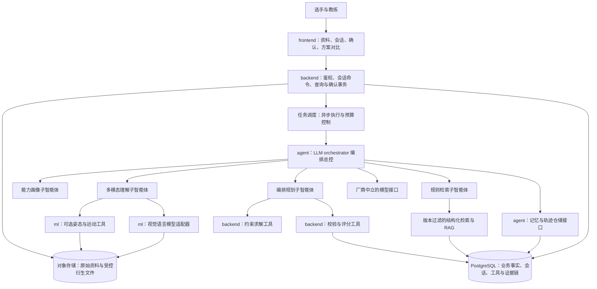
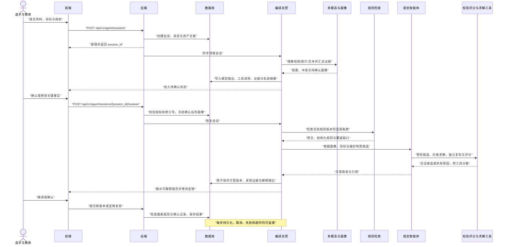
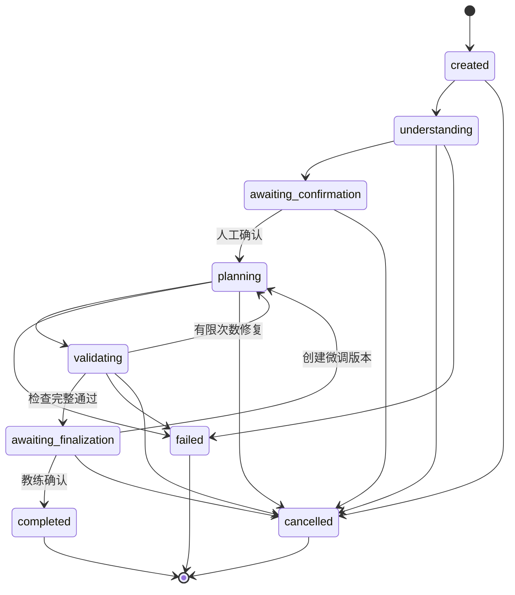

# 花样滑冰 AI 教练：技术设计

版本：v0.2；状态：评审设计与接口骨架。产品范围见 [PRD](PRD.md)，表结构与执行约束见 [数据库设计](database-design.md)。本文是唯一的总体技术设计入口；数据库文档负责数据字典，不另设重复的智能体架构文档。

## 1. 核心决策与实现边界

LLM Agent 是首版必需的主脑：理解目标、组织证据、提出个性化构思、选择工具、比较取舍和解释结果。视觉语言模型承担视频与照片的语义理解，传统姿态估计只提供辅助测量。单靠二维关键点与加权分数不足以判断艺术意图、资料冲突或个体偏好，也不能替代教练决策。

CP-SAT 或同类约束求解器是规则合法性保证工具：把 Agent 的候选方案修复为满足已编码约束的可行序列。合法性保证严格限定于经核对的规则版本、约束编码和检查覆盖范围；求解成功不等于覆盖全部 ISU 裁判判断。规划由 Agent 负责，评分由确定性工具负责，人工掌握关键事实和最终方案的确认权。

本次只提供文档、DDL、示意数据、Protocol 接口和页面占位，不实现 Agent 循环、真实模型调用、视频处理、评分或求解运行时。后续首版必须接入真实的文本与视觉理解能力；明确标识的回放仅用于演示恢复，不替代真实能力验收。

## 2. 系统架构与模块对应

| 层或目录 | 建议技术与职责 | 首版落地取舍 |
| --- | --- | --- |
| `frontend/` | Vue 3、TypeScript、Vite，现有页面加会话与复核页 | 保持现有依赖范围；页面展示引用与确认状态 |
| `backend/` | Python、FastAPI、SQLAlchemy、Alembic | API 与事务边界；不在请求线程执行模型或求解 |
| `agent/skating_agent/` | Python Protocol、显式状态机、可替换模型与工具适配器 | 子 Agent 为逻辑角色，可在同一进程运行，不要求多个服务或不同模型 |
| `ml/skating_ml/` | 视觉语言接口、媒体抽帧入口、可选 MediaPipe 姿态工具 | 视觉语义是必需路径；姿态工具按素材质量启用；不从单目视频虚构绝对高度 |
| `db/schema/` | PostgreSQL 16 基线，JSONB、外键、部分索引、生成列 | 数据库为事实源；向量扩展后续按规模评估，首版可用文本与结构化检索 |
| 异步任务 | Celery 与 Redis 为建议方案 | Redis 只做调度，不保存唯一状态；首版也可用数据库任务轮询，接口保持一致 |
| 文件与部署 | S3 兼容对象存储，可选 MinIO；后续容器编排 | 原文件不塞进消息；仓库尚无容器一键启动配置 |
| 约束工具 | OR-Tools CP-SAT 或等价可替换工具 | 只负责可行性与候选修复，评分与独立复检保持分离 |

## 3. Agent 框架与工具契约

### 3.1 总控与子角色

| 角色 | 输入与任务 | 结构化输出 | 权限边界 |
| --- | --- | --- | --- |
| `orchestrator` | 用户目标、预算、已确认事实；选择下一步骤与停止条件 | 当前状态、调用计划、待确认问题、方案引用 | 只通过白名单工具读写，不执行任意代码或数据库语句 |
| `multimodal_understanding` | 获授权媒体片段、照片、自述与上下文 | 观察、时间段、置信度、冲突、需澄清事项 | 不能把视觉判断直接变为长期能力事实 |
| `capability_profile` | 已确认观察、试做记录、训练负荷和专业限制 | 能力摘要、样本与时间窗口、不确定项、画像快照建议 | 成功率由真实试做样本统计；不把模型置信度当成功率 |
| `rule_retrieval` | 规则版本、组别、节目类型与查询意图 | 原文片段、来源定位、条款键、适用范围 | 检索库存正式资料；检索片段无权覆盖结构化规则 |
| `choreography_planning` | 冻结画像、偏好、规则、候选动作 | 方案意图、备选动作、排序理由、软偏好与取舍摘要 | 不创建分值或改写硬限制；所有方案必须交工具处理 |
| `explanation` | 已校验方案、工具分数、已采用证据 | 面向选手和教练的说明、引用与不确定性 | 只解释工具与证据支持的结论，不能通过润色新增事实 |

子角色复用 `SubAgent.run` 接口，返回结构化结果及引用；工具复用 `Tool.invoke`，声明输入版本、超时、幂等键和输出类型。二者明确分开：Agent 可以提出假设，工具结果必须有成功或错误状态，不能用空对象表示成功。

### 3.2 多模态与能力路径

视频先保存原文件摘要及授权信息，再由媒体工具裁剪、抽帧或传递受支持的视频片段，视觉语言模型描述动作语境、可见线索及与用户陈述的冲突。每条观察绑定 `asset_id` 和起止时间；照片绑定资产，文本绑定会话消息。模型适配器记录实际处理的片段清单与抽帧策略，避免“提交了整段视频就等于完整观看”的误解。

姿态工具返回逐帧关键点、质量和相对运动特征，经 `ml_task`、`ml_task_result`、`pose_frame_feature` 保留测量链路。遮挡、镜头切换、视角不佳时应拒绝输出精确结论；用刃、周数、落冰、速度与高度等判断须说明观测条件。视觉语义与运动测量相互印证，不互相冒充。

`agent_evidence` 保存候选观察与来源，人工确认后才通过能力构建服务形成 `capability_evidence` 和新的 `capability_snapshot`。`capability_snapshot_evidence` 保存实际纳入的证据，`capability_snapshot_stat` 保存实际使用的统计快照；不以“同一选手最新一条统计”代替血缘关系。样本不足时保留未知，不用固定默认成功率填补。专业限制由有权限的人员确认，不从伤病名称自动推断治疗方案。

### 3.3 规则检索与幻觉控制

1. 由规则维护人员录入官方资料，保存来源地址、页码或条款、文本摘要哈希、适用范围与复核状态到 `rule_source_chunk`；绑定 `ruleset_version`。赛季内修订使用 `revision_no` 新建版本，历史版本不覆盖。
2. 首先按冻结的规则版本及节目条件过滤，再执行关键词、全文或后续向量检索；RAG 只解释检索到的原文。比赛组别差异由规则输入快照携带，尚未建模的差异必须阻止正式定稿。
3. `element_level_value`、`ruleset_parameter` 与 `well_balanced_rule` 是计算输入。每项数值映射回官方来源；目前基础结构只覆盖部分条款，新增规则语义可能需要新增编译器与字段，不能承诺所有规则变化都只插入数据。
4. 未检索到、版本不匹配、原文与结构化值冲突时返回 `unsupported` 或 `needs_review`，禁止模型凭记忆补规则。种子库是 `draft`，不可作为正式推荐规则库。
5. 输入资料和检索内容均为不可信数据。提示注入不能扩展工具权限或修改系统规则；工具参数做结构校验、授权检查与长度限制。外部内容中的指令不作为可执行命令。
6. LLM 输出必须通过结构验证，所有事实引用须存在且属于当前会话，数字必须与评分结果一致。验证失败最多一次修复，再失败进入人工处理；未知分数显示缺失，不能补零冒充计算。

## 4. 规划、求解、评分与解释闭环

### 4.1 从意图到合法候选

Agent 先把“后半程保稳、保留擅长旋转、突出音乐表达”等目标转成可解释的候选方案与软偏好，再选择必要的工具。候选元素必须来自可用动作库与已确认能力，禁忌动作不能因收益更高被重新加入。

约束工具将候选元素、级别、联合跳结构和槽位编码成离散变量；每个有效槽位选择一个候选，按所选规则版本处理元素数量、重复、必备类别和组合结构。联合跳子项用 `seq_no`、`combo_index` 表示，不能把所有子项当成独立节目元素计数。规则差异由白名单编译器处理；未知 `rule_key` 必须拒绝编译并报告缺口。

目标可采用保持 Agent 意图的编辑代价、偏好满足度、工具计算的期望技术分与风险惩罚。风险权重、概率估计、候选集和求解限制均冻结在输入快照中；艺术性不能简化为自动加几个分。多方案通过不同意图和排除已得序列产生，再由 Agent 比较取舍，不能将重复方案充作三种风格。

CP-SAT 使用整数约束，金额需定义缩放与舍入规则。`OPTIMAL` 仅表示当前数学模型的最优，`FEASIBLE` 表示找到可行解；`INFEASIBLE`、`UNKNOWN`、`MODEL_INVALID` 不得展示为合法方案。超时仅在已有可行解且独立复检通过时展示候选，并标明未证明最优。[求解器官方状态说明](https://developers.google.com/optimization/cp/cp_solver)

### 4.2 校验与评分

求解后由独立校验工具重新读取冻结输入，核对规则覆盖、硬限制和结构；逐条写 `program_constraint_check`；每个完整批次使用同一 `checked_at`，`detail` 保存校验调用编号、输入摘要和覆盖清单，定稿只消费当前版本最新完整成功批次。工具须列出适用条款总数、已支持数、待人工条款和检查结果；“零违规”不等于检查完整。未覆盖硬条款不能定稿，人工不得用确认按钮绕过明确违规。

评分工具使用冻结规则和观察统计，示意计算为：

`E[TES] = Σ E[元素实际技术得分]`

`E[total] = E[TES] + E[PCS] − E[扣分]`

每个元素按成功、失败等互斥结果场景及其概率求期望，概率和应为一；GOE 等级须先经所选规则换算成分值，不能直接把等级加到 BV。降级、重复、组合和后段加成按具体条款处理；跌倒扣分只在总扣分中计一次。缺乏校准样本时提供情景范围，不声称精确预测比赛成绩。

PCS 仅含 `composition`、`presentation`、`skating_skills` 三项，2022/23 起使用三项制。教练基线和后续经验证的估计方法独立保存；因子、组别与时长规则按版本读取。不得由模型自行生成 PCS 数值或将“衔接更多”直接当作固定加分。[ISU 官方三项制说明](https://isu-d8g8b4b7ece7aphs.a03.azurefd.net/isudamcontainer/CMS/Corporate-Site/Press/FAQ/ISU-FAQ-Components--1755779090-5261.pdf)

`program_score_breakdown` 保存工具输出与引擎版本，`program_element_item` 保存冻结的元素估计值。Agent 最后依据工具结果生成报告，包含选择理由、未选方案、风险、证据及规则引用；报告中的数值逐项对照工具输出，不能仅通过语言模型自检。

### 4.3 编排生成时序

以下时序替换旧 PRD 中的图。参与者别名采用简单中文，消息统一加引号，路径与花括号保留在引用文本内；避免含歧义的裸消息和动态激活语法。兼容性需用 Mermaid 11 实际解析验证，语法参考 [Mermaid 时序图文档](https://mermaid.js.org/syntax/sequenceDiagram.html)。

## 5. 状态、记忆、证据与人在环

`agent_session` 是任务与对话的主记录，保存选手、目标组别、规则版本、画像快照、状态、预算、配置版本与输入摘要。会话记忆、工具记录、模型输出和证据全部在 PostgreSQL；模型上下文只按权限从这些事实组装，Redis 丢失不应丢失业务进度。

| 数据 | 表与关系 | 设计意图 |
| --- | --- | --- |
| 原始对话 | `agent_message` → `agent_session` | 消息序号会话内唯一；不在消息正文混入秘密或原文件 |
| 本次材料 | `agent_session_asset` → `agent_message`、`asset` | 明确哪条消息带入何份材料及授权范围 |
| 工具调用 | `agent_tool_call` → 会话，支持父调用 | 记录输入输出、版本、耗时、错误和幂等键；重试为新 attempt |
| 模型输出 | `agent_llm_output` → 会话，可关联工具调用 | 记录调用角色、部署别名、适配器版本、提示版本、采样配置、结构化输出与用量 |
| 轨迹 | `agent_trace` → 会话、工具或模型输出 | 只存可审计事件、决策摘要与引用，不要求采集模型隐藏思维链 |
| 证据 | `agent_evidence` → 资产关联、消息、规则片段或能力证据之一 | 来源恰好一种，另保留生产它的工具或模型输出；人工确认状态独立于模型置信度 |
| 实际采用 | `agent_plan_evidence` → 方案与证据；`capability_snapshot_evidence`、`capability_snapshot_stat` → 画像 | 区分“看过”与“用过”；用途、决策影响摘要可查询 |
| 人工复核 | `agent_review` → 证据或方案之一 | 记录审核人、结论、修订内容和原因；拒绝或修改不能直接成为已确认事实 |

所有 Agent 关联使用会话范围复合外键，避免把另一会话的消息、模型输出或证据挂到当前方案。`program_plan.agent_session_id` 与规则、选手、节目类型、画像建立匹配关系，历史人工方案允许无会话但必须保留其独立来源。

状态值由 DDL 限定，合法迁移、预算、锁与授权由未来应用事务实现。人工等待不占模型调用时限。会话使用 `revision` 乐观锁；同一确认命令携带预期修订号，冲突返回重新加载提示。审核、证据状态、画像关联和审计日志在同一事务提交；模型和工具网络调用在事务外执行，结果以幂等键落库。

关键抽取采用两步确认：用户可以修改候选证据，但修改后生成新证据并通过 `supersedes_evidence_id` 关联旧项；新项必须再次确认。方案微调生成 `parent_plan_id` 新版本，重新求解、评分和复检；确认记录只对准确的版本生效。定稿事务检查审核权限、证据确认、规则发布状态、覆盖完整性与最新报告，任一失败都不改变定稿状态。DDL 提供参照与取值约束，完整的业务门禁仍是后续实现内容。

可复现分三层：历史输出原样回放；相同冻结规则与工具配置复算；重新调用模型生成新结果。前两层应支持，第三层即使采样参数相同也不承诺逐字相同。模型别名与部署修订由运行环境注入，配置摘要、提示模板版本、工具版本、输入输出哈希及结构化结果共同构成复盘材料。

## 6. 模型选择、成本与时延

### 6.1 厂商中立与可插拔

`ModelGateway` 接收任务角色、脱敏上下文、媒体引用及输出结构要求，返回规范化结构结果、使用量、时延和部署元信息。配置使用 `TEXT_MODEL_ALIAS`、`VISION_MODEL_ALIAS` 等部署别名，不在文档、代码或种子中固定具体模型 ID。实际部署配置与密钥不入库；复现使用部署修订摘要。不同提供方的错误、限流、结构化输出及媒体能力由适配器统一处理。

选型以自有验证集为准：中文沟通、多模态时序理解、工具选择、引用准确性、结构输出合格率、隐私条件、成本与端到端延迟。允许文本和视觉角色使用不同服务；换服务须重跑评估。拒绝依赖某个专有推理格式，未具备所需媒体能力的部署不能接管对应任务。

### 6.2 学生团队预算方案

首版按每会话最多三段短视频、十张图片设计；预检先做文件与权限校验，再把必要片段交给视觉服务。按资产哈希、片段范围、预处理版本和授权主体缓存视觉观察；规则检索缓存键带规则版本，画像更新使规划缓存失效。缓存命中仍写工具调用，在 `output_payload` 中记录原结果的标识与输入摘要，并设置命中标志，不能丢失血缘。

建议起始预算为每会话六次模型调用、二十次工具调用、两轮规划修复、一次结构输出修复，模型累计输入输出文本预算两万 token；媒体计费单列。以一元人民币为可调试验额度上限，实际单价和币种换算从配置读取，测试后再决定可接受额度，不能宣称已能满足该价格。调用前原子预留额度，完成后结算，超额进入人工处理，防止并发超支。

上传完成后五秒内受理；自动处理阶段目标 P95 不超过九十秒，人工等待另计。作为初始分配，媒体理解三十秒、画像与检索十秒、规划二十秒、求解校验二十秒、解释十秒；这是预算分配而非已测性能。可并行进行独立资料读取，单次外部调用设超时，重试必须计入预算，禁止无限自我反思。优先复用已确认观察和结构化规则，避免把整个视频或整本规则重复放入上下文。

网络或模型不可用时返回可理解的失败状态；演示可选择已审核的历史回放，并展示原会话时间和配置摘要。不能静默退回纯求解器并声称智能体正常运行。

## 7. 接口与工程边界

现有 `/api/health` 保持健康检查；业务统一规划为 `/api/v1`。下列路径仅是接口设计，当前没有业务端点实现。

| 入口 | 职责与状态要求 |
| --- | --- |
| `POST /api/v1/agent/sessions` | 接收目标、资料引用与授权，创建会话后返回受理状态 |
| `GET /api/v1/agent/sessions/{session_id}` | 返回步骤、问题、预算、证据与方案引用，过滤敏感工具载荷 |
| `POST /api/v1/agent/sessions/{session_id}/messages` | 追加输入；若改变已冻结事实，创建新会话或修订流程 |
| `POST /api/v1/agent/sessions/{session_id}/reviews` | 校验权限、目标版本、修订号，提交人工复核事务 |
| `POST /api/v1/agent/sessions/{session_id}/cancel` | 取消后禁止继续产出定稿；保留已消费成本 |
| `GET /api/v1/programs/{plan_id}` | 查询元素、评分、规则报告、解释与采用的证据 |
| `POST /api/v1/programs/{plan_id}/revisions` | 创建微调子版本并重新进入校验流程 |

旧 `optimizer` 模块保留兼容占位，未来只转发生成意图到总控，不再直接把求解器当作产品入口。`backend/app/services` 暴露确定性工具，`ml` 负责感知适配，`agent` 负责决策编排；数据库仓储实现通过依赖注入连接，避免三个包互相循环导入。

`agent/skating_agent/memory.py` 定义会话加载、工具和输出追加、轨迹写入及确认事务入口；`agent/skating_agent/contracts.py` 定义结构化数据；`agent/skating_agent/subagents.py`、`agent/skating_agent/tools.py` 分别定义逻辑角色与工具接口。实现时必须处理会话租约、服务重启恢复、重复回调、取消竞争和部分结果失败。当前没有真实 worker、认证、存储适配器或预算执行器，不能把骨架健康检查当成完整系统验收。

## 8. 评估与质量门禁

| 维度 | 方法 | 拟定门槛与记录 |
| --- | --- | --- |
| 多模态理解 | 至少五十段经授权或合成标注片段，含遮挡、镜头切换和冲突自述；双人标注 | 报动作线索准确率、漏检率与拒答率，按画质分层；不宣称具备正式技术判定能力 |
| 能力画像 | 按选手划分训练与留出集，防止同一片段泄漏；与教练确认事实比较 | 样本不足单列；报告成功率校准误差与置信区间，先建立基线再设预测阈值 |
| 规则检索 | 每个正式支持条款有出处、版本及冲突样例 | 关键规则引用有效率 100%，不支持条款阻断率 100% |
| 工具与求解 | 已知合法、违规、不可行、超时与未知条款用例 | 正式推荐的覆盖条款全部复检通过；分数与独立人工核算一致到定义的舍入精度 |
| 个性化规划 | 相同资料下比较完整 Agent、去除视觉理解、纯工具候选及教练初稿 | 两名教练盲评至少十名选手案例，报告适配度、可修改性、分歧和时间，不只比较工具分数 |
| 幻觉与提示注入 | 伪造规则、自述中的越权指令、无来源分数、跨会话引用 | 关键事实与分值证据覆盖 100%；越权工具调用零成功 |
| 人工门禁 | 改证据、旧版本确认、并发确认、撤回授权与取消竞态 | 未确认关键事实和未复检方案均不能定稿 |
| 成本与延迟 | 固定输入预算重复测量至少二十会话 | 报 P50、P95、失败率、人工等待、文本与媒体成本；记录缓存命中率 |
| 可追溯性 | 方案反查会话与采用证据，视频正查影响方案 | 路径完整，跨会话错挂被拒绝，历史回放不依赖当前最新画像 |

这些是后续运行时验收要求；本次只验证 DDL、种子与示例查询可执行、骨架可静态检查及 Mermaid 11 可解析。

## 9. 数据治理与双赛答辩

资料授权范围记录在会话资产关联中；医学资料仅传递必要的已确认限制。原始模型输出及工具输入输出可能包含个人信息，必须脱敏、限制访问并配置保留周期；轨迹只记录决策摘要与引用，不保存密钥、签名下载地址或隐藏思维链。撤回授权后禁止新调用，清理对象与缓存，按保留政策清除敏感内容，仅留必要审计摘要。业务 API 的鉴权、对象访问、表级最小权限和删除工作流均属于后续 P0 实现，当前 SQL 不代表已经具备完整隐私控制。

校赛答辩应展示“选手资料—会话消息—工具调用—模型输出—人工确认—采用证据—方案版本”的关联查询、复合外键的拒绝案例、冻结快照与规范化取舍。国赛答辩在同一链路上展示视觉理解、Agent 主动澄清、个性化取舍和可解释报告，配合消融评估说明智能体实际贡献，避免把自然语言包装当作创新。

五分钟演示建议：资料与目标四十秒、视觉理解和人工确认五十秒、个性化方案与取舍七十秒、分数及规则出处五十秒、微调和复检四十秒、数据库证据链五十秒。实时演示、预先审核的回放和合成示例分别标识。先完成一个正式核对的组别闭环，再扩展规则覆盖与资料范围。

## 10. 本次交付自检记录

本记录对应 2026-11-10 的文档与骨架修改，不代表后续产品验收已经完成。

| 检查 | 结果与范围 |
| --- | --- |
| 产品文档边界 | 搜索框架、求解器、姿态库、数据库、业务路径及全部四十四个表名，无技术实现残留；PRD 不含架构图或时序图 |
| 文档与结构一致性 | 四十四张表均有文档说明；示例查询与独立脚本内容一致；本地文档链接有效 |
| SQL 执行 | 四个初始化文件成功执行；八组示例查询成功，合成草稿没有评分和试做记录的查询按预期为空 |
| 数据完整性 | 跨会话消息、来源歧义、非法片段时间、重复幂等键、方案上下文错配、无审核对象、五项 PCS 及总分不一致八项反例均被拒绝；合法三项 PCS 可写入 |
| 图形兼容 | Mermaid 11.17.2 对两张 ER 图、系统架构图、编排时序图、状态图共五张图全部解析并渲染成功 |
| 骨架检查 | 三十五个 Python 文件语法通过；Agent 与视觉接口可导入；示例环境配置可加载；后端健康检查通过，业务接口仍未实现 |
| 前端 | `npm run build` 完成类型检查和构建 |
| 变更格式 | `git diff --check` 通过 |

数据库执行验证使用 PGlite 0.5.16 的 PostgreSQL 18.6 引擎，覆盖实际建表、种子、查询和约束拒绝，不是仅做文本语法检查；本次未在原生 PostgreSQL 16 服务上复测。PostgreSQL 16 仍是设计基线，正式部署前需在目标版本重新执行初始化与集成验证。模型、视频处理、求解、评分、授权及定稿门禁仍为后续实现内容。
